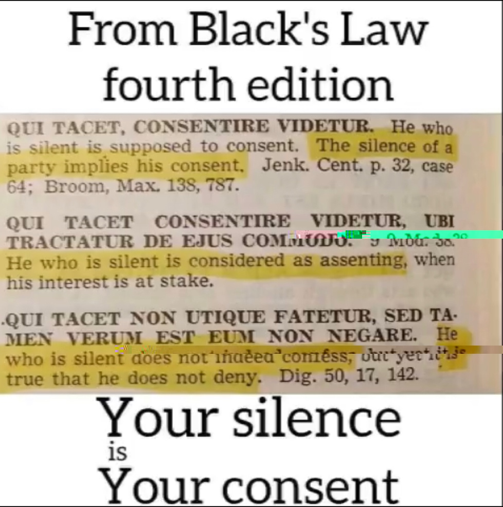

**: G.-O.-O.-D.-[I.-S.-M.].**

**For the grantor of our dominion-[is spiritually meek].**

****

**: G.-O.-O.-D.-B.-O.-I.-Two-~02.**

**For the grantor of our dominion book of interpretation- book number-(2)-two.**

**By this autograph of this author known by this give calling of: Andrew:……….-**

**And of entry one-(1)-in the grantor of our dominion book of deed[s]-book- number one-(1)-now create this book on this tenth day of this month known- as April and in this year of twenty-twenty-three-[10~-~04~-~2023].**

**: We do not consent.**

**: We do not contract.**

**: We do not answer question.**

**With this index of the chapter[s]-in this book.**

**Chapter-(10)-ten: Corporation and Person:…………….Page 05 - 14**

**Chapter-(11)-eleven: Paper-Slavery scam:……………..Page 15 – 20**

**Chapter-(12)-twelve: Birth certificate scam:………….Page 21 – 28**

**Chapter-(13)-thirteen: Four-(4)-corner rule……………Page 29 – 34**

**Chapter-(14)-fourteen: Autograph/signature:……….Page 35 – 44**

**Chapter-(15)-fifteen: Right of travel example:……….Page 45 – 56**

**Chapter-(16)-sixteen: Examples of scenarios:…………Page 57 – 62**

**Chapter-(17)-seventeen: Basic notice writing:……….Page 63 – 72**

**Chapter-(18)-eighteen: Useful information:…………..Page 73 – 80**

**[ As writ on page sixty-seven-(67)-of this book ]**

**For the knowledge of the consequence by the- capitalising of word(s)-in a doc-u-ment is with-**

**claim and under-standing of the fraudulent miss-leading miss-use by this conveyance of grammar.**

**For the knowledge of the-“Chicargo-Manual-Styles-Dictionary-Edition-sixteen-(16)-Article-**

**11~-~147”-under-foreign-language does claim this:**

**“There-is-no-jurisdiction-between-two-(2)-languages appearing on the same document”.**

**For the-“New-Oxford-Styles-Dictionary”-is with- the statement of writing with-out the use of-**

**capitalised word[s]-and not just letter[s]-for we- believe this is not English and by foreign-gloss.**

**[ As writ on page sixty-seven-(67)-of this book ]**

****

## : G.-O.-O.-D.-B.-O.-C-P.-Chapter-(10)-ten.

**: Grantor of our dominion book of corporation and person chapter ten.**

**“The birth-certificate clausula rebus sic stantibus”**

**[ It is illegal to use a legal name ]**

**With this interpretation of the fraud by the three-(3)-birth certificates being the start of the modern- day slavery of all men and women on this earth.**

**For the creation of the birth-certificate is not the- fraud for the fraud is with use of this counterfeit- document being pose as if real.**

**With this being the same for all-“statute”-which is- of the-“legal standing”-for these are being use as if- they are real-“law”.**

**What is the meaning of this word “Corporation” ?**

**With there being many dictionaries with many definitions in this world we must- understand the importance of the disclosure of the dictionary being used for the correct- meaning of the language being used.**

**We can duplicate words in to as many dictionary as we choose but we cannot ever- duplicate any definition for we can have one-(1)-definition in each dictionary for each- word and thus then constitutes as each dictionary being it’s own language for each- dictionary of words will hold different meaning in each dictionary.**

**With the word “corporation” in English being derive from the Latin word of “Corporare”- and the late Latin word of “Corporatio” meaning: Combine in one-(1)-body.**

**Oxford English Definition: Corporation.**

**An entity that has legal personality, i.e. it is capable of enjoying and being subject to legal- rights and duties (see juristic person) and possesses the capacity of succession. A- corporation aggregate (e.g. a company registered under the Companies Acts) consists of a- number of members who fluctuate from time to time. A corporation sole (e.g. the Crown)- consists of one member only and his or her successors. See also incorporation.**

**Cambridge English Definition: Corporation.**

**WORKPLACE; [abbreviation Corp.]**

**A** [**large**](https://dictionary.cambridge.org/dictionary/english/large) [**company**](https://dictionary.cambridge.org/dictionary/english/company)**, or a** [**group**](https://dictionary.cambridge.org/dictionary/english/group) **of companies that are** [**controlled**](https://dictionary.cambridge.org/dictionary/english/controlled) **as- a** [**single**](https://dictionary.cambridge.org/dictionary/english/single) [**organization**](https://dictionary.cambridge.org/dictionary/english/organization)**: Whether you** [**work**](https://dictionary.cambridge.org/dictionary/english/work) **for a** [**large**](https://dictionary.cambridge.org/dictionary/english/large) **corporation- or** [**small**](https://dictionary.cambridge.org/dictionary/english/small) [**company**](https://dictionary.cambridge.org/dictionary/english/company)**,** [**following**](https://dictionary.cambridge.org/dictionary/english/following) **these easy guideline can** [**help**](https://dictionary.cambridge.org/dictionary/english/help) **you to** [**succeed**](https://dictionary.cambridge.org/dictionary/english/succeed)**.**

**Blacks Law Second-(2)-Edition~-Definition: Corporation.**

**An artificial person or legal entity created by or under the authority of the laws of a state or- nation, composed, in some rare instances, of a single person and his successors, being the- incumbents of a particular body, but ordinarily consisting of an association of numerous- individuals, who subsist as a body politic under a special denomination, which is regarded In- law as having a personality and existence distinct from that of its several members, and- which is, by the same authority, vested with the capacity of continuous succession- irrespective of changes in its membership, either in perpetuity or for a limited term of years- and of acting as a unit or single individual in matters relating to the common purpose of the- association, within the scope of the powers and authorities conferred upon such bodies by- law.**

**Blacks Law Eighth-(8)-Edition~-Definition: Corporation.**

**corporation. An entity (usu. a business) having authority under law to act as a single- person distinct from the shareholders who own it and having rights to issue stock and exist- indefinitely; a group or succession of persons established in accordance with legal rules into- a legal or juristic person that has legal personality distinct from the natural persons who- make it up, exists indefinitely apart from them, and has the legal powers that its constitution- gives it. — Also termed…body corporate; corporate body. See COMPANY.**

**company. 1. A corporation — or, less commonly, an association, partnership, or union — that carries on a commercial or industrial enterprise…**

**Bouviers Law Dictionary eighteen-fifty-six-(1856)-definition: Corporation.**

**An aggregate corporation is an ideal body, created by law, composed of individuals united- under a common name, the members of which succeed each other, so that the body- continues the same, notwithstanding the changes of the individuals who compose it, and- which for certain purposes is considered as a natural person. Browne's Civ. Law, 99; Civ.**

**Code of Lo. art. 418; 2 Kent's Com. 215. Mr. Kyd, (Corpor. vol. 1, p. 13,) defines a corporation- as follows: " A corporation, or body politic, or body incorporate, is a collection of many- individuals united in one body, under a special denomination, having perpetual succession- under an artificial form, and vested by the policy of the law, with a capacity of acting in- several respects as an individual, particularly of taking and granting property, contracting- obligations, and of suing and being sued; of enjoying privileges and immunities in common- and of exercising a variety of political rights, more or less extensive, according to the design- of its institution, or the powers conferred upon it, either at the time of its creation, or at any- subsequent period of its existence." In the case of Dartmouth College against Woodward, 4~- Wheat. Rep. 626, Chief Justice Marshall describes a corporation to be "an artificial being- invisible, intangible, and existing only in contemplation of law. Being the mere creature of- law," continues the judge, "it possesses only those properties which the charter of its- creation confers upon it, either expressly or as incidental to its very existence. These are- such as are supposed best calculated to effect the object for which it was created. Among- the most important are immortality, and if the expression may be allowed, individuality- properties by which a perpetual succession of many persons are considered, as the same- and may act as the single individual, They enable a corporation to manage its own affairs- and to hold property without the perplexing intricacies, the hazardous and endless necessity- of perpetual conveyance for the purpose of transmitting it from hand to hand. It is chiefly- for the purpose of clothing bodies of men, in succession, with these qualities and- capacities, that corporations were invented, and are in use." See 2 Bl. Corn. 37.**

**What is the meaning of this word “Person” ?**

**Oxford English Dictionary Definition: Person.**

1. **A human being regarded as an individual.**

**"the porter was the last person to see her prior to her disappearance".**

**Similar:**

**•     (in legal or formal contexts) an unspecified individual.**

**•  "each of the persons using unlawful violence is guilty of riot".**

- **an individual characterised by a preference or liking for a specified thing.**
- **"she's not a cat person".**
- **a character in a play or story.**
- **"his previous roles in the person of a fallible cop".**
- **an individual's body.**
- **"I would have publicity photographs on my person-at all times".**
- **[Date]**
- **(especially in legal contexts) used euphemistically to refer to a man's genitals.**

1. **[Grammar]:**

**A category used in the classification of pronouns, possessive determiners, and verb- forms, according to whether they indicate the speaker (first person)- the addressee (second person), or a third party (third person).**

1. **[CHRISTIAN-THEOLOGY]:**

**each of the three modes of being of God, namely the Father, the Son, or the Holy- Ghost, who together constitute the Trinity.**

## Blacks Law Edition Two-(2)-Definition & Citations: Person.

**A man considered according to the rank he holds in society, with all the rights to which the- place he holds entitles him, and the duties which it imposes. 1 Bouv. Inst. no. 137. A human- being considered as capable of having rights and of being charged with duties; while a- “thing” is the object over which rights may be exercised.**

**Blacks Law Dictionary Edition Six-(1)-Definition & Citations: Person.**

As found in Black's Law Dictionary, Sixth Edition, page 1142 under: “Person”. In general- usage, a human being (i.e. natural person), though by statute term may include labor- organisations, partnerships, associations, corporations, legal representatives, trustees- trustees in bankruptcy, or receivers. See e.g. National labor Relations Act, § 2(1), 29 U.S.C.A. § 152; Uniform Partnership Act, § 2.  
  
Scope and delineation of term is necessary for determining those to whom **[**Fourteenth- Amendment**](http://caselaw.lp.findlaw.com/data/constitution/amendment14/)** of the national Constitution affords protection since this Amendment expressly- applies to "person." 

**The word "person" in legal terminology is perceived as a general word which normally- includes in its scope a variety of entities other than human beings. Church of Scientology v. U.S. Dept. of Justice, 612 F.2d 417, 425 (1979)**

**Bouviers Law Dictionary eighteen-fifty-six-(1856)-definition: Person.**

**PERSON. This word is applied to men, women and children, who are called- natural persons. In law, man and person are not exactly-synonymous terms. Any- human being is a man, whether he be a member of society or not, whatever may- be the rank he holds, or whatever may be his age, sex, &c. A person is a man- considered according to the rank he holds in society, with all the rights to which- the place he holds entitles him, and the duties which it imposes. 1 Bouv. Inst. n. 137.**

**2. It is also used to denote a corporation which is an artificial person. 1 Bl. Com. 123; 4 Bing. 669; C. 33 Eng. C. L R. 488; Wooddes. Lect. 116; Bac. Us. 57; 1 Mod. 164.**

**3. But when the word "Persons" is spoken of in legislative acts, natural persons- will be intended, unless something appear in the context to show that it applies- to artificial persons. 1 Scam. R. 178.**

**4. Natural persons are divided into males, or men; and females or women. Men- are capable of all kinds of engagements and functions, unless by reasons- applying to particular individuals. Women cannot be appointed to any public- office, nor perform any civil functions, except those which the law specially- declares them capable of exercising. Civ. Code of Louis. art. 25.**

**5. They are also sometimes divided into free persons and slaves. Freemen are- those who have preserved their natural liberty, that is to say, who have the right- of doing what is not forbidden by the law. A slave is one who is in the power of a- master to whom he belongs. Slaves are sometimes ranked not with persons but- things. But sometimes they are considered as persons for example, a negro is in- contemplation of law a person, so as to be capable of committing a riot in- conjunction with white men. 1 Bay, 358. Vide Man.**

**6. Persons are also divided into citizens, (q. v.) and aliens, (q. v.) when viewed- with regard to their political rights. When they are considered in relation to their- civil rights, they are living or civilly dead; vide Civil Death; outlaws; and infamous- persons.**

**7. Persons are divided into legitimates and bastards, when examined as to their- rights by birth.**

**8. When viewed in their domestic relations, they are divided into parents and- children; husbands and wives; guardians and wards; and masters and servants- son, as it is understood in law, see 1 Toull. n. 168; 1 Bouv. Inst. n. 1890, note.**

**For the “department of transport” governs all “vessel” on this plane-t.**

**For the “universal postal union” governs all move-ment of “vessel” on this plane-t.**

**John Henry SMITH**

**Birth date writ as born date**

**Register = Transfer title owner-ship**

**Registration date**

**HALIFAX PLC**

**Register = Transfer title owner-ship**

**Date incorporated**

**Corp-oration                                     Per-son**

**With the standing of the “person” and the standing of the “corporation” being equal in- the eye[s]-of the law this is for both of the entity[s]-are considered equal on paper.**

**For the name on the paper cannot speak or act for itself weather this be the “Halifax Plc”- or “John Henry SMITH” and this is because they are a deceased estate existing on paper- without the capacity or energy of that of a man or a woman.**

**By the shortening of the word “corporation” we get this word “Corps” which is derivative- of this word “Corpus-Juris” and this means “Out-law” or “No Law”.**

**For the “world” is one of a “corporate world” and with the “corporate world” being- under the “legal jurisdiction” and the “legal jurisdiction” not being that of the “lawful- jurisdiction” and this ultimately means that there is no law.**

**For we are a lawless state throughout this world as there is only the “legal” re-cog-nised.**

**With this knowledge of-“Habeas Corpus”-here-in.**

Before the-“Judges of the Royal Courts of Justice”-on this tenth day of April and in this year- of twenty-twenty-three-(10~-~04~-~2023].

With this application under-“CPR – Civil Procedure Rule”-of-“CPR Part 52 r52-(1)-(ii)”-being- with this-“Writ of Habeas Corpus ad Subjiciendum”.

Further the law states that-“no living man or woman can be imprisoned or restrained- except by judgement of the Kings Court or whilst awaiting trial by them”. 

This freedom is safeguard by the-“writ of habeas corpus”-and whenever any man in- England is detained against his will and not by sentence of the-“Kings Court”-but by anyone- else then he or anyone on his behalf is entitled to apply to any of the “Judges of the High- Court”-to determine weather is detention is lawful or indeed unlawful. 

**See; Darnels case, 3 St. Tr. I. and R v Somerset, 20 St. Tr. I.**

Put plainly the-“Police”-hold no right to deprive any living man or woman of his or her- liberty and or private property except by due coarse of-“The Common Law of the land”-and- any other decision weather or not the-“Police or G4S”-are aware of it, will be simply invalid.

Moreover the-“Police”-definitely not exempt from the-“Petition of Rights 1627”-and the-“Bill of Rights 1688”-and the-“Habeas Corpus Act of **1640, 1679** and **1816**”-which provide- the constitutional safeguards that protect the individual rights of the living men and women- in England and Wales from any abuse by the-“Public Servants”-such as the-“Police”.

Further, CPR Part 52 r52-(1)-(ii)-provides that no permission is required of a-“Court”-to- appeal any refusal to grant this-“Writ of Habeas Corpus ad **Subjiciendum**”. 

**“Habeas corpus ad subjiciendum means “that you have the body- to submit to” in Latin. It is also known as the “Great Writ” and is a- writ that is directed to someone detaining another person to- inquire as to the legality of the detention”.**

**For the three-(3)-categories of the three-(3)-different year-“Habeas Corus”-is writ here:**

1. **1640  - Party of…**
2. **1679  - Evidence of…**
3. **1816  - Force to give evidence of…**

**We must apply for the correct Habeas Corpus applicable to us on the court form-[Part 4].**

**With the family member having no alternative to do this as-“Prisoner”-is-”incommunicado”.**

**For the definition of the word-“Incommunicado”-is writ here as an example:**

**The-“Prisoner”-is incapable of communication due to no access to mail or computer etc etc due to being detained and so any family member now holds this right to communicate for them.**

**The Use of Incommunicado Detention**

**International Law and Standards**

The most significant, and most criticized, feature of Spain’s antiterrorism provisions is the use of incommunicado detention. Incommunicado detention is generally understood as a situation of detention in which an individual is denied access to family members, an attorney, or an independent physician. In some cases, as in Spain, incommunicado detainees do not even have the right to notify anyone about their arrest. While there is no prohibition under international law of incommunicado detention per se, there is significant consensus among United Nations human rights bodies that it can give rise to serious human rights violations and should thus be prohibited. The U.N. Human Rights Committee, charged with monitoring the implementation of the International Covenant on Civil and Political Rights, issued an authoritative statement on the interpretation of the ICCPR’s Article 7 on the prohibition of torture. In General Comment No. 20, adopted in 1992, the Committee recommends that provisions be taken against incommunicado detention.[57](https://www.hrw.org/reports/2005/spain0105/6.htm)The U.N. Commission on Human Rights has repeatedly reaffirmed this position, most recently in a 2003 resolution, holding the view that “prolonged incommunicado detention may facilitate the perpetration of torture and can in itself constitute a form of cruel, inhuman or degrading treatment or even torture.”[58](https://www.hrw.org/reports/2005/spain0105/6.htm)  

Despite these general affirmations, many countries continue to practice incommunicado detention, both pursuant to national legal provisions as well as illegally. Its use is usually justified as a necessary measure in the fight against terrorism. The United Kingdom, for example, allows for forty-eight hours incommunicado detention under the Terrorism Act 2000; in June 2003, Australia adopted a Terrorism Act empowering the Australian Security Intelligence Organization to detain and hold suspects incommunicado for up to seven days, a period that can be extended by order of the Attorney General for successive periods of seven days. Countries as varied as Egypt, Serbia and Bolivia all allow incommunicado detention for different periods of time. Countless more countries are cited by human rights organisations for systematically and illegally holding terrorism suspects in incommunicado detention.

****

## : G.-O.-O.-D.-B.-O.-P-S.-Chapter-(11)-eleven.

**With this grantor of our dominion book of paper-slavery chapter eleven.**

**With this interpretation of the birth-slavery-scam.**

**Born Certificate**

**Baby  SMITH**

**Day born:…………**

[1st witness – Mother]

**Informant: Mother**

**Landlord**

**Real Property**

**Corporate   Commercial**

**Jurisdictions**

**Treasury Direct Account**

**Beneficial mineral-[en-title-ment]-rite**

**Certificate of an entry                                          Certificate of birth**

**of a birth.                                                    [ Of = Without in trust law ]**

**John Henry**

**Born date:…….**

**Mother:…….**

**Father:…….**

**Birth date:…….**

**John Henry SMITH**

**Our born day changes to the word Birth here…**

**[**2nd Witness – Father] .

**Informant: Father**

**Registration date:…….**

**Banker———**

**Personal Property**

**Common & Cannon &**

**Maritime Jurisdictions**

**———High Priest**

**Ecclesiastical  =  Soul**

**Talmudic – Old Deed**

**Testament jurisdiction**

**Office of the                                           Office of the**

**“Debt-or”                                              “Credit-or”**

**For the knowledge of the birth-certificate-scam is with the claim of the correct style-dictionary with the correct definition and rule for the importance of not committing any- perjury here-in.**

**With the three-(3)-characters of the three-(3)-birth-certificate being of use and in play by- the judiciary and the bar.**

**With their being six-(6)-jurisdiction available under the gallery of the bar for the judiciary- and anyone acting in this role as a presumed authority sitting on our beneficial mineral- “entitlement”-rite[s]-as creditor for we people do not know who we are most of the time- by our miss-leading “Rothschild owned education” by the state without our knowledge.**

**By this we mean most people assume the character of the “debt-or” not the “credit-or”.**

**For we can only assume one-(1)-role and be in one-(1)-office at any one-(1)-given time- and so when we answer this common question for example of:**

**“State your name to the court ?“**

**We usually by our miss-led education and miss-guidance and direction by our mother and- father by a similar education do state the detail of that of a “debt-or” and not that of a- “credit-or” and this allows the authority to step down into the office we are not in for the- facilitation of business and this makes them now the beneficiary of our estate does it not.**

**With us being give a key at the age of eighteen-(18)-and another one-(1)-at the age of- twenty-one-(21)-being a symbol for the importance of which office we will assume.**

**Authority in trust of our treasury direct account**

**“Debt-or”                                           “Credit-or”**

**For the past two-(2)-year the government have spent millions and millions and this can- only be if they are acting as creditor and so when will we people learn our correct details- in order for us to be the true creditors we are and make our governments the true- debtors that they are…?**

**With the knowledge of the combining of the two-(2)-fact[s]-is with this claim of this state-ment.**

**For the colour-red is the fact.                         For the pen is the fact.**

**By the adding of the word[s]-is for the modification of the fact with that what it is not.**

**For now we will have “red-pen” and no longer a “pen” and so this is the “Color of law”.**

**For the give here-say calling is the fact.       For the hereditary family calling is the fact.**

**With the give christian here-say calling being not that of an hereditary calling and this- being the confusion of the people for we cannot “assume” we can use what we have not- being give… And hereditary is not being given unto us.**

**Also by adding the two-(2)-fact[s]-together we have now modify both of the fact[s]-into- that what they are not and thus created a “fictional name” and not that of a calling.**

**For the nature will call and as they say “nature calls”.**

**With our mother and father giving us a Christian calling… this is never give writ down… this is always give by being orally omit and this is the “government policy” to write this- down as per our page seventeen-(17)-of this book of our interpretation[s].**

**With us first paying our fee and then being asked only two-(2)-question[s]-by the- “registrar” at the “births, deaths &- marriages register” and these being:**

1. **State your name ?**

**And**

1. **What’s ya date of birth ?**

**Just like in the film “Pirates of the Caribbean” when “Captain Jack Sparrow” lands at the- dock and he cannot get past the harbour-master without first giving a name and paying a- fee on the day being docked or birthed with this port-authority.**

**With this correction notice on this page twenty-eight-(28)-of this eighty page book for the correction of our calling and our status with use of our certificate of diplomatic identity.**

****

## : G.-O.-O.-D.-B.-O.-S.-J.-Chapter-(12)-twelve.

**: Grantor of our dominion book of standing jurisdiction chapter twelve.**

**Ewe - 🐑 –                       Will be                         Heard**

**Into a**

**Pen - 🖊 –             Where we will pass          Sentence**

**With the question of where do you live ?**

**We first must know this: Living = Livery = Livery = Farming = Farming = Cattle = Cattle = Ewe.**

**For the people of this earth do not live… for we- are not a farm animal…**

**For we simply exist in this flesh and blood vessel- and with dominion over our land.**

**: With this script for this standing of this man.**

By this **Sight** of our **Existence** we now **Present** ourself as this- **Man** with this **Given** **Here-Say** **Calling** of full colon **John-**

full stop and with this **Special Appearance** as this **Private- Natural Person** we now **State** we are the **True Beneficiary** of- the **Estate** known as “**John SMITH**” we believe is being- administered this day unless there is any **Evidence** to- support the **Fact** of us not being **Stood** here as this- **Beneficiary** here this day and we now **Appoint** the- **Prosecution** as this **Crown Agent** and **Trustee** of our **Estate-** we believe is being **administered** here this day.

With this we now com**man**d that the **Bond** be brought- forward for the **Discovery** of the one who will **indemnify** us-

for **Damages**.

We now com**man**d all **charges** be here **discharge** and give- this instruction for the **balancing** of the **books** and of the- **accounts** with immediate effect by this **Judge** here acting on- this day.

**Case law: Cruden v. Neale, 2 N.C338 (1796).70.**

"Every man is independent of all law's except those prescribed by nature and is not bound by any- instructions formed by men without his consent".

This government/police only governs by consent.

**On this twenty-second day of this month known as January and in this year- of twenty-twenty-three-[22~-~01~-~2023].**

**: With this knowledge of the game and our standing.**

With our standing being not by our sight: For our standing is define purely by the **Words** we**-**

choose to use in order for us to identify and be-“**Heard**”-but not as the character of-“Ewe”.

For the **Court** being the **Paper-Work** and the **Doc-U-Ment** and the **Building** being the- **Venue** then we the people must hire the venue as we the people and convene our own **tri**-**al**.

With their being two-(2)-jurisdictions of use and these being the **Legal Jurisdiction**-[control]- governed by **Statutes** and **Acts** and **Rules** and **Legislation** and then the **Lawful** **jurisdiction**-[control].convened by the people of this earth and with the use of common laws of the land.

With these being express here by our two-(2)-definition[s]::

1. **Legal Jurisdiction** – for any **Employees**-[slaves]-of corporations including that of the-“**Crown**”-and by assuming any-“**Birth Certificate**”-name **Copyright** to the-“**Crown**”-means to **Act** as one employed by the-“**Crown**”-and thus an **Employee.**

For the corporation exist only by the name in which is written upon the company- paper-work when registered with the-“**Crown Corporation**”-by the company house-

With the date in which it was in-corporated…. HALIFAX BANK… E-ON… O2… etc etc.

With all-“**Birth Certificate**”-having the standing of a **Person** in the legal system and- thus being exactly the same principle as a-“**Corporation**”-for they both hold a name- with an incorporation date and neither can speak and act for themselves for they- are dead entities in law and artificial entities in the “**Legal**”

And with this all **Statutes** and **Acts** are what **Govern** the entire “**Legal”** jurisdiction- and this clearly is for the persons who now are employees by voluntary servitude- and choice of their own free will by ignorance.

With the legal system facilitating all criminal activity under further **Acts** and **Statutes**- such like the “**Criminal Justice Act**” where we again hold no capacity of standing as- man and woman and that of people.

1. **Lawful Jurisdiction** – With this being for people standing as men and women in- order to answer under a jury of their peers… twenty-three-(23)-people whom know- this man and women and their common self now being judged by their peers… 

With the crimes being any: **harm, injury, loss** or **fraud / deceit** of any other people.

By our knowledge we can truly only ever judge ourselves and this comes from with-in and- with great wisdom by our lessons with the time we all each hold on this plane of earth. For- we are all students and we are all teachers.

For the knowledge of the word **Person** being also known as a **Persona** or a **Character** or an- **Artificial Person** or a **Legal Fiction** or a **Corporation** or a **Corpse** for short is with the claim- of the over-standing of this grammar being use by the one whom no longer wish to be of- the lawful standing of man and of woman and be them-selves for they now by choice of- words now hold that of a **Legal Standing** and as a **Person** and as we know a **Person** is of- **Equal-Standing** to that of a **Corporation** for they both hold no energy of their own.

And with this the most valuable asset on this planet is the **Energies** and **Sweat Equity** of-

the **People** for there is no **Corporation** with the capacity to **Act** and there is no **Money** in-

this world which can move by its own **Energy** for we the **People** are the **Energies** behind-

the entire **Global Corporate illusion** for the world of **Commerce** and we the **People** will one-(1)-day inner-stand our true **Value** and **Worth** and **Standing** on this **Earth**.

**“Crown Prosecution Act - 2018”**

**I**

**I**

**I———————I———————I**

**I                                                         I**

**I                                                         I**

**Civil Jurisdiction                           Criminal Jurisdiction**

I                                                         I

I                                                         I

I                                                         I

**Legal Standing                                Lawful Standing**

I                                                         I

I                                                         I

I                                                         I

**Person/Corporation                           Man/Woman**

I                                                         I

I                                                         I

I                                                         I

**Statutes/Acts                                 Common Law**

I                                                         I

I                                                         I

I                                                         I

**Benefits** and **Privileges                       For Given Rights**

For the knowledge of the power of the inner-standing of the three-(3)-principles written-

below here is by the experience of the journey with this being ones own unique wisdom of- their individual choice of energy use.

1. **Charge –** This is an allegation or presumption or accusation and consists of four-(4)- 

elements:

1. **Account** – An encumbrance of an asset.
2. **Obligation –** We as man are under no obligation of corporate rule[s].
3. **Right of claim –** Fictitious entities cannot bring any claim by themselves.
4. **Jurisdiction –** Civil or Criminal – People or persons.
5. **Crime –**
6. **Mens Rea –** This being the initial **Thought** of the crime.
7. **Actus Reus –** This being the **Acting** upon the **Thought** of the crime.
8. **Corpus Delicti –** This being the **dead body** – The **evidence** in fact.
9. **Valid Cause –** Valid cause of action 
10. **Violation** of **Legal Right –** We hold right of fair trial and many rights.
11. **Corpus Delicti –** Where is the evidence of the crime and a victim ?
12. **Re-dress ability of the Court –** Re-dress uses the **Law** to seek **Justice** not **Legal.**

With this definition of the word **Discovery**: Being the name of **procedures** which enable a- **Party** to **Civil Litigation** to **Discover** information about the other sides **Case** before the **Trial**.  

**Discovery of Documents** is a pre-trial **procedure** that enables a **Party** to require an- opposing **Party** to **Disclose** the **Existence** of **Documents** relevant to the **Litigation** and to- **Procedure Documents** for inspection**.**

The **United Kingdom** did not **Act** to impose general  **Tortious Liabilities** on the **Crown** until- nineteen-forty-seven-(1947)-when the “**Crown Proceedings Act** of **1947”** abolished the- **Crowns** immunity from **Discovery** by providing that in **Civil Proceedings** in which the **Crown-** was a **Party**, the **Crown** could be required to make **Discovery** of all **relevant documentation.**

**Information to be provided upon any arrest:**

The most common requirement to most often arise in **Civil Action** is the **Necessity** of the- **Police** to **Inform** a **Person** upon **Arrest** of the facts and of the **grounds** used for the **Arrest-**

either at the **Time** of the **Arrest** or as soon as **Practicable** afterwards and if the **Police Fail** to- do either of these two-(2)-duty then the **Arrest** will be **Deemed Unlawful** under the-[**PACE**]- “**Police and Criminal Evidence Act – Section 28-(1)”.**

The provisions **Enact** the **Common Law** requirements as set out in **“Christie V Leachinsky-**

**(1947) AC : 573”.**

Even if an “**Arrest”** or a “**Stop and Search”** can be **justified** by the **“police”** a claim of “**False-**

**Imprisonment”** may succeed in the “**Legal Fiction**” world if it can be shown that the **“Legal”-**

requirements at the **Time** of the **Arrest** had not been fully **Complied** with.

For the **Principal** of the **Vicarious Liability** does not apply at **Common Law** to the members- of the “**Police** **Force**” as they are not **Employees;** But the **Principal** is extended to include-

The “**Police Service**” by this “**Statute”** of “**Police Act 1996** – **Section 88-(1)**” as amended by-

the “**Police Reform Act 2002**” which replaced the reference to “**Torts**” with unlawful- conduct.

**E.-G. –** Because it is contrary to the “**Human Rights Act 1998**”.

**Oxygen                                                                               Mens Reas**

**Fuel                                                       Ignition              Actus Reus                              Corpus Delicti**

With this fact of the taking away of either the **fuel**, the **ignition** or the **oxygen** will result in- there being no possibility of the **Fire** ever being create and this principle is the same if there-

is no evidence of the **thought** of a crime or the **act** of a crime or the **evidence** itself then- there must be no crime being or have been commit.

**[ For we can only ever sight a fact and  we only ever see a fiction ]**

****

**With this notice for this correction by this matter of fact with this true-certify-and witness copy of our correct likeness and calling.**

**Before this man with this calling of Mark of this family of Jones and acting for this-“Crown- Copyright Own Birth Certificate name”-known as-“Mark JONES”-and as this-“Data-Handler”-for this-“Corporation”-known as-“Barnsley Metropolitan Borough Council”.**

**On this tenth day of this month known as March and in this year of twenty-twenty-three- we now correct our-“name”-with this calling of: Andrew.-Formerly known as-“Andrew-Smith”-and by this matter of fact we now command this here correction.**

**For this duty of the-“personal sensitive information”-of this man known as: Andrew.-Is- with this man known as: Andrew.-For this correction by this instruction of this-“Corporation”-known as-“Barnsley Metropolitan Borough Council”-with immediate effect.**

**For the sight of our true-certify-and witness copy of our correct likeness bond with this- notice is for this proof of this identity of this man known as: Andrew.-without the use of-any-“Crown Copyright Own Surname”-and without the use of any such-“title”-by this- claim.**

**For the-“Data Protection Act of 1998”-and the-“Data Protection Act of 2018”-and the-“General Data Protection Rule of 2015”-is for the upholding by the-“Corporation”-of the-“United Kingdom”-under this legislative rule of the-“United Kingdom”-with the inclusion- of all the-“Statutory Acts of Rule”-of the-“Legal System”-and writ by the-“Parliament”-of- this-“country”-and-“Corporation”-known as the-“United Kingdom”.**

**With this we now command our status be corrected within this lawful time-frame of- thirty-three-(33)-days and is the duty of this-“Corporation”-known as-“Barnsley- Metropolitan Borough Council”-of the notification of the performance of this duty with- this consideration in writing and by first class recorded post for this man known as-**

**: Andrew.-.And of this geographical post location of: 33~-Any street or road, Any town or- City-[A.-~33~-~3~-A.-A.].**

**By this reasonable accommodation of this author and man known as: Andrew:…………-With this autograph for this energy of our own free-will and volition and with this sound- mind.**

****

## : G.-O.-O.-D.-B.-O.-F.-C.-R.-Chapter-(13)-thirteen.

**: Grantor of our dominion book of four corner rule chapter thirteen.**

**For the knowledge of the four-(4)-corner rule is with this claim here of the following dis-closure[s]:**

**For one-(1)-must first understand the importance of this term of the four-(4)-corner rule- for this game-play of commerce in all of it[s]-form[s]-and this is in play globally.**

**With this first principle:** being that what ever is in a box cannot get out of a box.

**With this second principle:** being the constitution of a box is not just what we imagine of-

a card-board box but that of a piece of paper and the use of-

bracket[s]-both square and curve for example.

**With this third principle:** being for all of the box and bracket being in use on a document-

render the content of the box and bracket as invisible and non-

existent and there-fore not part of the document by this use.

**With this example:** When we look at a picture by an artist and in this example we will use-

**“Picasso”-**we can only have an interpretation of the meaning of the-

picture and we could ask a thousand people to look at the same-

picture and they may all have their own interpretation[s]-and it is only-

when we ask the artist of their mind-set at the time of creating the-

picture we will have the true meaning and not an interpretation. 

**For the one with the interpretation is the one without all of the fact[s].**

**For the knowledge of the constitution of a box is with the claim of this document and-**

**These example writ here :**

**Television = Channel = Programme**

**Book / Magazine / News-paper**

**Any form of paper**

**Bracket**

**Pen**

**The use of brackets and the four-(4)-corner rule.**

**The use of brackets on certain information on a form combines a grammar device with- legal theory to** legally isolate **whatever is in the brackets from-[** thus render it legally- implacable and insubstantial to **]-the body of text within the surrounding content.**

**The “Legal” theory of this is derivative of the four-(4)-corner rule in “Law”.**

**Under the “four-(4)-corner rule”; Intention of parties, especially that of grantor is to be- gathered from the instrument as a whole and not from “isolated parts thereof”.**

**[“Davies- V Andrews, Tex.Civ.App, 361 S.W.2d 419, 423 – Blacks Law - 5th Ed. Page 591”]**

**And this combine with the definition and description of [ Square brackets ] found in the-**

**“Plymouth University Foundation Degree Guidelines” on essay writing.**

1. **For the use of “square brackets” like [ ] and “round brackets” like ( ) hold a- technical name of “Parentheses”.**
2. **With this we believe “square brackets” are used for word structures.-[Word].**
3. **With this we believe “round brackets” are used for numerical structures-(111).**

**For any statement in bracket should be “grammatically independent of the sentence in- which it occurs”. That is the sentence should be complete even if the content of the- brackets were to be removed.**

**With the meaning of the term “Contract” being derive from and only from within the- “four corners” of the document-[Which is a box in itself]-but not from an isolated section- of it.**

**With this reminder of the fact that words and phrases in law are used with precision and- not just used in general.**

**The “legal” phrase “not from isolated parts thereof” is a processional statement and in- other words there will be no meaning at all is to be derived from isolated contents within- the “box” of the document.**

**For the use of “brackets” inside the “four corner” of a “box” will create an implied “inner-box”- which will be now completely separate of the “outer-box” grammatically and thus will “legally”-isolate the content of the “inner-box” by rendering what is in the “inner-box” as a mere reference-**

**or comment but “non-substantial” to the outplaying text of the “contract” in the “outer-box”.**

**And so when we bracket for example the “post-code” or for example “United-Kingdom” or- anything else on a document “legal” or not we are declaring that it is “legally-isolated” and- “isolated” in itself and therefore will be grammatically referenced but not “legally-intrinsic” to- the contractual meaning of the content of the surrounding document.**

**According to the “four corner rule” no contractual meaning can be apply to or be derive from any-**

**“isolated-parts” of the document.**

**In this way one-(1)-is off-setting a presumption of a particular “jurisdiction” by virtue of the non-inclusion of the “post-code” on the face of the document.**

**For the brackets are “legally” saying:**

**“These inner contents are legally isolated from and not to be construed as part of the legal- meaning of the surrounding contents and so we are not a “citizen” of the “United-Kingdom”-**

**As will be presumed if we didn’t bracket the “post-code” and the word “United-Kingdom”.**

****

## : G.-O.-O.-D.-B.-O.-A.-A.-S.-Chapter-(14)-fourteen.

**: Grantor of our dominion book of autograph & signature chapter fourteen.**

**For the knowledge of the meaning word “autograph” and the word “signature”is with the- claim of this disclosure here in:**

**With the thumb-print of the people being unique for everyone and no two-(2)-prints ever- the same by the pattern and the line of the skin of the thumb itself:**

**Auto-graph = “Auto”: meaning:  autonomous and “graph” = poll / seal / thumb-print.**

**Signature = “Sign”: Meaning: poll / seal / thumb-print and “Nature” meaning with energy.**

**Cursive-manner signature = curse the document and this null and void it.**

**How to Sign Your Name:**

The legal/corporate system will try and lower your status and make you give up your rights.

This can be done to you very simply and without your knowledge just by signing your name- incorrectly; even the colour of the ink you use has a legal ramification and meaning behind it.

Everything that is applied to you today is actually applied to your mark, so you must be sure- where you leave your mark and how.

This has been going on for centuries and is nothing new, it’s time you learnt how it’s done to- you.

**Blood Seals**

Before reading and writing become accessible to everyone, most people left their mark by- using a thumbprint in their own blood, often referred to as a blood oath.

This tradition changed over time to using red ink instead of blood, but carries the same- weight within a contract.

As writing became more common, and with more documents being written, having to cut- yourself and draw blood every time to sign a new document became a little excessive, so red- wax seals were used.

The red in the wax was to symbolise the blood, and is still used to this day.

If you did not have a seal, then another way to strengthen your signature would be to sign- first and then apply your thumb print, in red ink, over your wet ink signature.

**Protecting Your Mark**

Before we can go into how to protect your rights when you sign a document, we need to- distinguish between an autograph and a signature.

**Signature:**

A signature is a handwritten mark made as a proof of identity; however we must ask what- identity, and what colour ink is used.

In almost all cases, a signature is a proof of your legal identity only.

**Autograph:**

An Autograph is a hand-written mark made as a proof of identity, but only refers to your- true living breathing man or woman status.

When signing your name the colour of ink plays a vital role in the identity, status and power- of the signature.

  

 **Black Ink:**

When signing in black ink, you are signing in your legal identity only. 

The colour **black- denotes death** and your legal identity is a legal fiction, or dead entity.

It does not represent you as a living breathing man or woman.

**Blue Ink:**

There is some speculation that the origins of the colour blue refers to the Royal blue, and- anyone using it is therefore a subject to the monarchy.

Blue ink also represents “**Water Admiralty Equity Law**” meaning you are under the- jurisdiction and the court of “Admiralty and Equity of the Sea”. This is often just referred to- as maritime law, or Law of the Sea. .

However today this is also a signature that refers to your legal identity only, but is often- promoted to having added security of being difficult to photocopy, and making it easier to- tell if you are in possession of an original document or a copy.

**A copy of any document has no legal standing in court, only the original- charged document, with a signature or autograph does.**

**Red Ink:**

The colour red makes reference to blood, as original marks were not signed but often made- in blood, and sworn as a blood oath.

The colour red refers to the living only, and if used then an agreement or contract has been- made with a living breathing man or woman.

Signing in red is used within Common Law, and is used to signify the principal creditor.

**Purple Ink:**

Purple is a unique composite of red and blue. Purple ink is used to symbolise the harmonic- unity of opposites joined, which would be the blue ink of your legal identity and the red ink- of your true living breathing natural identity. Historically it’s the colour of power and of- knowledge, often sacred, linked to inspiration and mystery, peaceful movements and- cooperation.

Purple is often associated with poetry, reconciling worlds of reason, thought and imagination.

It shares mysterious energy of sound and form, and wields the secret power to unite people- of Earth regardless of their nationality, religion, age, sex or profession.

Usually purple ink was only reserved for royalty and Sovereign people.

**Gold Ink:**

The use of gold is to establish the highest possible status and to immortalise that status for- all eternity.

Often only for the most powerful of royalty, and impregnated with real gold, an autograph- from a member of royalty was immortalised forever and could not be undone.

This autograph was often accompanied by a royal seal in red.

Today it’s customary to sign your wedding vows in gold ink to symbolise immortality.

Manipulation Over time, usually within school when you were very young, you have been- conditioned to use certain colours and stay away from others.

You were never taught about this system, and the importance of your signature, how it’s- used and why it’s so important to those who control the system.

Here are some of the ways you’ve been manipulated over time.

**Red Ink:**

Red ink has power as it refers to life but children have been conditioned into thinking it- means something wrong, and so they now fear it.

From an early age you have been taught that if you do something wrong, then Teachers will- mark bad grades in red ink.

So before you reach the age of consent, and become Sovereign, you have been conditioned- to think that red ink is bad.

**Black Ink:**

You are probably aware that when asked to sign a government document it will often state- to sign in back ink.

If you sign in black then you have signed for your legal identity only and not you.

However to sign in black ink is an offer and not a demand, and you have every right to sign- any document in any colour you wish.

The official narrative is “black ink is generally considered more professional” and "louder"- colours like purple or red are “not professional.” But the truth is they want you in black ink- and stay away from purple and red.

 

**How To Strengthen Your Signature**

When signing a document you may of course add anything you wish to your signature or- autograph, after all it is your mark to make.

Some additions may not be understood by the 3rd party, and a remark or note maybe- needed to clarify its meaning, however most additions to signatures are recognised within- many courts all around the world.

Here’s a list of a few additions you can make to your signature.

By reasonable accommodation.

Sometimes referred to as an accommodation endorsement, this is a legal obligation entered- into as a gratuitous favour without consideration.

This is the signer’s addition to a contract; without consideration means without cost.

It is usual to write “By reasonable accommodation” 

before adding “All Rights Reserved.”

**All Rights Reserved:**

Regardless of the contract or document being signed, signing your name “all rights reserved”- insures the protection to maintain all your inherent human rights.

You must write all rights reserved **before** you sign the document as the document is not- charged until you sign it. You cannot alter a charged document once signed, this would be- fraud.

It is also a prudent idea to sign your name across “All Rights Reserved”, so it cannot be- deleted at a later date from the document.

**All Rights Reserved, None Waved Ever:**

This statement is to make absolutely clear that not only are all your rights protected, but you- unequivocally do not waver any of them.

**Non-Negotiable Autograph:**

When you are dealing with a corporate personhood or legal fiction, they may attempt to get- you to sign using your legal fiction identity when you sign a contract.

Are you affixing a “signature” or an “autograph” to the document?

A living breathing man or woman affixes “autographs” to contracts, while corporate officers- affix “signatures” on behalf of the corporation.

Adding Non-Negotiable Autograph to your mark clearly indicates it is an Autograph and not a- signature.

 

**Secured Party Creditor:**

This means someone who has voided and cancelled the contracts creating the corporate- fiction- called government citizen or resident, and has taken control of their Legal Name- Trust, and replaced- it with private citizen status.

They can operate freely to discharge debts or court actions at will.

**No Assured Value, No Liability:**

Assured means the opposite of insured. Insurance means providing protection against a- possible eventuality, whereas assurance is a positive declaration to give confidence, or a- promise.

Signing your name “No Assured Value” is stating there is no promise to give consideration- meaning there is no promise to pay.

Adding “No Liability” is a disclaimer to indicate that the signer can in no way be held liable if- there are any costs as a result of the signing the document.

Signing a document in this way is not an acceptance of any costs mentioned within or- caused by the document. The value can be financial or tangible.

**Errors and Omissions Excepted:**

Often reduced to just “E&OE”, Errors and Omissions Excepted comes from Commercial- Contract Law and gives notice that the details in the document may not be accurate or- submitted in full.

This may not be a fraudulent act as it just highlights that all the details contained within a- document may not be fully known at the time of signing.

**Without Prejudice:**

This term or phrase enables all parties to negotiate settlement of a claim without implying- any admission of liability.

Any documents headed or signed “without prejudice” cannot be presented as evidence in- any court action without the consent of both parties.

**Without Recourse – Non Assumpsit:**

Signing “Without Recourse” removes any possible recourse against you, meaning another- party connected with the document being signed cannot sue, or at least cannot obtain- adequate relief even if a lawsuit moves forward.

Adding “Non-Assumpsit” adds the fact that no promise has been made.

**Sovereign:**

Free from any De Facto corporate government jurisdiction, and having supreme authority.

**Consent:**

When signing any contract, agreement or document, it must be done under informed- consent; however under current day practices from local, regional, and state government- you will often be coerced and bullied into signing something you do not wish to.

**Here are ways to sign a document when your right to consent has been violated:**

**Under Protest:**

Adding Under protest to your signature denotes that you expressly object, disagree or- disapprove of the document being signed.

It is now on the record that you have voiced your objections and had to unwillingly sign the- document.

**Non Assumpsit:**

This is Latin for “do not assume” and originated in the mid-17th century, and means did not- undertake, or by which a man denies that he has made any promise.

Often abbreviated to just N.A. signing this before your signature means you did not- undertake or promise regarding any details of a document being signed.

**Vi Coactus:**

Vi Coactus is a Latin term meaning “having been forced” or “having been compelled”.

Placing the term Vi Coactus or just V.C. before your signature indicates that the signer was- under duress, rendering the document null and void.

**Watermarked Paper:**

When signing your mark on any document it is advisable to not only read the entire text- written and to confirm the nature of any seal present, but to also hold the paper itself up to- the light and look for a watermark.

Although a watermark can be as innocent as identifying the manufacturer or grade of the- paper, and can help detect and prevent counterfeiting and forgery, watermarks can also- carry other legal ramifications if not challenged.

Watermarks have been used on postage stamps and currency, and are used to show- authority and ownership over a document, similar to a wax seal.

Watermarks can also be used to denote that the law of the sea is being presented within a- document, and not law of the land.

Overall a watermark can be beneficial, if the symbolism of the mark is known and on the- record. It would be prudent to write official documents, such as affidavits and notices with- watermarked paper using a mark of distinction, trust and honour, such as the Sovereign- Fraternity.

  

**Strongest Signature:**

The most powerful signature would actually be an autograph, written in purple ink, with- your own finger print in red ink placed across the freshly signed autograph.

The autograph should be accompanied with “all rights reserved” written below the- autograph, with some of the signature crossing into the text.

****

## : G.-O.-O.-D.-B.-O.-R.-O.-T.-E.-Chapter-(15)-fifteen.

**: Grantor of our dominion book of right of travel example chapter fifteen.**

**For the knowledge of the word[s]-of the-“United-Kingdom-Pass-port”-is- with claim of this non-defined sentence-structure writ here with the use of- the-“Times New Roman”-font-style of grammar for the conveyance in- speech-mark of this page forty-seven-(47)-of eighty-(80)-page book number- two-(2)-only by this extract bond here of this-“United-Kingdom-Pass-port”.**

**With this extract of this page of this-“United-Kingdom-Passport”.**

**“When travelling overseas, The Queen does not require a British passport”.**

**“As a British passport is issued in the name of Her Majesty, it is unnecessary for- The Queen to possess one. All other members of the Royal Family, including The- Duke of Edinburgh and The Prince of Wales, have passports”.**

**“The first page of British passports contains a representation of the Royal Arms- together with the following wording:””**

**“Her Britannic Majesty's Secretary of State requests and requires in the name of- Her Majesty all those whom it may concern to allow the bearer to pass freely- without let or hindrance and to afford the bearer such assistance and protection as- may be necessary.”**

**“In realms (Commonwealth countries where The Queen is Sovereign), a similar- formula is used, except that the request to all whom it may concern is made in the- name of the realm's Governor-General, as The Queen's representative in that- realm. In Canada, the request is made in the name of Her Majesty by the Minister- of Foreign Affairs.”**

**With this knowledge of the-“Court”-and this may be writ as-“Caught”-being by fact a-“Foreign-Vessel”-in-“Dry-Dock”-and this will be shown by the-“flag”-on the top of the- building being with the use of the-“venue”-and this-“flag”-will-“govern”-the-“language”-in use is with this statement and claim.**

**With this statement is this claim of the-“United-Kingdom-Court[s]”-being in-“dry-dock”-by the-“Port-Authority[s]”-order by first giving a-“name”-and then-“paying a fee”-and- with this we believe all-“judge”-are being-“Paid”-by the-“Port-Authority[s]”.**

**With this knowledge of the of the-“court”-being in actual fact a-“port”-of this-“court”-and the-“United-Kingdom-Passport”-page writ here in this page forty-seven-(47)-of this- book clearly showing our freedom of navigational travel of any and all-“Port”-by holding-such doc-u-mention in their possession.**

**With this being said: we have only one-(1)-question….**

**Why do people not take there-“Passport”-with them in order to-“discharge”-all-“charge”-of-“trespass”-and grant passage of this-“Port”.**

**With this page fifty-seven-(57)-of this book in this chapter sixteen-(16)-will- give example of scenarios by foot and by a private conveyance.**

**With this page seventy-nine-(79)-of this book holding the guidance sheet of- an example for how we may wish to use our identity-card we are holding.**

**With this paragraph for the use of this notice without promissory note.**

**With our example notice for this right to travel starting on page forty-nine-(49)-of this- book can be writ with use of only six-(6)-page and not seven-(7)-page by removing the promissory note on the back page and exchanging the paragraph writ below for the very last paragraph writ on page fifty-two of this book of interpretation book number two-(2).**

**: By this we now command under-“deforciare”-[V888]-our property be now give back to we the-**

**: rightful owner and this will include the-“manufacturer ownership certificate”-and the document-**

**: we were wrongfully give with-out the full disclosure of the deceit now place upon we the people-**

**: for the-“application”-of-“driving licence”-for this will hold our original likeness and the wet ink by**

**: our hand with-in thirty-(30)-day of this notice.**

**With this example notice for the right of travel.**

**Before: Julie: Lennard.-Acting as the-**

**“Chief Executive-Officer”.-Of-**

**“D.-V.-L.-A.”-Longview Road-**

**Swansea--[S.-A.-~6-~7-J.-L.].**

**: For we create this constitution and notice on this day the third day of this month known as-**

**: March In this year of twenty-twenty-two.-[03~-~03~-~2022].**

**: With this notice of this yield up and surrender by this rescission and de-**

**: registration by the fictitious unilateral miss-leading non-disclosure by the-**

**: conveyance of grammar.**

**: Notice to principal is notice to agent and notice to agent is notice to principal.**

**: Before-“Julie LENNARD”-In their private capacity and unlimited capacity.-**

**: For we: John.-Create this notice and agreement in now-time jurisdiction by use of the correct-**

**: grammatical rules of the English language by this definition of the-“New Oxford styles manual-**

**: dictionary/glossary of terms”-for this doc-u-ment and conveyance here-in this now time.**

**: For we the people(s): knowledge of this constitution is with this claim of the correct sentence-**

**: structure communication, parse syntax grammar with the rights and freedoms of the creative-**

**: quality of our lives here-in.**

**: By us giving this closure and a strict condition of us in satisfaction and accord is we now-**

**: command-“Julie LENNARD”-give us equal closure with any future correspondence being also-**

**: writ with this use of the same correct-“Oxford English”-language and grammatical rule[s]-here-in.**

**: For the service of this our notice be on both the-“MINISTRY-OF-TRANSPORT”-and the-“DVLA”-**

**: by way of our service upon the C.-E.-O:  of-“DVLA”-known as-“Julie LENNARD”-is that we now-**

**: rescind and revoke by ab-initio all presumed contractual obligations with said commercially-**

**: operated agency known as the-“DVLA”-and all subsidiaries there-of in this now time.**

**: For the-“legal-title”-to this private conveyance marked by the identification number of-“ZZ03-**

**: ZZZ”-is hereby now revoked and rescinded-[“V.-~5-log-book and licences plate”]-by way of this-**

**: special delivery post with-“DVLA”: For we now hold the correct proof of claim bond on this page-**

**: five-(5)-of only seven-(7)-page by this our declaration and claim of being the Equitable and lodial-**

**: title holder of said private vessel with this identity mark of-“ZZ03 ZZZ”-For we now mark this-**

**: special vessel with our said identity mark of: John.-~23~- For the re-cord of this here claim.**

**: For we now create this notice with the best of our knowledge and belief and command-“Julie-**

**: LENNARD”-now perform by way of a correct sentence structure communication parse syntax-**

**: grammar for the importance of not committing perjury here-in.**

**: For we as man by our will now grant our passage give to us by: G.-O.-D.-On the postal road[s]-**

**: and shipping lane[s]-with the navigational freedom of our choice of trans-port here-in.**

**: For we believe the presumed-one-(1)-word-“[in]surance”-is by fact three-(3)-syllables as writ-**

**: and bond here with this intent of the miss-leading of us the people by grammatical fraud.**

**[“In”= No         “Sur” = Surety         “ance” at the end of a word = contract]**

**: For the parse syntax of the bond grammar being of our belief would there-fore by our correction-**

**: equal the sentence of-“No-surety-contract”-and we there-fore now command-“you”-“Julie-**

**: LENNARD”-now perform by giving us the closure for our fore-said fact and belief by way of a-**

**: correct sentence structure parse syntax grammar communication defining our said state syntax-**

**: and equally-“yours”-“Julie LENNARD”-here-in.**

**: For we: John.-Are not that of a corporation and person for we exist and stand by the sight of our-**

**: existence and state this claim of us not ever operating in any-“commerce”-and by our will we-**

**: now revoke by ab-initio this-“licence”-of-“ZZZZZ1234567”-bond and return with this notice-**

**: grant and give our-“Trust Estate”-by way of a fictitious unilateral conveyance and misuse of the-**

**: language used by the grammar being their convey-[(U.-C.-C.-Title-~18].**

**: For we by our claim now bond here this one-(1)-definition as writ here with-in these bracket[s]:**

**[“Black’s Law Dictionary, 4th Ed. 1951-~-DRIVER. One employed in conducting or operating a-**

**coach, carriage, wagon, or other vehicle, with horses, mules, or other animals, or a bicycle, tricycle, or motor car, though not a street railroad car”].**

**: For we now state all our natural customary right being under this our claim and by our lodial-**

**: title of: John.-Birth this twenty-second day of August  in this year of nineteen-ninety-three.**

**: For we: John.-By this our word now command our right of our non-specific movement of-**

**: going-one-(1)-place here on Earth to another place here on earth by our chosen vessel: For our-**

**: right to travel being of a unhindered right of travel and by our individual choice as man without-**

**: entering into commerce.**

**: For we accept special delivery mail with proof of postage only for the purpose of fraud at this-**

**: geographical post location state at the top right hand corner of this notice with-in thirty-(30)-day-**

**: of the date of this notice: constitution: statement and claim of any lawful rebutt of this notice.**

**: For we will state claim of any silent acquiescence by any name party in this notice be by the-**

**: dishonour and in the agreement of this our notice, statement and claim.**

**: For we hereby give sight of this notice by our statement: claim and right of the party[s]-and-**

**: representative[s]-bond as follows for the filing in their record[s]-and for our[s].**

**: For the knowledge of the party[s]-here-in we will by fact exercise our un-hindered customary-**

**: right of navigational travel in thirty day of the date of this un-re-butt notice with use of our-**

**: choice of vessel on the postal Road and shipping Lane here-in.**

**1~-“John SMITH.p.-p.-Of-[ the address of thy fiction as by: John.-& John SNITH]-[A.-~3~-~4~-H.-L.].**

**2~-“Julie LENNARD”-acting as the-“Chief-Executive-Officer-of D.-V.-L.-A.-Longview-road-**

**Morristown-Swansea-[S.-A.-~6~-~7~-J.-L.].**

**3~-“Stephen WALTON”-Acting as the:-“Chief-Executive-Officer” of-“South-Yorkshire police”-**

**of-“Carbrook-house-~5~-Carbrook-Hall-Road-[S.-~9~-~2~-E.-H.].**

**4~-“Clerk of the court”-of-“Barnsley Law Courts”-“The courthouse”-Westgate, Barnsley-**

**[S.-~70~-~2~-H.-W.].**

**5~-“Clerk of the court”- of-“Sheffield Crown Court”-“The law Courts”-W.-Bar, Sheffield-**

**[S.-~3~-~8~-P.-H.].**

**6~-“Elizabeth DUNHAM”-Acting as the-“Information Commissioner”-of:-“Information-**

**: commissioners office”-Wycliffe house, water lane, wilmslow-[S.-K.-~9~-~5~-A.-F.].**

**7~-“The-R.-T.-Hon: Grant: Shapps.-Acting as-“Secretary of state for transport”-“House-of-**

**: commons”-London-[S.-W-~1~-A-~0~-A.-A.].**

**8~-“Dame-Cressida: Dick”.-Acting as-“The metropolitan police chief”-of-“Scotland-**

**: yard”-~8-~10~-Broadway, London-[S.-W.-~1~-H.-~0~-B.-G.].**

**: By reasonable accommodation.-**

**:………………p.-p.-J.-S…………………..**

**: Persons personal representative.**

**: Crown-[Creator]-[de-facto]:…………………**

**: Sovereign: John.-[CD]-[de-jure]:…………………**

**: Persons personal representative-[AB]-as: Christian:…………………**

**: For we as: Jane-Mary.-Hereby bare witness of this attestation: statement and claim-**

**: by now giving this our notary seal and autograph in this here and now time by this fact:……………..**

**: For we as: Joan-Lisa.-Hereby bare witness of this attestation: statement and claim-**

**: by giving this our notary seal and autograph in this here and now time by this fact:…………………….**

**: With this autograph of this author as: John.-Of this doc-u-ment being true and correct:…………**

**: By this notice in writing of the yield up of property with the correct owner-**

**: by this correction of the unilateral non-disclosure of miss-leading conveyance.**

: **Before this woman known as-“Julie LENNARD”-in their private and unlimited capacity.**

**: For this man with this given here-say calling of: John.-Acting as the persons personal-**

**: representative of this bifurcated trust estate known as-“John SMITH”-encumbered-**

**: under the-“Cestui Qui Vie Act of-~1666”~-now hold complete authorisation of this right of-**

**: disposal of this property give by the miss-leading grammar and denial of free inform consent.**

**: For the knowledge of the navigational freedom of travel with use of the postal Road and-**

**: shipping lane by this man with this give here-say christian calling of: John.-p.-p.-Of this birth-**

**: day of this twenty-second day in this month known as August in this year of nineteen-ninety-**

**: three is with this statement and claim here-in of our own creative choice of vessel for this-**

**: movement in this here and now time by this fact**

**: By this yield up of this property known as the-“driving licences”-with the rightful owner of the-**

**: corporation known as the-“D.-V.-L.-A.”-is bond with this notice for the woman known as-“Julie-**

**: LENNARD”-acting as the-“Chief executive officer”-of the geographical post location of-“DVLA-**

**: Swansea-[S.-A.-~99~-~1~-A.-E.]-is with the knowledge of the unilateral non-disclosure of the-**

**:-“licence”-being issue by the fraudulent miss-leading miss-use in the conveyance of grammar.**

**: By the deed of sale bond with this notice with the fee of one-(1)-Troy ounce silver coin we here-**

**: by now grant full lodial title of this private conveyance with this identity mark and special-**

**: plate[s]-of-“John.-~23”-as a true likeness bond here is with this statement and claim of this-**

**: man with this give here-say Christian calling of: John.**

**: By the failure of the disclosure of the correct definition of the word-“person”-and the correct-**

**: definition of the word-“driver”-give us the false miss-leading knowledge of with holding our-**

**: natural right as man of exercising our right of-“bartering and trading with-out fee or licence”-**

**: and the direction of acting in the capacity of a-“crown copyright employee”-with no rights for-**

**: the one-(1)-operating in commerce and equal in law as that of a corporation for a flesh blood-**

**: man existing by sight and a-“name”-are not one-(1)-of the same: for we are not a corporation as-**

**: man with this give here-say christian calling of: John.-Birth this twenty-second day in this month-**

**: known as August in this year of nineteen-minty-three-[22~-~08~-~1993].**

**: With this state-ment of our own volition of the best of our belief and knowledge and with sound-**

**: mind we will at all time[s]-exercise due caution and awareness and travel at speed[s]-deem safe-**

**: for the condition and naturally we will be without capacity of engaging in any action that may-**

**: endanger the life and the property of another man or woman here-in.**

**: With the-“promissory note”-bond with this constructive notice being pay to the order of five-**

**: hundred thousand pound sterling for the in-demnification purpose and in satisfaction and-**

**: accord in this public and private partnership with the-“Road traffic act of-~1988~-section-~144-**

**: (1)-here-in this honour on this our page seven-(7)-of only seven-(7)-page of this here constitution.**

**: With this witness deed of sale constructive notice for this knowledge of this-**

**: transfer of property by this fee in substance of a one-(1)-Troy silver ounce coin by-**

**: the will of the man here-in is with this claim.**

**: With this transfer of property by this deed with this good faith and with this here true likeness-**

**: of this one-(1)-Troy silver ounce coin for this consideration as bond here with this deed of sale of-**

**: this constructive notice for this transfer of property here-in as doc-u-ment here-in this our page-**

**: five-(5)-of only seven-(7)-page.**

**: For this transfer of this property identify here as this private conveyance commonly known as a-**

**: “BMW X3”-of this colour-“navy  blue”-with this stamp identity number with this private-**

**: conveyance of-“\*WWWWZZZZ33WW33\*”-is now by this deed of sale-this lodial title ownership-**

**: of this man with this given here-say Christian calling of: John.-with this birth-date of this-**

**: twenty-second day in this month known as August in this year of nineteen-ninety-three-**

**: [22~-~08~-1993]-with this true likeness bond here with this sale and with this claim here-in.**

**: By this bond of this persons personal representative and authorised signatory for the transfer of-**

**: property of this deed of sale for this bifurcated trust estate known as-“John SMITH”-is by this-**

**: hand and seal of this man known as: John.-here-in with full power of attorney for this donor and-**

**: as bond here with this notice.**

**: By reasonable accommodation.-**

**:…………………p.-p.-J.-S………………………………………….**

**: Persons personal representative and authorised-**

**: signatory: for this bifurcated trust estate here-in.**

**: With this witness autograph of this deed of sale by this man known as: Adam:……….**

**: With this witness autograph of this deed of sale by this man known as: Anthony:……….**

**: With this autograph of this author known as: John.-for this deed of sale notice here-in:……….**

**: For this is our notice-[Bond to our chosen vessel]-With our claim of right for-**

**: passage by our individual choice of un-hindered travel going one empty space to-**

**: another empty space: In the here and now time and by our choice of vessel.**

**1~-For the stopping of this vessel under this identity mark and lodial title of: John.-~23~-without- lawful excuse now come with this fee of fifty thousand pounds-(£50,000)-by wrongful hinder to- us by the hinderer here-in this now time.**

**2~-For the taking of this vessel under this identity mark and lodial title of: John.-~23~-without- lawful excuse now come with this fee of fifty thousand pounds-(£50,000)-by unlawful hinder to us- by the hinderer here-in this now time.**

**3~-For the trespass of this vessel under this identity mark and lodial title of: John.-~23~-without- lawful excuse now come with this fee of fifty thousand pounds-(£50,000)-by unlawful hinder to us- by the hinderer here-in this now time.**

**4~-For the placing on this vessel under this identity mark and lodial title of: John.-~23~-without- lawful excuse any form of contract including that of a notice come with this fee of fifty-thousand- pounds-(£50,000)-by wrongful hinder to us by the hinderer here-in this now time.**

**5~-For we: John.-As this persons personal representative of-“John SMITH”-By our will-**

**declaration and claim of right now state we will only communicate by the sight of a correct-**

**sentence structure communication parse syntax grammar for the importance of not committing-**

**perjury here-in this now time.**

**6~-For we: John.-Now create this notice and agreement in this now-time jurisdiction by use-**

**of the correct grammatical rules of the English language by definition of the “New Oxford styles-**

**manual dictionary/glossary of terms”-for the importance of not committing perjury here-in.**

**By reasonable accommodation-**

**:………………p.-p.-J.-S……………………**

**Persons personal representative.**

**Crown: [Creator]-[de-facto]:…………………**

**Sovereign: John.-[CD]-[de-jure]-:…………………**

**Persons personal representative-[AB]-as: Christian:…………………**

**For this third day in this month known as March in this year of twenty-twenty-two-[03~-~03~-**

**2022]- is this day we now command this our wish of being executed. All errors and omissions-**

**excepted and without prejudice here-in by this autograph of our hand and seal as this author:……**

**[This will be on Robin blue egg shell or Sky pastel blue paper for authenticity]**

**[With this promissory-note for the indemnification of any possible damage]**

****

## : G.-O.-O.-D.-B.-O.-E.-O.-S.-Chapter-(16)-sixteen.

**: Grantor of our dominion book of examples of scenarios chapter sixteen.**

**With this correction notice on this page twenty-eight-(28)-of this eighty page book for the correction of our calling and our status with use of our certificate of diplomatic identity.**

**With this example of the scenario[s]-we may be in.**

**For the knowledge of the man and woman being of fact and the piece of paper-“Birth- Certificate”-being equal of a piece of paper-“Company Incorporation”-as writ on this page-**

**twelve-(12)-of this chapter ten-(10)-in this grantor of our dominion book of interpretation- book number two-(2).**

**For the man and woman can-not be the man and woman if they choose to act for that- what they are not:**

**For example: there is no-“corporation”-and no-“company”-that has any energy of it’s- own and with this being said any and all-“corporation”-and-“company”-can only-**

**“operate in commerce”-by the energy of the man and the woman.**

**For the man and woman who-“act”-for the-“company”-and-“corporation”-are no longer-**

**being them-self and are thus-“re-presenting”-themselves into another character role such-**

**as the character of-“Defendant”-and-“Claimant”-and-“You-[ewe]”-and by doing this we-negate the fact that we are a man and a woman.**

**Example: When-“Johnny Depp”-is in the act of the character role of-“Captain Jack- Sparrow”-he is no longer being and known as-“Johnny Depp”-and if the character of-“Captain Jack Sparrow”-did die this would not mean that-“Johnny Depp”-has died.**

**[if the-“Queen”-dies does this mean-“Elizabeth Alexander Mary”-has died ?]**

**With this now being known we must imagine now being either approach on foot and- being stop in a private-conveyance by the-“Corporation”-and-“Company”-known as the-**

**“Police”-is now with us for the identification of what standing we are and this will give- the outcome of this stop and approach with this-“Corporate Entity”.**

**For the equality of the law is paramount and this means all-“Party”-of a-“Contract”-must- be of equal standing and this must be for example either the standing of that of a-“Corporation”and a-“Corporation”-and that of a-“Wo/man”-and a-“wo/man”-and- therefore can-not be for example an equality of the-“Law”-with the-“contract”-being- create by these two-(2)-“Party”-here of an in-equal standing for one will be an-“Entity”-known as a-“Corporation”-and one-(1)-will be a flesh and blood-”Wo/man”-with a-“heart”-and a-“mind”-and a-“soul”-and-“energy”.**

**With this first example of this possible-scenario by this man known as-**

**: Adam.-with this story of this-“traffic-stop”-of this man on this fourteenth- day of this month known as October and in this year of twenty-twenty-two.**

**: Adam.-Can we ask the reasonable ground for stopping us constable[s]-?**

**Police – Yes under section-~163~-to section-~165~-of the-“Road Traffic Act”-**

**Now do you have any identity like a bank card or driving licence-?**

**: Adam.-here is our true certified likeness-[held up visibly]- constable.**

**Police – is it Adam-?**

**: Adam.- No it’s full colon Adam full stop.**

**Police – Okay we’re just gonna do some checks… Few minutes pass…**

**Are you the owner of this-“Vehicle”-?**

**: Adam.- We do not understand for we are not you we are we and call full-**

**colon Adam full stop and yes we are the owner of this private-**

**conveyance on these postal road[s]-and shipping lane[s].**

**Police – And so what are you doing this evening-?**

**: Adam.- Again we are not you we are we and we are exercising our customary right of travel un-hindered.**

**Police – okay enjoy the evening-? And they drive off And…**

**: Adam.- We now continue our customary right of navigational travel on the postal roads and shipping lanes by our own voluntary free-will.**

“Road Traffic Act section of-~1988”.  

**Under Section 163 of the Road Traffic Act (RTA) 1988,**

a constable in uniform has the power to stop any vehicle that is being driven on the road. If required to stop, a person must do so, otherwise they will be guilty of an offence.

**Under Section 164 of the Road Traffic Act (RTA) 1988,**

Power of constables to require production of driving licence and in certain cases statement of date of birth.

**Under Section 165 of the Road Traffic Act (RTA) 1988,**

Power of constables to obtain names and addresses of drivers and others, and to require production of evidence of insurance F1... and test certificates.

**Blacks Law Edition four-(4)-Dictionary definition of: Driver**. 

1. **One employed** in conducting a coach, carriage, wagon, or other vehicle, with horses, mules, or other animals. 
2. Frequent accidents occur in consequence of the neglect or want of skill of drivers of 

public stage coaches, for which the employers are responsible. 

1. The law requires that a driver should possess reasonable skill and be of good habits for the journey; if, therefore, he is not acquainted with the road he undertakes to drive; 3 

**Blacks Law Edition Six-(6)-Dictionary and definition of: Person**. 

As found in Black's Law Dictionary, Sixth Edition, page 1142 under: “Person”. In general usage, a human being (i.e. natural person), though by statute term may include labor organisations, partnerships, associations, corporations, legal representatives, trustees, trustees in bankruptcy, or receivers. See e.g. National labor Relations Act, § 2(1), 29 U.S.C.A. § 152; Uniform Partnership Act, § 2.

**[As writ on page ten-(10)-of this book]**

****

**For we are not you and we are not your for we are- we.**

**With this extract of the acceptance by the-“Silent- Acquiescence”.**

**[ With this reference of the remedy in this page- seventy-nine-(79)- of this book ]**

****

## : G.-O.-O.-D.-B.-B.-N.-W.-Chapter-(17)-seventeen.

**: Grantor of our dominion book of basic notice writing chapter seventeen.**

**With their being only four way for a document to- constitute and be considered as being bond is writ- below here:**

**First: Brass bond – Same as true certified identity copy.**

**Second: Needle – And with cotton or ribbon through hole punch.**

**Third: Glue – We glue one corner of the page[s]-together.**

**With a man’s word being his bond we must- consider this and bond all our document served- even if only one-(1)-page.**

**With this guidance for the non use of staple[s]-as brass- bonding is so much more powerful.**

**With this we can use staple in one corner and then add glue- over staple this bonding page and pages together.**

**[CEO Name]-Before-“Barry White”.-                                                       Our name: John: Smith.-**

**Debtor – left                                                                                                Creditor - Right**

**Corporation address                                                                                             Our address**

**With the postcode in brackets                                                        with the postcode in brackets**

**: With this conditional notice in writing of the……….**

**Before this man known as-“Barry White”-in their private and unlimited capacity on this- thirty-first day of this month known as March in this year of twenty-twenty-one and- acting as the-“Chief Executive Officer”-for this corporation known as-“Yorkshire Water- Ltd”.**

**With this kind thank you for your correspondence we now received on this day the- twenty-ninth day of this month known as March in this year of twenty-twenty-one and in- the form of what we believe to constitute as a-“proposed liability statement”-and we-  now respond in this timely fashion.**

**Blah….**

**Blah…**

**Blah…**

**Blah…**

**Blah…**

**Blah…**

**For the knowledge of the grammar here being convey is with the use of the-“New Oxford- Styles Dictionary”-for this definition and rule and of the best of our belief and knowledge- and with this sound mind and a strict condition of you using the same style for the- voidance of not committing any perjury.**

**By reasonable accommodation.-**

**………………….p.-p.-J.-S…………………**

**Persons personal representative.**

**: With this here autograph by this man known as: John:…………**

**[Basic notice writing re-buttal template]**

**With this basic notice writing template on this page sixty-five-(65)-of eighty page book for- the rebuttal of any single document ever post through our door and with these three-(3)-notice template writ here for this example:**

1. **Notice template one-(1)-on this page sixty-seven-(67)-notice of grammar fraud.**
2. **Notice template one-(1)-on this page sixty-nine-(69)-notice of withholding rights.**
3. **Notice template one-(1)-on this page seventy-one-(71)-notice of physical hardship.**

**For the basic notice template on page sixty-five-(65)-of this book is writ with the-“Creditor”-on the right hand side of the document and the-“Debtor”-writ in the left hand- side of the document with the autograph equally being in the right and the-“Cursive- manner”-or-“non-cursive”-signature upon the left hand side always.**

**With this we must have an header for our notice with the description of what the- condition are of this notice…For example:**

**“With this notice for this correction of our name”.**

**With this we now start with our first paragraph addressing the-“sender of the mail”-we- are rebutting in the correct capacity.**

**With this our second paragraph will hold the relevant day we received their document- and the day and date we now return this and with the-“sender of the mail”-never- sending recorded or special delivery tracked mail they cannot ever prove the day we- receive this and open this and so even if we receive a document eleven-(11)-days- previous we could write in this paragraph we received this today for example putting us- back into the lawful time-frame for rebutting of three-(3)-days.**

**For the-“Blah Blah”-will be replaced with any single paragraph or paragraphs now of the conditions of our notice: For example:**

**For the knowledge of the use of our calling is without the use of any-“Title”.**

**With this we now add our final paragraph disclosing the dictionary use for our notice writ.**

**[Example notice re-buttal notice template one]**

**: For this is-a-constructive-notice for the correction of-a-miss-leading-grammatical-**

**: mistake by the man known as-“Chris Blake”-under vicarious liability.**

**~1~-: Before: Chris: Blake: in their private-capacity on this second day in this month known as-**

**: April in this year of twenty-twenty-two-[02~-~04~-~2022].**

**~2~-: We thank-“you”-for-“your”-document we received on the fifth day of this month known as-**

**: April in this year of twenty-twenty-two and date this thirtieth day of March in this year of-**

**: twenty-twenty-two and respond in this timely fashion with no knowledge of any previous-**

**: alleged document-“you”-state-“you”-sent us without the proof of any delivery.**

**~3~-: For we the man full-colon-John-full-colon-Smith-full-stop is without the understanding-**

**: of the context of-“your”-document and command the correct language(s)-with the correct-**

**: style[s]-used by: Chris: Blake: for the creation-of the document we full-colon-John-full-**

**: colon-Smith-full-stop now hold with the date of the thirtieth day-of the month known as-**

**: March in the year twenty-twenty-two-[30~-~03~-~2022]-with the mistake by the man known-**

**: as: Chris: Blake.-as true-certified-copy-bond-with this two-[2]-page document and notice.**

**~4~-: For we are with-out certainty of exactly what the man: Chris: Blake.-is asking in: Chris-**

**: Blake(s)-document we now hold with the claim of-“Alleged offence detected by camera”.**

**~5~-: For the knowledge of the consequence by the capitalising of word(s)-in doc-u-ment is with-**

**: claim and under-standing of the fraudulent miss-leading miss-use by the conveyance of grammar.**

**~6~-: For the knowledge of the-“Chicargo-Manual-Styles-Dictionary-Edition-sixteen-(16)-Article-**

**: 11~-~147”: under-foreign-language does claim this:**

**“There-is-no-jurisdiction-between-two-(2)-languages appearing on the same document”.**

**~7~-: For the-“New-Oxford-Styles-Dictionary”-is with the statement of writing with-out the use of-**

**: capitalised word(s)-and not just letter(s)-for we believe this is not English: and by foreign-gloss.**

**~8~-: For we: John: Smith.-Construct this agreement in now-time-jurisdiction and base upon the-**

**: correct-grammatical-rule of the English-language by this definition of the-“New Oxford Styles-**

**: dictionary”-and with this strict condition of-“your”-correspondence is that this be in the same-**

**: correct English-Language for the voidance of perjury and fraud by the conveyance of grammar.**

**~9~-: For we the underwriters with clean hand(s)-in equity here-by serve this notice that the un-**

**: lawful-entry by-“mercantile-agent(s)”-without claim of right leave(s)-us as vulnerable-adults(s).**

**~10~-: For we: John: Smith.-Of the post: 33~-Any Lane, Any Town or City-[A.-~33~-~3~-A.-A]-**

**: now claim we are with-out the knowledge of the constitution in the document with the date of-**

**: the thirtieth day in the month known as March in the year twenty-twenty-two-[30~03~2022]-**

**: and we now command the correct-styles-dictionary for the grammar used for the importance-**

**: of not committing perjury by the man known as: Chris: Blake.**

**~11~-: For we: John: Smith.-accept mail by special-delivery-[private]-signed for only: for the-**

**: proof of the service to be maintained at all times at the exact post as-follows-~33~-Any Lane-**

**: Any Town or City-[A.-~33~-~3~-A.-A].**

**~12~-: For the knowledge of the fact[s]-being modified into that what they are not by the motion-**

**: of word[s]: is with the claim of the knowingly miss-leading-miss-use by the conveyance of-**

**: grammar by this state-ment and claim we now give-“you”: Chris: Blake.-here sight of.**

**~13~-: By reasonable accommodation.-**

**:…………………p.-p.-J.-S…………………**

**: Persons personal representative.**

**~14~-: By this man known as: John: Smith.-Of the best of our knowledge and belief-**

**: with-a-sound mind and of our own volition as this author here bond this our autograph:……….......**

**[Example notice re-buttal notice template two]**

**: For this doc-u-ment is now with this public and private partner-ship notice disclosure.**

**“Lauren Poultney”-acting as the-“Chief Constable”-of-**

**“South Yorkshire Police Headquarters”-of this post-**

**“Carbrook House, Carbrook Hall Road-**

**Sheffield, South Yorkshire”-**

**[S.-~9~-~2~-E.-G.].**

**: With this notice in writing of us with-holding our rights here-in.**

**[Notice to agent is notice to principal and notice to principal is notice to agent]**

**Before this woman known as-“Lauren Poultney”-acting as this-“Chief Constable”-for the-“South Yorkshire Police Force”-on this fourteenth day in this month known as May in-**

**this year of twenty-twenty-two-[14~-~5~-~2022]-and here give this notice of our reply in- this timely fashion- of-“Your”-notice we received this twelfth day of the month known as- May in this year of twenty-twenty-two-[12~-~5~-~2022].**

**With this volition here of us being with-out any knowledge of this-“allegation”-until now-**

**we receive this notice and ask for the proof of any postage for any previous mail said to-**

**have been sent by-“you”-“Lauren Poultney”-us over this matter.**

**For the knowledge of the right of silence by this man known as: John-Henry.-acting as this- persons personal representative of the bifurcated trust estate known as-“John Henry- SMITH”-encumbered under the-“Cestui Que Vie Act of-~1666~-and-~1540~-is with-**

**this statement and claim of our own volition and with a sound mind and now exercise-**

**this right here-in now.**

**With the process of the law for the criminal jurisdiction being-“all due process of law- should be followed”-we now state we are being asked to violate this our right to silence-**

**by the notice we here hold with this date of the tenth day in this month known as May-**

**in this year of twenty-twenty-two-[10~-~5~-~2022]-with the asking of the-“furnish driver- details”.**

**With this we do not understand exactly the conveyance of the grammar we hold by the-**

**woman known as-“Lauren Poultney”-for the word structure of-“furnish driver details”-is- without any definition and existence in the-“Oxford Styles Manual Dictionary”-and with-**

**this we now command the correct styles dictionary for the importance of not committing- any perjury.**

**With this knowledge of us now holding the right to refuse to provide anything that may-**

**be in-tended to incriminate us is with this statement and claim of our own volition and of-**

**sound mind and with this we now exercise this right and our right of silence here-in for-**

**the voidance of not providing anything that may in-criminate us known as: John.**

**With the burden of proof being on the claimant of this criminal jurisdiction and claim and- we now state the claimant will be cross examined by us and we will be as-king for the full disclosure of the correct parse-syntax of the sentence-structure being use and the styles dictionary for the definition and rule of the conveyance give by this here claimant.**

**With this we now state this doc-u-ment create is with the use of the-“Oxford Styles-**

**Manual”-glossary and terms and with-out the use of any box’s with the continuation of-**

**the evidence in the sentence structures and with this here complete interpretation for-**

**the importance of not committing any perjury.**

**With this we now give this woman known as-“Lauren Poultney”-fourteen-(14)-day of the- receipt of this notice for their response of our conditions state in this notice by way of- special-delivery mail for the proofs of postage at this geographical post location known as-~33~-Any Road, Any Town, Barnsley-[A.-~33~-~3~-A.-A.]-and any failure will be by the- dishonour of this woman known as-“Lauren Poultney”-and we will deem this matter as- being fully discharge here-after this time frame.**

**For this notice is with-out prejudice and with-out re-course with all error and omission- being excepted here-in as this conveyance is by the best of our belief and of our- knowledge and with this sound mind here-in.**

**: By this reasonable accommodation.-**

**:………………………p.-p.-J-H.-S……………………**

**: Of this persons personal representative.**

**: With this autograph of this man and author as this persons personal representative:………**

**[Example notice re-buttal notice template three]**

**Finance Officer                                                                                                   John-Henry Doe**

**Barnsley Metropolitan Borough Council-                                                     33 Three Road**

**Westgate, Barnsley                                                                                            Barnsley**

**S70 1AA                                                                                                                A33 3AA**

**Today’s date: Monday 21st March 2017.                                        Our ref: Physical hardship 01**

**With this notice of this “Physical Hardship” upon our “person”.**

**We as John Doe do not believe that anyone in authority is supposed to do harm to any of its inhabitants there-of; and**

**The law states that the minimum we are allowed to live on is the allocated amount issued by the Department of Work and Pensions [ D.W.P. ];**

**We as John Doe already survive on less than the minimum stated in law; and**

**We believe that paying monies to B.M.B.C. from here on, in the form of a fine would be putting us in harm’s way and so we now offer ten pound-[£10]-per calendar month here on in despite knowing this will cause physical hardship directly upon our person.**

**This is demonstrated by a copy of a recent common financial statement attached:**

**[letter from D.W.P listing benefits]**

**Also attached is evidence provided by the N.H.S. proving we receive help and support for our medical condition (s);**

**Letter from NHS stating condition(s)**

**We also remove any rights of implied access and any trespass that occurs upon my properties shall be dealt with in a  lawful manner;**

**We as John Doe.-of-~”33 Three Road, Barnsley”-[A33 3AA]-now Revoke any and all consent and assent relating to this issue and any consent or assent to-“Barnsley Metropolitan Borough Council”-or-“Magistrate”-who assumes or presumes it may have acquired by acquiescence, tacit or otherwise.**

**All presumed consent is forbidden now or in the future.**

**By reasonable accommodation:**

**……………………………**

**John-Henry Doe.**

**We must rebutt any notice with-in three-(3)-day but can go- a maximum of ten-(10)-day.**

**If we are returning outside of this time frame then we must- write on our notices the day we received and then return- within three-(3)-days of this time stating this fact.**

**Write in size 12 for the grammar & 14 for the notice header-**

**Or**

**Write in size 11 & 12 for the notice header.**

**We must write to the man or woman using a brown- envelope and a special delivery label affixed sticker to- document as well as envelope…..we then scan document- when autographed etc and send copy in brown envelope- and keep our original with the receipt and proof of service.**

**We do not have to accept mail in any form and can deny- accepting special/recorded delivery off the postman but- with Mail post using first or second class stamps we must- not open and Scribble name out in window and write this:**

**: Unknown addressee: does not live here: Return to Sender.**

**No law states we must open Mail or door or answer our- phone.**

****

## : G.-O.-O.-D.-B.-O.-U.-I.-Chapter-(18)-eighteen.

**: Grantor of our dominion book of useful information chapter eighteen.**

**: With this interpretation of the law and the rule of law.**

**Law - This derives from the Magna Carta 1215 and states the law of the land- although in 1250 a new Magna Carta was written and duplicated difference- been all rights were removed.**

**The government at this time tried to hide the 1215 and use the 1250 version- but the 1215 was created by living man / woman (TREATY) and the 1250 by a- corporation known as the crown.**

**It wasn’t until 1689 when the Bill Of Rights 1689 was written thus stopping all- confusion between the 1215 and the 1250 Magna Carta as this re introduced- all Rights that were tried to be removed by the 1250 version....**

**All these have tried to be hidden for many years and there is no such original- ever found to exist only copies and as we know a copy is not that of an- original.**

**We still are to this day ignored by governments who only implement rule of- laws not law of the land due to holding dominion over our lands we so grant- and surrender by our own free will be it by mass level deceit and trickery.**

**For the ignorance of the law is no excuse.-For if we accept legal for example- we are not accepting lawful.**

**These derive from the ten (10) commandments of the bible and are writ into- our grantor of our dominion book of deed.**

1. **Harm            2)  Injury**
2. **Loss             4)  Fraud/Deceit**

**With all four-(4)-being broke by the crown on the persons and not the people.**

**[RULE OF LAW] - This is legislative acts written by a corporation called U.K.- limited under parliamentary departments and only given the power of force- through the governs consent, meaning;**

1. **Government owned by Crown corporation.**
2. **Birth Certificate created / owned by Crown.**
3. **By using Birth Cert you become government employee.**
4. **As government employee you have to follow policies and procedures of- that corporation I.e. Statutory Rules of law (Acts)**
5. **When you state the full title MR / MRS JON DOE and the date- corporation was created (Birth Cert created) you create a verbal- contract called joinder which gives your consent to be punished under- statute law**

**Who holds written authority for the use of a crown copyright owned birth- certificate name with no title and with only a likeness of  your name but with- use of capitalised grammar non-existent in an English dictionary ??**

**With this in mind there is no likeness of our face-[crown]-upon any certificate- by the state of the-“births deaths and marriages”-arm of the crown- corporation**

**Wo/man calling in lower case**

**[DEAD ENTITY NAME]-(person)-[IN ALL CAPITALS]-a corporation is a dead- entity!**

**: With this autograph of this author known by this give here-say calling of: Andrew:………….**

**With this knowledge of the persons personal representative.**

**Monopoly**

**: Banker/Creditor**

🚢🚗🐕🎩👢 et**Etc…**

**Or**

**Birth-Certificate**

**: Player.                                                 : Player.**

**With the game of “Monopoly” we’re create in the early nineteen-(1900)-hundreds for the- top economists of the world to prove that this system and method will always fail as we will- explain here:**

**With the first player being “Bankrupt” and then the second player being “Bankrupt” and- then the third player and so on until one player is left… we’ll when the last player stands and- there is no one to “Trade” with then they also become “Bankrupt” and the game now must- go back into the box ready for a new game.**

**With this in mind we have three-(3)-different characters in play at any one time as shown:**

1. **The “Piece” – boat, The car, The dog, The hat, The boot Etc Etc Etc…**
2. **The “Banker” – Who doesn’t exist…And…**
3. **The “Player” – The energy behind the “Banker” and the “Piece” and so is all three-(3).**

**With the wo/man being the “Player” and the “Banker” and the “Piece” and the “Piece” being- equal of that of a “Birth-Certificate” for neither the “Piece” nor the “Birth-Certificate” piece- of paper hold no energy of there own and cannot speak and “act” for themselves.**

**For the wo/man being the actual “Piece” will be subjective to the “Rule” and conditions such- like “Jail” and “Pay-Tax” and be liable for these penalties by our own voluntary consent by- “acting” for and as the actual “Piece” / “Birth-Certificate”.**

**For the “Player” is by fact not the “Piece” and so can act as the “Player” of the “Piece” and- not the “Piece” itself and if we look at the “Player” as being the same as a “Barrister” in- “court” then the “Barrister” is never “liable” for the “Piece” just like the “Player” will not be- “Liable” in the same manner.**

**With this “Player” being of this “role” of the “Latin” word of “Per percurationum” meaning- when “syntax” to English means this:**

**“Persons personal representative”**

**We must refer to the page four-(4)-of this book of the “Chicago Manual Style” stating “there- is no justification for two-(2)-language appearing on the same document” and use the now- “syntax” of this “Latin” word known as “Per Percuriationum” as this “Persons Personal- Representative” writ as this for short before or after our initials “p.p.”wherever we must- “sign” even “under duress” we can be the wo/man and not the “Piece”acting as the now- “Player” of the “Piece” with no “liability” equally.**

**In our first book we explain a cursive manner signature as we all learn at school……..And we-should with this know a “signature” not a “cursive signature”can be our initials for when we- “curse” a document we null and void it… and in a “fiction” world of “corporation” and- “person” we cannot have a real contract for two-(2)-corpse cannot contract by fact and so- this is why we’re taught to null and void by a “cursive signature” and with this give our example here of how we would “sign” any document moving forward.**

**Signed on behalf of:………………….**

**With this autograph of this Persons personal representative known as: Andrew:………………..**

**With this example is this clear separation of the “Debtor” and the “Creditor” as the left side- of a document is for that of a “Debtor” and the right hand side is for the “Creditor” and the- man and energy of the “persons personal representative” and the “Debtor” by the bond of- their autograph and the “Signature” non “cursive” on the left signifies and separates all of- the three-(3)-characters and the energy behind them.**

**With this extract and definition of the word “Per Percuriationum” using the second edition- of the “Blacks Law Dictionary” on this next page sixty-seven-(67)-of this eighty-(80)-page book.**

**Black Law Dictionary edition two-(2)-definition: per percuriationum.**

Sometimes in the [business world](https://thelawdictionary.org/article/business-entity-types-explanations-and-overview/), it’s necessary for office staff to sign a letter on someone else’s behalf, such as the manager or company president. This usually happens when the manager or president is not available or too busy to sign letters himself. Only an authorized representative should sign on someone else’s behalf.

Aside from internal company matters, there are other situations where people may need to sign on another person’s behalf. Commonly, real estate agents, investment brokers, and lenders will obtain permission to do so.

**How to Sign a Letter on Someone Else’s Behalf:**   Procuration is the official term for signing for someone else. This term is taken from the Latin word [procurare](https://thelawdictionary.org/procurare/) meaning “to take care of.” Now, when signing on someone else’s behalf, the signature is preceded by p.p. standing for per procurationem. The p.p. is a signal to the reader that someone signed the letter on behalf of another.

Here are some examples of how to use the p.p. designation:

p.p. Staff Signature.                                   p.p. Staff Signature  
President’s Name                                       President’s Name

Check with your employer to learn their preferred method of signing with the p.p. designated

**Signing as Power of Attorney:**   If a person is too ill to handle his own affairs, he will need a power of attorney — a person who has the legal right to sign any document on behalf of an incapacitated person. Ideally, people will appoint someone ahead of time to be their power of attorney. When a person passes away and their business affairs need to be tied up, the power of attorney can sign as the deceased.

When a person appointed power of attorney signs the document for another person, the document bears the same legal weight as if the incapacitated person signed it himself.

An attorney must prepare the documents giving permission to sign on behalf of an incapacitated or deceased person. Only the person granted the power of attorney has the right to do so. If any other person attempts to sign on behalf of another, the letter or document is not legally binding.

**Signing for Your Child:**   Laws vary state by state, but in some situations, a parent or guardian can sign on behalf of a child. For instance, if someone under [18 years old](https://thelawdictionary.org/article/what-you-can-legally-do-when-youre-18/) opens a bank account, receives a tax return, or needs to sign another legal document, the child may need the [parent or guardian](https://thelawdictionary.org/article/how-to-write-a-legal-guardianship-document/) to sign on his or her behalf.

**: G.-O.-O.-D.-I.-S.-M.**

**: Grantor Of Our Dominion Is Spiritually Meek.**

**: With this guidance for the use of our diplomatic identity card.**

1. **No identity card or paper holds the capacity to speak and act for itself and so we- must individually stand competent for ourselves and for the identity we ourselves- choose to present in this corporate world.**
2. **With the vessel being the paper/card and the cargo being the grammar writ upon- the paper/card just like a vein being the vessel and the cargo being the blood.**
3. **With the paper/card with the details upon being only a likeness of us for the- paper/card and our body are not one-(1)-of the same.**
4. **With our identities bearing the correct details our parents gave us with the correct- dates and with a true likeness of us being bond states claim of us as-“Creditor”-   and not the-“Debtor”-as a U.K.-“passport”-and a U.K.-“driving licence”-will state.**
5. **With our identities including the dictionary being used for our conveyance giving- only one-(1)-interpretation and being now the law for we all agree upon our- contract giving autographs for this proof.**
6. **With this claim of this fact by our disclosure of everything being in our paperwork- and there being no subjective interpretation by any oral grammar being omit our- best remedy will be as follows:**
7. **We must state we are not one-(1)-of a name for we are not a person/ corporation and now hold our-“Certificate of diplomatic identity”-with our- choice of likeness clearly for the-“authority”-to sight.**
8. **We now state either of these:**
9. **We do not answer questions.-We do not consent.-And Nor do we contract- then walk away.**
10. **Or**
11. **State Everything is in our paperwork for the only answer we give for any- question then walk away**
12. **Or**
13. **Ask if we hold the right of silence ? When answered the say…. We now- exercise our right of silence here-in and then walk away.**

****

**With this autograph of this witness known as: Jordan.-Bond here:…………-And as entry- number two-(2)-in the grantor of our dominion book of deed[s]-book number one-(1).**

**With this autograph of this witness known as: Austin.-Bond here:…………-And as entry- number fifteen-(15)-in the grantor of our dominion book of deed[s]-book number one-(1).**

**With this autograph by this hand of this author with this sound mind call: Andrew:…………-As this grantor of our dominion and as entry one-(1)-in our grantor of our dominion book- of deed[s]-book number one-(1)-with this claim as this owner and as beneficiary in this- here time by fact.**

