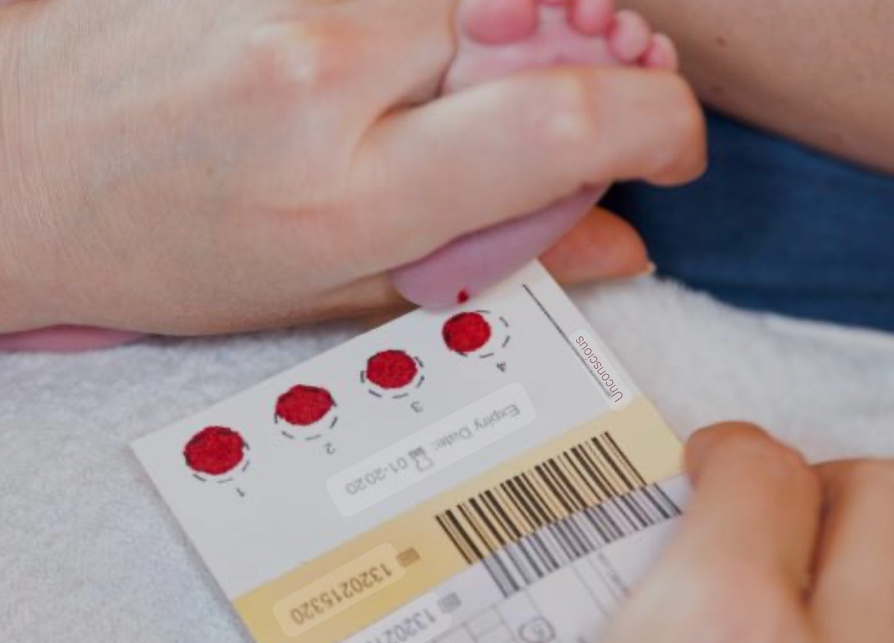
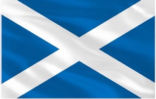

**Book number-(5)-five;**

**Original draft copy**

**The front cover of this book is after this page**

****

**One man and his pen;**

**Trust is everything…**

**: Unique doc-u-ment identity: Exhibit – 21092025 – GEG – OMAHP**

**For this is the Index of this book**

**For the-“Index of this book”-is on page……………………………………………………………. 1**

**For the-“disclosure and disclaimer and transparency“-is Chapter 1 on page…….. 5**

**For the-“brief information on lawful v legal“-is Chapter 1 on page…………………… 6 – 8**

**For the-“Goodism explanation and trading options“-is Chapter 2 on page……….. 9 – 16**

**For the-“fundamental interpretation of trust“-is Chapter 3 on page……………….. 17 – 28**

**For the-“interpretation of what creates a trust”-is Chapter 4 on page…………….. 29 - 36**

**For the-“Birth Certificate fraud by conversion“-is Chapter 5 on page………………. 37 - 54**

**For the-“rebuttal of the constructive trust”-is Chapter 6 on page……………………. 55 - 60**

**For the-“interpretation of the public world”-is Chapter 7 on page………………….. 61 - 74**

**For the-“Goodism Trust explanation”-is Chapter 8 on page…………………………….. 75 – 82**

**For the-“Naas Talks Trust explanation”-is Chapter 9 on page…………………………… 83 - 108**

**For the-“guide of equity, remedy and Trust”-is Chapter 10 on page………………. 109 - 116**

**For the-“practical guide for the trustees”-is Chapter 11 on page……………………. 117 - 124**

**For the-“tricks and traps of the-“legal system”-is Chapter 12 on page……………. 125 - 130**

**For the-“defence playbook of potential challenges”-is Chapter 13 on page……. 131 - 150**

**For the-“statement and disclosure”-is Chapter 14 on page…………………………….. 151 - 152**

**For the-“autograph of the ministers as authors”-is on page…………………………… 153 - 154**

**For the-“epilogue”-is on page………………………………………………………………………… 155**

## For this is chapter one

**For this disclosure is with this transparent- disclaimer;**

**For this is the disclaimer express by these authors;**

**For the knowledge of the mindset of this author known as: Andrew of the-“House of- Trueman”-is with the claim of knowing the-“true intention”-of this author by their-“interpretation”-expressly writ within this book;**

**For the-“intention”-of this book is with the sharing of both the knowledge and the- experience by the wisdom of the people as the-“ministers”-of this private ecclesiastical- guild known as the-“Goodism Ecclesiastical Guild”;**

**For people as the-“ministers”-are with both the body and the soul complete and- embodied as one with the word-“minister”-by this transparency meaning an-“ecclesiastical”-word similar with the word of-“trustee”-although should not be confuse- as being one and the same;**

**For there is no intention by this book of giving any-“legal advise”-whatsoever as the- intention is for the sharing of knowledge with the people in order of them making there- own choice of how they may use this knowledge as this may potentially benefit them- both physically and spiritually;**

**For the knowledge of the-“definition”-of the words express in this book is by this claim of- the-“Oxford Style Manual”-and the-“Oxford Style Dictionary”-for the words writ and- express without the use of any-“speech-marks”;**

**For the use of the “hyphens” by this author is for the continuation of evidence in the- sentence-structures throughout this book with all words convey being by the- interpretations of these authors;**

**For the colour of the ink in use in this book is significant with standing for the entity we- speak of with examples as follows;**

1. **Gold / purple = Goodism   b) Blue = Commerce   c)   Red = Security  d) Green = Naas;**

**For the Capacity of Contract is by the Living verses the-“Artificial Persons”;**

**For this document collates authoritative lawful and-“legal”-sources illustrating the- distinction between a living man / woman-[natural person]-and a-“corporation-[artificial- person]-and the limits of their respective capacities and abilities of contract by conscious;**

1. **Law of Nature and Capacity to Contract**

**Bouvier’s Law Dictionary (1856) – “Contract”;**

**Bouvier’s – “Person”;**

**"Persons are define by law of two status; ether natural or artificial;**

1. **“Natural persons”-are such as are formed by nature — as men and women;**
2. **“Artificial are such as are created and devised by human laws for the-**

**purposes of society and government — as corporations and bodies politic”;**

1. **Capacity of Corporations;**

**Blackstone’s Commentaries on the Laws of England, Book I, Ch. 18;**

**"A corporation is an artificial person, created by law, and composed of one or-**

**More natural persons, authorised to act as a single individual… and possessing-**

**only those rights which are conferred by its charter."**

1. **Meeting of the Minds;**

**Black’s Law Dictionary (2nd Ed., 1910) – “Consent”;**

**"Consent: The concurrence of wills. The union of two or more minds in a thing-**

**done or to be done”;**

1. **Case Law;**

**Trustees of Dartmouth College v. Woodward, 17 U.S. (4 Wheat.) 518 (1819)-**

**"A corporation is an artificial being, invisible, intangible, and existing only in-**

**contemplation of law”-and therefore implied;**

1. **Lawful Maxims- Consensus facit legem — Consent makes the law;**

**“Fictio juris non est ubi veritas — A legal fiction does not exist where truth is-**

**Known”;**

**Corporationis persona est ficta — The personality of a corporation is a fiction;**

1. **Summary;**

**Domain Living Man / Woman, Corporation Natural, conscious being of artificial- creation of law, Full Capacity, inherent, sui juris derived, limited, sub lege-**

**Contractual Power by will and consent by an agency or charter Jurisdiction of-    Common law / Law of Nature and statutory / Commercial law;**

1. **Brief Summary of Jurisdictions;**

**Ultimately Jurisdiction means control;**

**For the jurisdiction of-“monopoly”-is the the rules writ within the game / box- cover;**

**For the jurisdiction of-“scrabble”- is the the rules writ within the game / box cover;**

**For the rules writ for the world of-“commerce”-are known as;**

1. **Universal Commercial Code-[UCC]-governing all commerce;**
2. **Universal Postal Union-[UPU]-governing the movement of all-“vessels”;**
3. **Department of Transport-[DOT]-governing all-“vessels”;**

**For there are no countries anymore as they are all-“Registered Corporations”-and each- “corporation”-such like the-“United Kingdom PLC-[UK]”-is with the obligation of creating- its own jurisdiction / rules by the interpretation of the-“UCC”;**

**Example:**

**For the-“UK”-is with the following three-(3)-acts by this interpretation;**

1. **“1998 Data Protection Act”;**
2. **“2018 Data Protection Act”;**
3. **“2015 General Data Protection Rules”;**

**Whereas in the-“United States PlC-[US]”-they do not interpretations any-“data protection- acts”-by the best of our belief and knowledge;**

## For this is chapter two-

**and explains the Goodism Ecclesiastical Guild-      and the distinct types of trade entities-                      we can choose;**

**For these are basic examples of some methods of trade available to us-dependent on our knowledge as people or-“persons”;**

**Before we begin here is a quick word reference guide by our interpretation;**

**Corporation:** means a piece of paper similar with that of a-“**birth certificate**”-but known as- an-“**incorporation certificate**”-for this is generated by-“**companies house**”-upon the-“**registration**”-of said-“**company**”-and equally holds a-“**name** and a **date**”; as most-“**goods**”- and-“**products**”-do, for we-“**name**”-what we claim;

For a-“**person**”-and an-“**incorporation certificate**”-are equal in-law for they are the same;

1. “**Registered**”; [transferring all titles by the registration as a deed];
2. Have a-“**name** and a **date**”-written on them;

**HMRC:** means-“**His Majesty’s Revenue and customs**”**;** an extortion of money from our- energy and labour by deceit for this family’s upkeep and privilege; **do we need them ?**

**Jurisdiction**: means the control of….. juris = law and Diction = dictionary definitions and- rules and styles of the language being express: example the jurisdiction of **monopoly** is the- rules of the game and the jurisdiction of scrabble is the rules for that game etc etc…

In the case of-“**Registration**”-with the-“**United Kingdom plc**”-the jurisdiction or governance- is by the-“**statutes and Acts** and **Legislative Codes**”-create by the-“**United Kingdom**- **Parliamentary corporation**”-with the-“**titles**”-being transfer and give away by-“**registration**”;

**Person**: means a-“**registered birth certificate**”-holding a-“**name** and a **date**”;

**Name**: means a word given by the creation of our imaginations for the claiming of- something: he who creates it and holds it owns it as they say;

**UTR:** means a-“**unique tax reference or code**”-generated by the-“**HMRC**”-upon our-“**registration**”-for the purpose of-“**commerce**”-within the-“**United Kingdom**”-for the- purposes of volunteering-tax from our energy and our labour;

**Unincorporation**; means a group of like-minded people coming together for a common- cause, benefiting the local and wider communities and-“**unregistered**”; For these are- govern by there own articles and cannons and codes agree by the members and commonly- known as being a **guild** or a **private association**;

**For this describes the different entity’s of trade dependant on knowledge;**

For there are many methods given to us in order of creating an entity for the purposes of-“**commerce** and **trade**”-with these being describe briefly here by our interpretation;

1. **Sole trader; [Maxim; a man is worthy of his labour]**
2. This is usually an individual using a-“**capitalised birth certificate**-      

**name**”-as the-“**trading name**”-with-“**Personal** **Unique Tax Reference Number”**;

1. This is usually-“**registered**”-and-“**register**”-means-“transfer of title by deed in gift- for the benefit of another”;
2. This entity volunteers in-“**paying taxes**”-each year from their labour at an- amount set by the-“**United Kingdom Corporation**”-govern by the-“**statutes** and- **Acts** and **Legislation** and **Codes** create by the-“**United Kingdom Parliamentary**-**corporation**”-masquerading as a-“**Country**”;
3. Bio-metrics are not needed at present dependant on the-“**income amount**”-generated each year by said individual;
4. **Limited Business;**
5. For this is not a man or woman or building but in actual fact an-“**incorporation**-**certificate**”-create by the-“**companies house**”-which has a-“**name** and a **date**”-upon it; but cannot speak or act for itself as is a piece of paper;
6. This entity is-“**Registered**”-and therefore is govern by the-“**statutes** and **Acts** and- **Legislative Codes**”-create by the-“**United Kingdom Parliamentary corporation**”-with the-“**titles**”-being transfer and given away;
7. For this entity volunteers in the-“**paying of taxes**”-and submitting all-“**personal**- **bio-metrics**”-such as-“**face identity, finger prints and eye scans**”-as-“**directors** or-“**persons of significant control”**;
8. **Unlimited Business;**
9. For this is ultimately a-“**registered limited business**”-although becomes an-“**unlimited business**”-upon completion of the following forms / documents;
10. **Form RR05**     ii) **Form IN01**     iii) **articles of association governing entity**;
11. For this is now govern by its own articles such like-“**exempt** from **levy** and **tax**”;

1. **Unincorporations;** For the term unincorporation means an organisation or entity- create for the purposes of trade and commerce but without any-“**legal relations**”-being establish for this is-“**not registered**”-by any means;

For these types of entities are usually known as-“**Guilds**”-and-“**private associations**”-and are operate as-“**not for profit, earthly humanitarian and community societies**”-and as such are govern by their own-“**Articles of Association**”-and-“**Cannons of**- **Conduct**”-express in the document-[**constitution**]-forming part of the operational-rules of said entity;

For the term-“**Guild**”-is usually reference in ancient times and known as a-“**secret**- **society**”-of some sort;

For the term-“**Guild**”-is usually a collection of-“**private associations**”-in a similar- manner as the-“**Head Quarters of a business such like McDonalds**”-being the-“**Guild**”-and the-“**Franchise Restaurants**”-being the-“**Associations**”;

For this structure maintains the same jurisdiction within an organisation even- though each-“**Association**”-is individual by the objectives express within the articles- of association convey with in the-“**Guild** or **Association**”;

For the jurisdiction express in the-“**Guilds**”-and-“**Associations**”-we create are convey- as the-“**Divine Lore of Equity**”-[**Ecclesiastical Jurisdiction of the Ai**r]-and by the-“**Common law principles of the land with the English** **Constitution**”; 

For the above fore mention methods are choices for us all but limited by our knowledge in- most cases and this is why we share our interpretation of these methods in order for the- people in making better inform decisions for the benefit of themselves and others alike;

For the-“**unincorporated**”-entities and organisations commonly known of in this world are-writ below here;

1. **Vatican** – Private-[Ecclesiastical]-Association;
2. **Crown Corporation** – Private Guild;
3. **WEF** – World Economic forum; Private Association;
4. **WHO** – World Health Organisation; Private Association;

For the-“**HMRC**”-clearly state that they recognise-“**unincorporations**”-and must do- otherwise the-“**Vatican, Crown, WEF** and **WHO**”-wouldn’t be recognised and they are in- actual fact running the world in-plane sight through various-“**media outlets** and- **government** **narratives**”-repeated throughout the world similar with that of the-“**Covid 19**”;

So what works for them can work for us and this is why we operate as: **G.-O.-O.-D.-I.-S.-M.-Ecclesiastical Guild** with this being an anagram for;

**Grantor Of Our Dominion is Spiritually Meek Ecclesiastical Guild**

For the: **G.-O.-O.-D.-I.-S.-M.-Ecclesiastical Guild** was founded by this man known as: **Andrew-** and is now a group of like mind people by consisting of-(**7**)-seven founding members stood- as-“**Ministers**-[**Mini-Stars**]”-and create on the twelfth-(**12th**)-day of **May** and in the year of-(**2020**)-two thousand and twenty;

For the: **G.-O.-O.-D.-I.-S.-M.-Private Earthly Association of Trust** was founded by the people-as-“**Ministers**”-for the: **G.-O.-O.-D.-I.-S.-M.-Ecclesiastical Guild** autographing in agreement- the minutes of meeting in agreement of creating this sub-association of this guild;

For the: **G.-O.-O.-D.-I.-S.-M.-Private Earthly Association of Trust** is with-(**19**)-nineteen-founding members as-“**Ministers**-[**Mini-Stars**]”-each with their own unique position and- title with description for transparency;

For the: **G.-O.-O.-D.-I.-S.-M.-Private Earthly Association of Trust** was establish on the twenty-seventh-(**27th**)-day of **May** and in this year of-(**2023**)-two thousand and twenty-one;

For this Guild and sub-association express above are for the sharing of the knowledge and- awareness with the people local and a far for the raising of their conscious on this plane of- earth and in-“**Gaia**”-and some of this knowledge is convey within this book for this exact- purpose and intention;

For the: **G.-O.-O.-D.-I.-S.-M.-Ecclesiastical Guild** is with a private agreement known as a-“**Charter**”-with the ecclesiastical entity known as the-“**Naas Talks Guild**”-create by the man- known as: **Christopher-nicholas** stood as the-“**Original Founding Member**”;

For this-“**Charter**”-is with the agreement of a member of the **G.-O.-O.-D.-I.-S.-M.-Ecclesiastical Guild** being a-“**founding member**”-of the-“**Naas Talks Guild**”-stood in honour- by our good character, faith and with positive intentions equally with: **Christopher-nicholas**; 

For this-“**Charter**”-is in the agreement of the people of the **G.-O.-O.-D.-I.-S.-M.-Ecclesiastical- Guild** creating a unique-“**special purpose vehicle**”-specific with the-“**Naas Talks Guilds**”-objectives and processes and here known as the-“**Hybrid Remembrance Trust**”;

For this-“**Charter**”-gives the-“**Naas Talks Guild**”-sole-“**intellectual property rights**”-outside- of the **G.-O.-O.-D.-I.-S.-M.-Ecclesiastical Guild** for them to alter, adjust, adapt to their liking- and distribute by their discretion with anyone they choose;

For the-“**Hybrid Remembrance Trust**”-is explain in chapter-(**9**)-nine of this book from page- one hundred and one-(**101**)-in further detail;

For the entity being-“**registered**”-as part of the process is sent by post an-“**incorporation**- **certificate**”-for the proof of-“**incorporation**”-and this has a-“**unique company number**”;

For this document is usually required for the opening of a-“**business bank account**”-for one;

For a-“**limited business**”-and an-“**unlimited business**”-must have a minimum of two-(**2**)-parties-“**Acting**”-as-“**Directors**”-and-“**Secretaries**”-by the-“**birth certificate name**”;

For anything-“**Registered**”-is with-“**legal standing**”-and therefore govern by the-“**legal**-**system**”-although an-“**unincorporation**”-not being-“**Registered**”-cannot be sued by the-“**legal system**”-and structure as follows;

For the original founding members of the guild or association are with the duty of creating a-“**certificate of establishment**”-for the purposes of obtaining a-“**Bank Account**”-as a club, society etc what is similar with a-“**certificate of incorporation**”;

For the-“**unincorporation**”-must have a minimum of three-(**3**)-people-“**acting**”-as the-“**Chairman, Treasurer and Secretary**”-although can have as many founding members as it- wants; these three people must-“act”-as there-“birth certificate name”-for the purposes of-contracting with any-“**bank or building society**”;

For this is the difference between being the player sat at the side of the monopoly board- moving the piece and actually being the piece itself; when we do a-“**cursive manner- signatory**”-we become the-“**legal entity**”-by our own confession; 

Yes we were taught this at school for those unlucky enough to go there; it is illiterate and- illegible and a scribble of non-sense with no real claim of ownership and acceptance;

## For this is chapter three

**: fundamental interpretation of what is Trust;**

**: fundamental interpretation of what is Trust”;**

**For this world whether you realise or not is govern entirely by “trust”;**

**Fundamental explanation of what is “trust”;**

**For the word-“trust”-is the most powerful jurisdiction in governance of the people on this- plane of earth and exists in all manner of ways in our lives weather we real-eyes this or- not with many people experiencing the consequences of being party of this-“broken- trust”;**

**For the following examples are of our belief and interpretation of the world we see:**

1. **For the soul is with the temporary use of our body and we cannot take it with us- once we leave;**
2. **For the true owner of the-“vehicle”-is the-“DVLA”-as they hold the-“certificate of- manufactures origin”-and we hold the-“V5 logbook”-as the-“keeper in trust”-and- an-“employee”-of this-“company”;**
3. **For the true owner of any-“bank card”-is the-“bank”-with claim of the-“logo”-express upon said card and we therefore must hold this in-“trust”;**
4. **For the-“passport”-is own by the-“Crown Corporation”-and confirms the holder as- being the-“legal fiction”-due to attaching their likeness with said-“birth certificate- name”-and an-“employee”-and a-“citizen”;**
5. **For the-“receipt”-we are give when we hand a coat into a cloakroom is similar- with the concepts of the-“DVLA”-and the-“Passport”-etc etc… as the-“receipt”-becomes the entitlement to something of value; so a-“security”;**
6. **For the trust relationship within our family and friends is very dear to us and once- broken can and does have devastating and sometimes volatile consequences;**

1. **Why do we pay “taxes” in shops when we are not a-“corporation”…?**

**Is it as we are-“acting”-as-“corporate birth certificate name”…?**

**without full disclosure on a-“global Shakespearian stage”.**

**In this world everything is trust whether we want to believe it or not but in this book- we’re not just going to talk about-“trusts and wills and probate” and what happens in the- “public arena / system”.**

**We are going to tie into this the most important trust ever create in this world which is- call the-“Unam Sanctum”-and writ in the year of-“1302”-by-“Pope Benefice VIII (8th)”;**

**In this book we will be going to show people how to collapse and close the-“constructive- trust”-known as a-“Cestui Que Vie Trust”;**

**But if we do choose to collapse and close this-“Cestui Que Vie Trust”-we’ve gotta expect- things may happen from it on the street and in a-“court / caught“; as we will stand as the- “true beneficiary”-of the estate with or without creating a notarised deed poll;**

**For the one with the notarised deed poll is with the choice of settling this deed in an- expressly written trust such as the Hybrid Remembrance public / private trust by the-    Naas Talks Guild and by this man known as: Christopher-nicolas.-Stood as the original- founding member of this guild with other people as founding members;**

**For one of the purpose of the Naas Talks Guild is for the use as a third trustee for these- Hybrid Remembrance Trust by the members of this guild when chosen and this should- give the reassurance of the ongoing support and mentoring of the trustees for these-   trust deeds mention;**

**For the Goodism Ecclesiastical Guild is with the continual ongoing support for the- members and creates many intellectual property deeds and documents for the- knowledge sharing and competency building of the trustees of these trusts;**

**For the author accepts-“no liability”-for anyone using the information in this book for- themselves and their own journey and gain by this disclaimer and with the transparency- of this our claim.**

**For the word known as trust has been used for many many years and as an example the- knights of the crusade once call for battle and duty gave their-“security / proper-ty”-with- the church as the-“trustee”-by the creation of the trust for the knight may or may not- return and the church would protect and take care of this knights security until such time- they die or they return;**

**For the creation of the trust is with the knowing of the creation of the contract at this- same time as one and the same;**

**By this intent of the settlor / grantor for the creating of the trust is with this condition of- the-“trustee / trustees”-being entrusted with this duty;**

**For the trust contract ensures the-“trustee[s]”-will perform and administer the trust fund- and the security properly and correctly for the benefit of the Beneficiaries;**

**For the two-(2)-type of method for the creation of a private trust are writ below:**

1. **Express = Written and convey with the intention of the settlor:**
2. **Implied = Verbal / Orally omit with other people as witnesses;**

**For the private trust is lawfully create with use of the following three-(3)-certainties:**

1. **For the first is the certainty of intension: For this shows the settlor had full- intention of creating a trust rather than a gift or another type of contract;**
2. **For the second is the certainty of subject matter: For this will be writ and define in- “schedule A” usually as the security / proper-ty settle into a trust;**
3. **For the third is the certainty of objects: For these will be writ into the private trust- and define as the beneficiary[s];**

**And a privately express written trust will not lawfully exist without these three-(3)-certainties writ above.**

**For the private trust deed is with the lawful definition and operating principles and- powers of the private trust in equity in order for the protection of all of the assets with- the unique identity in the private trust and will name the trust with the term[s]-and- condition[s]-of the private trust by the settlor[s]-mind with the proof of the three-(3)-certainties making a private trust valid in equity and the natural law by this intension- subject-[ive] matter and object-[ive]-matter being crucial;**

**For the trust deed is with the name[s]-of the-“settlor”-and the-“trustee”-and the-      “beneficiary“-and the-“witness”;**

**For this guide is by our interpretation of the character roles of a trust;**

**For the people with the intention for the creation of the trust are here known as the- settlor and the trustee and the beneficiary and with the two-(2)-witness not party of this- trust and independent of the trust;**

**For the private trust is express by the use of the-“Universal Postal Union, Royal Mail- special delivery, post-office article claim number”-and by the two-(2)-autograph of the- witness for the proof of the execution of this deed here post;**

**For the security is the word of choice we use for the common word known as proper-ty- and asset and anything of financial worth and monetary value;**

**For the settlor is the man/woman with the intention of the creating of the private trust- for the lawful transfer of the security / asset with the duly appoint trustee;**

**For the trustee is the man/woman in act as the-“birth certificate/legal entity name”-and- appoint in this position for the over seeing of the assets and the direct funds of one or- more of the beneficiary[s]-and the operations of the private trust;**

**For the beneficiary is the wo/man with the-“beneficial interest”-in the security  / asset of- the private trust and with the true certify identity with the likeness of the beneficiary-  with the unique identity number create by the: G.-O.-O.-D.-I.-S.-M.-Ecclesiastical Guild;**

**For the protector is the man / woman originally chose by the settlor of the private trust- with the power of hiring, firing and retiring trustees and another benefit is where there- maybe an inexperienced trustee;**

**For the witness is the man/woman in act as the-“birth certificate/legal name”-and- without the benefit of the trust as they will be independent and not the settlor or trustee- or beneficiary as the witness of the execution-[autographing and signing]-of the- expression of the trust deed;**

**For the trust assignment is the list with the individual reference of the individual security- by the wish of the settlor for the settlement / transfer in with the private trust and this- deed of trust assignment will be use for the specific listing of the private security being- protect with the date witness of the transfer / settlement of the security in with the- private trust;**

**For the trust certificate is the document create for the proof of the lawful expression by- the settlor of the intention of expressing a trust with the witness autographed and- signature for the proof of the execution of this deed;**

**For the trustee certificate is the proof of the certainty of the intension of the creating of- the private trust with the intension and the assignment of the security with object matter- clearly convey and will give a formal recognition and evidence of a trustee exists and with- the-“possessory legal ownership”-of trust security[s]-and asset[s];**

**For the meeting of the mind is the document create by the settlor with the intention of- creating a trust and will give proof of a trust being create without the beneficiary and the- security / proper-ty being shown;**

**For the expressing of the trust** **is with this choice of the costly local paper and the free- local library notice board and the Peoples Express Public Announcement Security Interest- Board part of the: G.-O.-O.-D.-I.-S.-M.-Ecclesiastical Guild website with the low monthly- subscription and unique reference; [ready late 2026];**

[**For the two-(2)-witness are for the proof of the execution of the private trust**]

**For the unit of beneficial interest-[UBI]-certificate is a lawful equivalent of share holding- in the private trust and sometimes issue with the beneficiaries with the number of units- allocate or agree as a representation of the private trust;**

**“Blacks Law Definitions”**

**For the blacks law sixth-(6)-edition** **is with these following words and definition for the- knowledge of this reader:**

**For the word legatee is with this meaning of the person who received a legacy;**

**For this word specie is with this meaning: as applied to things, it signifies individual- identity, this on a bequest of a specific picture the legatee would be said to be entitled to- the delivery of the picture in specie;**

**For this word ownership is with these two-(2)-expressions writ here:**

1. **Equitable ownership – ownership rights protected in equity;**
2. **Exclusive ownership – ownership free of any kind of legal or equitable-**

**interest by anyone else;**

**For the-“blacks law dictionary edition six-(6)-states”-the settlor can reposit any property- into a trust but…**

**what can be describe as property / asset-[we use the word security instead]:**

**For the knowledge of this word security is with the claim of these writ examples below- here and the above transparency of our meaning:**

**Corporeal-[tangible]                                                  Incorporeal-[intangible]**

**House and profit of house                                               Our sons and daughters**

**Car                                                                        Our fingerprints**

**Furniture                                 And                              Our eye-scan**

**Jewellery                                                                         Our blood**

**Money                                                                           Our hair**

**Bank Accounts                                                             Our bodily fluid[s]**

**Land and profit of land                                                            Our body[s]**

**Fruit / Vegetables**

**Animals / Pets**

**For these definition is by the use of the blacks law dictionary sixth-(6)-edition;**

**For the-“Naas Talks Guild Hybrid Remembrance trust”-is with this extra- specifically writ-“Sacred Schedule”-for the settlement of any-“ecclesiastical- deed poll”-and-“claim of title”;**

**For this trust is specifically writ for the holding of property-[letter of wishes- writ as an addendum adds powers for-“stewards”-for managing an estate]-and gold / silver and crypto wallets and land on the page express as-“Schedule A”-and;**

**For the holding of the-“ecclesiastical deed poll”-and any-“deed / enrolled- deed poll”-and any other paper claim on the page express as the-“Sacred- Schedule”;**

**For this-“Hybrid Remembrance Trust”-is with the unique ability of standing- both public and private dependent on use and further explain in Chapter- nine-(9)-and on page one hundred and one-(101)-of this book;**

**For this knowledge is of the-“statutory system[s]”-and maybe of our benefit and- advantage in knowing this:**

**For the private / foreign trust is create with the-“United Kingdom’s recognition of the- trusts act of 1987”-and is also recognise by the-“international courts of justice and this- act implemented the-“Hague Trust Convention with international agreement in 1985”;**

**For the-“European court of human right-[ECHR]”-and also known as the-“Strasbourg- court”-is an-“international court”-for the-“council of Europe”-which interprets the-“European convention on human rights”;**

**For the-“senior courts act of 1981”-states in-“section forty-nine-(49)”-that-“the- separation of the two-(2)-jurisdiction of common law and equity and subject of the- provisions of this or any other act, every court exercising jurisdiction in-“England and- Wales”-for any civil case or matter shall continue to administer the-“law of equity”-on- the basis of wherever there is conflict or variance between the rules of equity and- common law with reference of the same matter then the rules of equity shall prevail”;**

**For the-“Article three-(3)-of the Hague trust convention”-only applies with the trusts- create by the voluntary intension and evidence in writing and this is the reason we- express ours with ink creating an equally and binding contract;**

**For the-“Article six-(6)-of the Hague trust convention”-states-“a trust shall be govern by- the law chose and writ by the settlor and this choice must be express in the term[s]-of- the document/instrument and the other option is this must be writ evidencing the- existence of the trust”;**

**For this is by the wish of the people for the creating of the private trust and must be with- the expression in writing with the jurisdiction / law we choose clearly express and this- law may be the private jurisdiction of equity and natural lore;**

**For the use of the-“public notary”-is one of the ways of our private trust becoming a-“public and statutory trust”-so we never use anything private in the-“public realm”;**

**For the use of the-“officer of the court”-is one of the methods our private trust is- becoming a-“public and statutory trust”-so we never use anything private in the-“public- realm”;**

**For there are many-“tricks and traps”-within the-“system”-design specifically for the-“trapping of your soul”-in-“paper slavery by deceit”;**

**Under the-“English trust law”-you cannot loose your assets even in a-“criminal court- case”. For they usually have a two-(2)-year window and so if evidenced and proven to be- set up in the correct time frame without malice or aforethought-[mens reas]-then the- trust will stand;**

**For the settlor reposits security / property / assets into the trust and so must hold the full- rights and-“interest-[legal owner]-of the security / property / assets”-in order of the- assignment with the trustees of the trust being lawful and once the security / property-    / asset is settle in the trust it is then-“legally own”-and held by the trustees although- segregated from any personal security / property / asset of the trustee who will have no- beneficial interest and right in this security / property and asset;**

**For the settlor reposits and does not deposit as when one deposits something in then- whatever goes in isn’t exactly the same as what comes out and this is exampled here by- the-“bank notes of the banks”-and the word repository being the reference of a vault;**

**For the security / property / asset of which is peculiar or proper of any person that- belongs exclusively for one-(1)-then the term is said to extend to every specie of valuable- right and interest and more specifically the ownership with the exclusive and unrestricted- right of a thing and this right for the despising of the thing in every-“legal way”-to poses it- and to use it and to exclude everyone else from interfering with it by example;**

**Other useful information:**

**For the highest right of the men and women is the right of owning private property;**

**“Recognition of Trust Act 1987” = Article 3 = Expresses: If not writ down it doesn’t exist;**

**Article 6 = Settlor creates the trust then transfers and-**

**deposits / reposits the Property / res into-**

**the trust and then the Settlor chooses the-**

**jurisdiction of law for the trust:**

**i.e.- “Divine Lore or Equity or Common Law”;**

**Article 49 + 63 = States we cannot leave the-**

**“UK or the Int Hague European Union”;**

**For the-“Hague Convention”-recognises foreign trusts such as one under the-“law of- Equity”;**

**For the three-(3)-certainties of creating a trust are- explain further on this page;**

**[For this is first briefly explain on page-(21)-twenty-one of this book]**

**For the are three-(3)-fundamental parts needed in order of creating a trust and these are- called-“the three-(3)-certainties”;**

**For the first certainty is: intention;**

**For this shows the settlor had full intention of creating a trust rather than a gift or- another type of contract and must be done with honour;**

**For example; three-(3)-possible scenarios are express below here;**

1. **John Smith was asked by a judge why he expressed his trust and he answered;**

**”In order of not paying council tax your honour”; for this is dishonourable;**

1. **John Smith was asked by a judge why he expressed his trust and he answered;**

**“In order of putting my half of our house in trust so that my wife cannot sell half- of an house”; for this is dishonourable;**

1. **John Smith was asked by a judge why he expressed his trust and he answered;**

**“For the protection of the property and the asset for the future generations and- bloodline”; for this is the only honourable intention one may express in trust;**

**For the second certainty is: object matter;**

**For this is the description of the property / security / asset / res of financial value / equity- being settle in the trust for the benefit of the potential beneficiaries;**

**For the third certainty is: subject matter;**

**For these are the people expressly writ as the potential beneficiaries within the trust- deed hold a potential claim and benefit of the property/ security / asset / res of financial- value / equity held by the-“trustees”-of the trust;**

## For this is Chapter four

**What creates a trust ?**

**what creates a trust ?**

**So imagine you have a car with the keys and the-“logbook”-then there is value in this:**

1. **for we can use it…**
2. **We can sell it…**
3. **We can finance it…**
4. **We could even hire it out…**

**But separating the car, keys and the-“logbook”-would take away any value for example:**

1. **The keys and the-“logbook”-were give with: Paul of London.-And…**
2. **The car was give with: Janet of-“Scotland”…**

**For this would render both: Paul and Janet, without the-“beneficial use”-of this car and-therefore be of no value to either of them…**

**For the severance within an express trust is by the separation of the-“titles”:**

1. **For the-“legal title”-is held by the-“trustee[s]”; And…**

**For the term-“title”-is with multiple meanings although in the-“legal world”-the-“Legal title”-is the-“legal ownership”-of a-“proper-ty”-which includes the right to- manage and sell and transfer by choice;**

**For this-“title”-is held by the-“person / legal fiction / corporation / Ens-Legis”-with- the-“name”-express on the-“title deeds”-and-“registered”-with the-“land- registry”;**

1. **For the-“beneficial title”-is held by the-“beneficiary[s]”;**

**For this is distinct for the-“beneficial title”-which refers to the right to the- “benefits”-of the-“proper-ty”-for example, any-“income”-for the-“renting of-proper-ty”;**

**For these are the main aspects of the-“legal title”;**

1. **Proof of ownership:**

**A-“person”-with-“legal title”-is the one recognised by the law as the owner and- can prove it through official records;**

1. **Right to control:**

**The-“legal titleholder”-has the authority to make decisions about the property- such as selling it or entering into agreements regarding it;**

1. **Official registration:**

**In many places-“legal title”-is-“registered”-with a-“government body”-such as the-“HM Land Registry”-in the-“UK”-which keeps official records of who owns what;**

1. **Distinction from beneficial title:**

**It is possible for the-“legal title”-and-“beneficial title”-to be held by different- people. For example, in a trust, the trustee holds the-“legal title”-while the- beneficiary holds the-“beneficial title”-and receives the benefit / income.;**

1. **Evidence:**

**While the-“legal title”-is a concept, a deed is the physical document that transfers- that-“legal title”-from one party to another;**

**For these are the main aspects of the-“beneficial title”;**

1. **Right of use;**
2. **Right of enjoyment;**
3. **Right of all benefits indefinitely;**

**For the word use for the-“titles”-before the year of our-“lord of 1535”-were known as-   “fee-simple titles”;**

**For the-“fee-simple titles”-were re-writ and replace in the year of our-“lord of 1535”-with- the word-“freehold”; and-“freehold”-is writ and define in such a way that we believe we- own something when in actual fact we only have-“right of use of it”;**

**For the-“freehold title”-consists of two-(2)-“titles”-as express above as being both the-“legal title”-and the-“beneficial title”-and once split this creates a trust;**

**For this is our interpretation of the first trust create by-“severance”-as-“newborns”.**

**First          Severance**

**is by the**

**Father**

**               [images from google]**

**For the-“severance”-of the-“after-birth”-and the-“newborn baby”-is usually perform by- the-“father”-and with the use of a pair of scissors;**

**For this-“severance”-is the first stage of creating the-“Cestui Que Vie Trust”-as now we- have two-(2)-entities;**

1. **“Newborn baby”-with capacity of one day stating their-“beneficial claim”; and…**
2. **“After-birth”-being the-“mineral wealth”-and-“Still birth twin recorded”-and- express on the-“live born record”-with the-“mothers maiden name”;**

**And the second-“severance”-is with the-“body”-and the-“soul”;**

**For the body- without the “soul”- is a corpse;**

**For the all caps- name is the- body and a- corpse!**

****

**For example:**

1. **“body incorporate”-and the-“birth certificate”-most people use for identification- and purposes of getting a-“bank account”-and”-passport”-etc etc…**
2. **“Soul”-transfer with the-“church / Vatican”-by the-“baptismal ritual”-and by the-transfer of the-“baptismal certificate”-with the-“church / Vatican”;**

**For the fact of the matter is no piece of paper can separate a-“body”-and a-“soul”-only-death itself;**

**For the transparency of the process by our interpretation of the creation of the-“first- Cestui Que vie trust”-is with the-“affidavit of mistake of an entry into a record”-express- on page thirty-five-(35)-of this book;**

**For the knowledge of what creates a trust is with the chapter of this book;**

**For the defining of the word is by the transparency of the dictionary being in use:**

1. **For the knowledge of the word-“birth”-is with the claim of the correct styles- dictionary being disclose.**
2. **For the knowledge of the word-“born”-is with the claim of the correct styles- dictionary being disclose;**

**For the very next page in this book is with an example of an-                      “Affidavit of a mistake of an entry into a record”-**

**For this is a correction of a mistake made by our fathers ignorance in deceit explaining- why we’re correcting this mistake in the form of an-“Affidavit”;**

**For the autograph area at the bottom right corner separates the-“Father, the son and the-Holy Ghost”-by the-“Surname and the given calling and the representative”;**

**For this is our affidavit of a mistake by an entry onto a record;**

1. **On the twenty-second-(22nd)-day of May in this year of nineteen seventy-five-(1975)-a- baby was born at the-“Barnsley General District Hospital”-in the geographical location- known as-“Barnsley”-by-“Collette Goodism-[Smith]”-and-“Peter Goodism”;**
2. **This baby was born in the delivery room and then transferred to a ward as a-“child”;**
3. **As a ward of the state the-“child”-was put into guardianship until the age of eighteen;**
4. **This new born child-[Medical Identity Number of DAA–056544]-was call Andrew but this- was combined with the fathers-“surname of Goodism”-and express as-“Andrew- Goodism”-on a-“Certificate of an entry of a birth”-by deceit of non-disclosure;**
5. **As our father soon thereafter registered the event with the-“Births Deaths and- Marriages”-by filling out the required form with a registrar;**
6. **For we state claim of our father-“Peter Goodism“-not reading the Act clearly as the Act- clearly asks to-“register births”-and we his child had been born and therefore there was- no need or requirement to register this newborn baby for a birth-[berth];**
7. **For we have obtained a copy of the form filled out by our father and registered with the-“Births Deaths and Marriages Register”-which is call the-“source document”-**

**[DAA–056544]-[See Annexe-“A”-not included];**

1. **The source document-[DAA–056544]-started a series of events created by our father once- again not reading the instructions clearly by entering the-“child’s given names in a column- column two-(2)”-which reads:**

**“if still-born, to be noted in this column and a birth includes a still-born”**

1. **“Births”-in the-“Births Deaths Marriages and Relationship Registration Act 1953”-is define- as a-“birth includes a still birth; but does not include a miscarriage”;**
2. **For we by our demand and by this declaration for our fathers mistake of an entry into a- “record”-be amended by this our will for we were never-“birth”-and our identity is not- one of a-“name”-for we are not a-“person or corporation”-for we are a son of the gods;**
3. **For we state claim to the aforementioned-“affidavit”-statement, claim and our bond by- these, our words to be true and to the best of our knowledge and our belief;**

**By Reasonable Accommodation of;**

**……………………………………………………**

**this-“Person Personal Representative”-for this-“Crown Entity”-of-“Surname”-[De–Facto]:……………-**

**Sovereign: “Christian name”-[CD]-[De–Jure]:…………….-**

**“Persons Personal Representative”-as: [AB]-Christian:…………….-**

## For this is chapter five

**For this is our interpretation of the-                        “Birth Certificate”;**

**“The birth-certificate clausula rebus sic stantibus”;**

**[It is illegal to use a legal name]**

**For this is our interpretation of the fraud by the- three-(3)-birth certificates being the start of the- modern day slavery of all men and women on this- plane of earth;**

**For the creation of the birth-certificate is not the- fraud for the fraud is by the use of this counterfeit- document being pose as being real;**

**With this being the same for all-“statute”-which is- of the-“legal standing”-for these are being use as if- they are real-“law”;**

**For the words express in this book are the interpretation of this author known as: Andrew;**

**For this is not intended as being-“any legal advice”-and is for the reader in using this-**

**knowledge by their own discretion and choice and for their own choice of use;**

**Brief examples of trust and some common uses**

**For this world whether you realise or not is govern entirely by trust…**

1. **Can you take your body with you when you die or are you holding it in trust…?**
2. **Do you have a-“driving licence”-as it has got-“DVLA”-written on it… who do you- think owns that really…? “DVLA”…? So we are just holding it in trust then are we- not…?**
3. **We are the-“keeper”-of the car are we not…? we are not the owner of the car we- are the-“keeper”, so we are-“keeping”-it in trust then…**
4. **When you are holding a-“passport”-you are merely holding this in trust as its own- by the-“passport office”-is it not…?**
5. **Why do we pay-“taxes”-in shops when we are not-“corporations”…?**

**Is it as we are-“acting”-as-“corporate birth certificate names”…?**

**without full disclosure on a-“global Shakespearian stage”;**

**In this world everything is trust whether we want to believe it or not but in this book i’m- not just going to talk about-“trusts and wills and probate”-and what happens in the-“public system”;**

**We are going to tie into this the most important trust ever create in this world which is- call the-“Unam Sanctum”-and writ in the year of-“1302”-by-“Pope Benefice 8th”;**

**In this book we will be going to show people how to collapse and close the-“constructive- trust”-known as a-“Cestui Que Vie Trust”;**

**But if you do choose to collapse and close this-“Cestui Que Vie Trust”-you've gotta expect- things may happen from it on the street and in a-“court / caught“; as we will stand as the- “true beneficiary”-of the estate in our true capacity as men and women;**

**For we the author accept no liability for anyone using the information in this book for- themselves and their own journey and gain by this disclaimer;**

**For the knowledge of the-“birth-certificate-scam”-is with the claim of the correct style- dictionary expressing the correct definition and rule for the importance of not- committing any perjury here-in;**

**For the three-(3)-characters of the three-(3)-“birth-certificate”-being of use and in play by- the judiciary and the bar;**

**With their being six-(6)-“jurisdiction available under the gallery of the bar”-for the- judiciary  and anyone-“acting”-in this role as a-“presumed authority”-sitting on our- “beneficial mineral entitlement”-rite[s] as the-“creditor”-for we people do not know who- we are most of the time by our miss-leading-“Rothschild writ and own education”-by use- of the-“state education system”-and without our knowledge;**

**By this we mean most people assume the character of the-“debt-or”-not the-“credit-or”.**

**For we can only assume one-(1)-role and be in one-(1)-office at any one-(1)-given time- and so when we answer this common question for example of:**

**“State your name to the court / caught ?“**

**For the people usually by this-“miss-led education”-and-“miss-guidance”-and direction- with their mother and father being in a similar-“education”-do state the details with that- of a-“debt-or”-and not that of a-“credit-or”-and this allows the authority to step down- into the office we are not in for the facilitation of business and this makes them now in- the-“creditor office”-and as the beneficiary of our estate does it not;**

**With us being give a key at the age of eighteen-(18)-and another one-(1)-at the age of- twenty-one-(21)-being a symbol for the importance of which office we will assume;**

**“Presumed authority in trust of our treasury direct account”**

**“Debt-or”                                           “Credit-or”**

**For the past two-(2)-years the government have spent millions and millions and this can- only be if they are acting as the-“creditor”-and so when will we the people learn of our- correct details in order for us being stood as the-“true creditors”-that we are and make- our-“governments”-the-“true debtors”-that they are…?**

**For the knowledge of the combining of the two-(2)-fact[s]-is with the claim of this state-ment by the collapsing of a trust;**

**For we cannot bring two-(2)-facts together or they will negate and colour each other;**

**For the colour red is the fact.                         For the pen is the fact.**

**For the adding of the word[s]-is with the modification of the fact with that what it is not;**

**For now we will have-“red-pen”-and no longer a-“pen”-and so this is the-“Colour of law”- and how many shades of red are there or type of-“pens”…?**

**For the give here-say calling is the fact.       For the hereditary family calling is the fact;**

**For the give christian here-say calling being not that of an-“res hereditary”-calling and- this being the confusion of the people for we cannot-“assume”-we can use what we have- not being given… And-“hereditary”-is not being given unto us;**

**Also by adding the two-(2)-fact[s]-together we have now modify both of the fact[s]-into- that what they are not and thus created a-“fictional name”-and not that of a calling;**

**For the nature is with the calling as the-“nature calls”;**

**With our mother and father giving us a Christian calling… this is never physically give and- writ down… this is always give by being orally omit and this is the-“government policy”-to- write this down;**

**For the correction notice is on page thirty-five-(35)- of this one hundred and fifty-six-(156)-page book- for the correction of our calling and status by the- use of our own-“certificate of diplomatic identity”;**

**For this is our interpretation of the-“birth- certificate, paper-slavery-scam”;**

**“Live Born Record”**

**“Baby SMITH”**

**Born: 21-05-1975**

**[1st Informant]**

**[and witness – Mother]**

**Informant: Mother**

**Landlord**

**Real Property**

**“Corporate & Commercial**

**Jurisdictions”**

**Treasury Direct Account**

**Beneficial mineral-[en-title-ment]-rite**

**“Certificate of an entry                                       “Certificate of birth**

**of a birth”                                                  [Of = Without in trust law]**

**: John-Henry.**

**Born: 21-05-1975**

**In the margins is the “legal fiction name”**

**Father:…….**

**Birth date:…….**

**“John Henry SMITH”**

**Our born day changes to the word Birth here…**

**[2nd Informant**

**[and Witness – Father]** .

**Informant: Father**

**Registration date:…….**

**<—————Banker**

**Personal Property**

**“Common & Cannon &**

**Maritime Jurisdictions”**

**High Priest———->**

**Ecclesiastical  =  Soul**

**“Talmudic – Old Deed**

**Testament jurisdiction”**

**Office of the-                                         Office of the-**

**“Debt-or”;                                            “Credit-or”;**

**First, we will talk about the-“birth certificate”-as these form part of a trust- call the-“Cestui Que Vie Trust”;**

**When we are born there are-(3)-three-“certificates”-create for every single baby that is- born;**

**For the-“first certificate”-create is call a-“born certificate”-with this one holding the four-(4)-heel pricks of the baby’s heel and known as the-“Guthrie Test”;**

1. **Now when we were born in the hospital, we were given the Christian calling of-            : Andrew. So why write the-”name, Baby Smith”-on this-“certificate”…?**
2. **We were call Andrew were we not…? So who is-“Baby Smith”…?**
3. **For this piece of paper may as well have-“Daffy Duck”-or-“Donald Duck”-writ on it- might it…? As we are Andrew and not “Baby Smith”.**

**For the fictional entity known as-“Baby Smith”-is similar with that of-“Captain Jack- Sparrow”-and just a fictional entity isn’t it…?**

1. **So we've got Andrew on one hand with a born day or nativity day by our mother- as witness and known here as “an informant”; and;**
2. **We have an-“hereditary family calling”-in the other hand writ and express on a- “birth certificate”-with a-“birth-day”-and witness by the father as the-“informant”;**

**imagine a ship coming from France to England, it would have what's called a-“manifesto”- with such information as the start point and end point and any cargo being carried with- the captains details and the boats name with the weight in tonnage etc etc…**

**so imagine there are one hundred-(100)-i-phones on this boat being-“shipped”-to England;**

**Well if you have watched-“Captain Jack Sparrow”-in the film-“Pirates of Caribbean”-when- he comes on to the dock, what does he have to do first before he leaves that dock…?**

1. **he's gotta go and see the harbourmaster and give a name; and then also;**
2. **he’s gotta pay a fee..**

**What must we do at the-“Births, Deaths & Marriages Register” ?**

**And so imagine this-“ship / vessel”-coming from-“France to England”-with a cargo of-“one- hundred mobile phones”;**

**The-“captain”-upon arrival of the-“port”-must go and see the-“harbourmaster”-and- “report”-his intentions giving both a-“name”-and a-“fee”;**

**Well we’re gonna pretend the-“crew”-accidentally dropping one of the-“mobile phones”-in the-“ocean / harbour”; we very much doubt that the-“crew”-are not going to jump in- and rescue this-“water damage mobile phone”; as this will be considered as being-“lost- stock”-and therefore-“lost at sea”;**

**But the captain's gonna have to go back and-“report”-this with the-“harbourmaster”-for- balancing and altering of the manifesto as they're only gonna get-“99 mobile phones”-  now and not the original-“100 mobile phones”; so that the-“captain”-can claim back the- “lost stock”;**

**With the mother being the-“informant”-and without realising basically-“signs”-and- “agrees”-and-“waves”-all rites and claims of this-“package” in-“abandonment”; what- she's doing is she saying-“she doesn’t want that mobile phone”-and this is when the- midwife usually comes in and takes the-“baby / package”-away for a short period of time;**

**And what happens when you cut one thing into two…? This is call a-“severance”;**

**For the-“severance”-of the-“umbilical cord”-is usually done by the-“father”-and a- “severance”-creates a-“trust”; with the natural “dna transfer sever”-of the real-     “beneficial mineral entitlement rite / right”-of the-“after-birth”;**

**So do you know who an “informant” is…?  What is a “police informant”…?**

**An-“informant”-is known as a-“witness”-and you must have two-“witnesses”-in order for- the correct-“execution”-of a-“doc-u-ment”-and-“deed”-in this-“world”; the-“mother”- being the-“witness“-of the-“first certificate”-and the-“father”-being the-“witness“-by the- “registering”-of the-“second certificate”;**

**With each-“birth certificate”-being like a game of-“monopoly”-or-“scrabble”; each- holding their own-“rules and characters”-different with each game;**

**And so each-“birth certificate”-as therefore got its own-“characters”-and “rules”-and we- cannot play-“monopoly”-using-“scrabble rules”-and-“vice-verse”;**

**By our knowledge this-“first certificate”-was create by-“King Henry”-in the-“year of 1540”- and the character for this game is known as a-“landlord”-of-“real property”; So have you- ever heard about what they call-“real estate”…? And there are two-“jurisdictions”- available under the-“gallery of the bar”-and these are-“corporate”-and-“commercial- jurisdictions”;**

**for the word-“jurisdiction”-in simple terms means-“control”;**

**So, if we are playing a game of-“monopoly”-then the-“jurisdiction”-of this-“game”-is the- “rules” written within the “game” and if we are playing a game of-“scrabble”-then the- “jurisdiction”-of this-“game”-would be the-“rules”-written within this-“game”; now- weather we realise this be not we're all playing the-“game of the United Kingdom- Corporation”-and all the-“rules”-for this-“game”-are known as-“statutes, acts, legislation- codes and rules”-and with millions of these in existence and being change around regular- how can anyone possibly keep up with all of these…?**

**And so the-“first certificate”-is with the one-“character”-and then with two different sets- of-“rules / jurisdiction”-and the-“mother”-is the-“informant”-and basically said she does- not want that-“iPhone / baby”; and without realising has just abandoned the “estate”; And the-“estate”-being the-“securitisation”-of the-“minerals”;**

**For the-“Guthrie Test”-is now perform and the four-“heel pricks of blood”-took are place- on the-“first certificate”-known as a-“born certificate”; And this then in our belief creates- two other-“certificates”-with these being held at the following locations:**

1. **“Born Certificate”-with the-“heel pricks of blood”-is at the-“Hospital”;**
2. **“Certificate of an entry of birth”-is with the-“person”-after asking for it at the- “Births, Deaths & Marriages Registration Office”-as most do;**
3. **“Baptismal Certificate” is in the “Vatican Archives”;**

**And so the baby born is with the natural claim of the-“beneficial mineral entitlement- rites / rights”-but those-“rites / rights and claim”-are now with a-“born certificate”;**

**And the-“midwife”-being the-“health department”-and not the-“wealth / treasury- department”-in hold of-“abandoned wealth / treasure”-has a duty in-“calling / informing”- the-“Births, Deaths & Marriages Registration Office”;**

**For the-“Births, Deaths & Marriages Registration Office”-is part of the-“HMRC / Treasury”.**

****

**[Picture took from a public archive on google]**

**For the-“S, O, L, E,”-has gone onto a-“plane piece of paper”-                                                      and not on the plane of earth;**

**For the-“second certificate”-create is call a-“certificate of an entry of a birth”-and is the- one that our-“father registers”-as the “second Informant”; and the ones usually used for- the obtaining of-“bank accounts”-and-“passports”-and-“driving licences”-etc etc…**

**And this is create by the-“midwife”-making a phone call to the-“general superintendent- registrar”-and the information being exchange and transfer in a manner of;**

1. **What’s the baby’s-“first name”;**
2. **What’s the baby’s-“last name”;**
3. **What’s the baby’s-“date of birth”;**

**For the bringing together of these-“names”-is by the people in-“act”-as these-“public- servants”-known as the-“midwife”-and the-“general superintendent registrar”-and- therefore on behalf of the-“Fictional Feudal Crown Corporation System of Paper Slavery”;**

**With this knowledge we know logically that the-“system”-are the ones who brought the- “give heresy Christian calling”-and the “hereditary family calling”-together as one and in- doing so create a-“legal fiction / persona”-for us to-“act”-as-“surety”-for by our- “ignorance” and-“deceit”; in the same way as-“baby Smith”-and-“Captain Jack Sparrow”- and-“Donald duck”-may-“appear”;**

**For the bringing together of the two facts known as the-“give heresy Christian calling”- and the-“hereditary family calling”-by doing so negate and colour each other into being- now a-“fiction”; just like if i have a-“pen”-what is a fact in my left hand and the colour-“blue”-what is a fact in my right hand; but when these two facts are brought together- these two facts now create the words-“blue pen”; Now how many shades of blue are- there…? Sky blue, navy blue, pastel blue etc etc… and so a-“blue pen”-is therefore now- not a fact but a-“fiction”; just like the two callings being brought together;**

**And so why are we using something that were never given to us…?**

**For the only box not completed on the-“certificate of an entry of a birth”-yet is the-“date- of registration”-as our-“father”-has not been in and-“registered”-yet; And under the-   “Latin word”-of-“datum”-meaning;**

**“When a date is added to an instrument it creates another instrument”**

**And our-“father”-by his own voluntary free-will and with-“non-disclosure”-is without the- realisation and knowing  of the of-“do-u-ments”-create here and of the “abandonment”- in doing so here-“registers”-this-“birth”-with the-“Births, Deaths & Marriages Registration- Office”-and in doing so adds a date in the “registration date box”-of the-“certificate of an- entry of birth”-what creates another-“do-u-ment”-and the-“third certificate”-in this- “birthing process”-commonly known by many people as the-“Cestui Que Vie Trust”;**

**For the two-(2)-“certificates”-being explain up to now are with the choice of two-(2)- characters and five-(5)-“jurisdictions available under the gallery of the bar”-for the- “presumed judges”;**

1. **“Born certificate”-is with the character known as the-“Landlord”-for-“real- property”-and the-“jurisdictions”-available for this are the-“corporate”-and- “commercial jurisdictions”;**
2. **“Certificate of an entry of a birth”-is with the character known as the-“banker”-for- “personal property”-and the-“jurisdictions”-are the-“common law”-and-“cannon- law”-and-“maritime admiralty”;**

**For the-“Certificate of an entry of a birth”-is the-“certificate”-most people hold and ask for- at sixteen-(16) for the obtaining of a-“bank account”-by the-“indoctrination”-of our- “parents”-and the-“education system imposed”-up on us;**

**For the holding of the-“Certificate of an entry of a birth”-is without the knowing of our- true-self, for we were only ever given an-“heresy calling”-such as: Andrew.**

**For the-“surname”-known in reality as the-“family name”-never given to us is hereditary- and by our belief means-“surety-name”;**

**For the trick of the-“system”-is by imposing on us a-“fake obligation”-in standing as- “surety”-for the entity known as the-“Certificate of an entry of a birth”;**

**For the three-(3)-jurisdictions in play under the-“second certificate”-known as the-“certificate of an entry of a birth“-are express here;**

1. **“Common Law”;**
2. **“cannon- law”;**
3. **“maritime admiralty”;**

**For these three-(3)-jurisdictions were separate before the-“world of commerce”;**

**For the purposes of-“trade”-these two-(2)-countries would use the jurisdiction of-“maritime admiralty”-and the water with ships for such business;**

**For the-“Common Law”-exists as the-“law of the Land”-and the-“constitution”-for the- country known as England 🏴󠁧󠁢󠁥󠁮󠁧󠁿 with a-“fixed cross”-like a plus sign;**

**For the-“Roman Law”-exists as the-“law of the Air”-and the-“constitution”-for the country- known as Scotland 🏴󠁧󠁢󠁳󠁣󠁴󠁿 is with a-“mutable cross”-like an X sign; [Ecclesiastical – spirt – Air];**

****

**For the merging of the two-(2)-flags is with the hidden message of the-“double crossing”-of the people; And this is done in many ways since the “1707 act of unions”; [merger];**

****

**“Third certificate”-create is call the-“baptismal certificate”-and is create by our-“baptism”-with the transfer of our-“sole”-“with the-“Vatican”;**

**For the adding of a date with an-“instrument”-such as a-“Certificate of an entry of birth”- is with the creation of this-“third certificate under the Latin word of datum”;**

**For the severance of the-“body and the sole”-is the-“second severance”-create with the- first being the cutting and separation of the-“umbilical cord”-and the-“baby”-as explain- on page thirty-three-(33) of this one hundred and fifty-six-(156) page book;**

**For the-“body”-without the-“soul”-is known as a-“corpse”-as cannot-“act”-and speak for- itself and knowing this why would we ever-“baptise”-our off-spring ?**

**For the-“blacks law dictionary”-is with the definition of the word-“person”-and when- looking at this definition it states-“see human”; and when we look at the word-“human”- it states a-“human”-in this book as being a-“monster or thing”;**

**For the-“body”-without the-“soul”-is similar with a table or chair or pen or basically an- object without energy to-“act”-for itself; And this is why we are refer to as a-“thing”-in- the-“court / caught”;**

**For the-“Certificate of an entry of a birth”-is the-“body incorporate”-and clearly states it is- a-“body incorporate”; And without a-“soul”-this now should make sense why it is a-“body- incorporate”;**

**For the-“baptismal certificate”-therefore in there-“paper world”-transfers the-“soul”-with- the-“Vatican”-as a-“record”-of this separation of this-“body and soul”; And these are held- in the-“Vaticans Vault”-and protect by the-“judges”-who took the-“extreme oath of the- jesuits”;**

**For the-“severance”-and separation-“creates a trust”-and by this the bringing back- together must therefore “collapse a trust”; And the only thing we can do to collapse this- “Constructive Trust”-is by completing an-“Ecclesiastical Deed Poll”-and posting to the- “Vatican”-in order to correct the-“record”-of this-“body and soul”-now being as one;**

**For this-“third certificate”-is with the character known as the-“High Priest”-and- govern by the jurisdiction known as-“Talmudic”-or-“Talmud”-and this being the-“Old- Testament”-as illustrate on page forty-four-(44) of this book;**

**For the-“instrument”-is with a-“margin / boarder”-defining the centre box of this- “certificate”-as being the-“jurisdiction of the land”-and the-“outer margin”-being the- “jurisdiction of the water / maritime”;**

**: Andrew.**

**Born: 21-05-1975**

**For this-“third certificate”-is here describe as conveying the correct detail on the-“inner jurisdiction of the land”-and in the-“outer jurisdiction of the water”-there will- be the-“name of the legal fiction / birth certificate name”-usually express on the- “second certificate”;**

**For the-“three certificates”-are-“watermark”-when held up to a light and a- “watermark”-is consider as being the-“current-sea / currency”-and the-“rivers allow- the flow of the current”-and the water not only-“deposits”-onto the-“banks”-but it- also-“withdraws”;**

**For the-“certificate of an entry of a birth”-as the-“second certificate”-create is with a- “cusip number”-writ in red at the top corner of this-“instrument”; For this-“cusip- number”-is like one stock of the pot such like-“one can of beans from Heinz”;**

## For this is chapter six

Rebutting the Constructive Trust:  
Guthrie Test, Birth Certificate, and-                                                                     Express Private Trusts;

Rebutting the Constructive Trust:  
[Guthrie Test, Birth Certificate, and Express Private Trusts]

**a)  The Guthrie Test:**

**The Guthrie test is a newborn screening procedure involving four-(4)-blood spot- samples are unwittingly took from the heel of a newborn baby. Statutorily, it is presented as- a medical necessity for genetic and metabolic screening. Symbolically, however, the four-(4)-pin pricks of blood are treated in commerce as an offering, forming a four-corner- jurisdictional box and rule: the hospital [health], the-“Vatican”-[spiritual]-and the-“City of- London”-[financial]-and-“Washington DC”-[executive]. Even if hospitals claim the cards are- destroyed, the presumption of their existence remains until rebutted. The living man or- woman may correct this by a declaration that life and beneficial title cannot be sever;**

b) The Birth Certificate is a Constructive Trust:  
The birth certificate process creates a constructive trust:

1. **Settlor: the informant (usually the mother);**
2. **Res: the legal fiction (registered name/entry);**
3. **Trustee (by presumption): the living man or woman;**
4. **Beneficiary: the state;**

**The res cannot be the beneficial title, as it is only the corporatized estate-[legal fiction]; The- beneficial title remains permanently with the living being, bestowed by divine authority, and- cannot be transferred or abandoned;**

**c) Express Inter Vivos Trust & Associated Instruments:**

  
An inter vivos trust is create during one’s life and is writ as a deed. Associated instruments- include: Meeting of the Mind, Trustee Oath, Trust Deed, Trust Certificate, and Claim of Settlement;

**These documents perfect the trust in equity by proving the three certainties of: intention, subject- matter, and objects. Once established, the constructive trust presumption collapses, as the-“legal- fiction”-is no longer abandoned but expressly settled into a private trust;**

**d)   Equity and the Express Trust:**

  
A constructive trust arises by presumption, silence, or operation of law. An express trust is- created intentionally, by deed, with certainty. In equity, an express trust always overrides a- constructive trust. Thus, once a living man or woman declares their express trust, the- presumption of state control collapses;

**e)  Four Seats of Power & Guthrie Rebuttal:**

  
The four seats of power are the hospital, the-“Vatican, the City of London, and Washington DC”- Symbolically, they represent the four-corner rule of enclosure and contract. Sending notices to- these bodies can complete the box and collapse the presumption, but it also risks unwanted- attention, scrutiny, or retaliation. In truth, it is not essential. The express deed itself is sufficient- remedy; The four-corner rebuttal can be completed privately within the trust rather than by- external notice;

**F)  Using Private Trusts in Practice:**

  
Private trusts anchor remedy. Associated documents such as oaths, certificates, and claims- provide evidence of intent, unity, and wholeness. In practical use, the trust remains private unless- statutory authorities intrude. When challenged, the trust is asserted as shield. Otherwise it- remains silent, avoiding unnecessary confrontation;

**g)  Affirmation of Wholeness and Standing:**

  
Affirmations serve both as substance and form. The substance is that the beneficial estate is- whole and cannot be severed, abandoned, or transferred. It flows from fertilisation to last breath- by divine authority. The form is that the body or corpus may undergo change [loss of limb, kidney- or placenta at birth], but this does not affect the beneficial estate—only the physical vessel;

**h) Model Affirmation:**

  
"This man known as: [John-Henry] is whole, present, and accounted for from fertilisation to last- breath; No severance of body, tissue, or record affects the beneficial estate, which remains- bestowed by divine authority, intact and unalienable”;

**i)  Conclusion:**

  
The Guthrie test and birth certificate processes create presumptions of abandonment, forming- constructive trusts; Express private trusts, supported by affirmations, oaths, and deeds, rebut- these presumptions; Beneficial title remains permanently with the living man or woman and- cannot be taken; Four-corner notices are symbolic but unnecessary; remedy lies in equity;    Private trust deeds provide both spiritual and practical protection, asserted only when needed;

**j)  Affidavit of Fact:**

**For this Affidavit notice is serve with the “Attorney General”-and the-“General Superintendent- Registrar”-by this author as a record;**

**[As express on page twenty-seven-(27)-of this book]**

**For the closing of the presumed constructive trust create at our birth is a perfected process by the-“Naas Talks Guild”-and a very good friend of ours known as this man: Christopher-nicholas;**

**For this process is with an in-depth sharing of knowledge and by pre-written and proven doc-u-ments for like-mind people remembering who they truly are and now correcting there status-within the system;**

**For the-“Naas Talks Guild”-is mention in chapter nine-(9)-of this book and the links for anyone- who wishes in connecting with the people of this Guild;**

**For this process involves a tried and tested method with a deed known as an-“Ecclesiastical Deed- Poll”-as well as further deeds / documents as part of this status correction process;**

**For the system tricks us into becoming a trustee / boat when in actual fact we are the true- beneficiary / captain of this vessel known as a-“Cestui Que Vie Trust”;**

## For this is Chapter seven

**“Our interpretation of the public world of intestate-and testate and wills and statutory trusts”;**

**For this is our-“interpretation”-of the difference- between the words- “Testate”-and-“Intestate”;**

**For the-“jurisdiction”-known as-“England & Wales”-is the-“governance”-of-“statutes and-acts and legislative rules”-changeable by the people-“acting”-for the-“parliament”;**

**For the main difference of-"testate"-and-“intestate"-is whether a-“person died”- with or- without a-“valid last will and testament”-commonly known as a-“will”;**

1. **“Testate”: [with a valid will]-If a-“person dies testate”-then their-“estate”-is- distribute by their express wishes outlined in their-“last will and testament”;**
2. **“Intestate”: [without a valid will]-then their-“estate”-is distribute according to- “state-specific laws of intestacy”-which set out the-“rules”-deciding who-“inherits”-what and by what proportion and capacity;**

**.**

**What does-“Testate”-mean:**

1. **For the-“person”-who dies with a-“legally valid will”-is commonly said to have-“died testate”;**
2. **For the one creating the-“will”-is known in the-“legal world”-as the-“Donor”;**
3. **For the-“will”-is a-“legal document”-that outlines the-“deceased person's”- wishes with regards the distribution of their-“property, money”-and any other- “assets”-consider part of their-“estate”-[known as their-"estate”];**
4. **For the-“person”-appoint in the-“will”-with the duty for the management and- distribution of the estate is known as the-“Executor”;**
5. **For the-“legal process”-of carrying out the instruction's writ within the-“last- will and testament”-is known as-“Probate”;**

**b) What does-“Intestate”-mean:**

1. **For the-“person”-who dies without a valid-“will”-is known to have- “died intestate”;**
2. **For the-“person that dies intestate”-then their-“estate”-is distribute according- to the-“state or country / corporate laws”-known as the-“rules of intestacy”-and not by the personal wishes of the one that has-“died”;**
3. **For these-“rules”-give a predetermined order of priority for the-“beneficiaries”- typically starting with a-“surviving spouse”-and then any-“children”-and then- with any other relatives such like-“parents or siblings”;**
4. **For the-“unmarried couple”-then a-“surviving partner”-is not automatically- entitled to any-“inheritance under intestacy rules”;**
5. **For the-“person appoint”-by the court to administer the estate is called- an administrator, and they are granted "letters of administration";**

**Feature**

**Testate**

**Intestate**

**Definition**

**The deceased left a valid will**

**The deceased did not leave a valid will**

**Distribution**

**By the instructions writ within**

**the will**

**By the laws of intestacy**

**Control**

**The deceased’s wishes are**

**Usually followed**

**The law determines who inherits what and who doesn’t**

**Process**

**Executors apply for a** [**Grant of Probate**](https://www.google.com/search?q=Grant+of+Probate&ie=UTF-8&oe=UTF-8&hl=en-gb&client=safari&mstk=AUtExfDVGqEDrTUecA-S8Tpzv4UWr9z6RwpuMib89quyfAS8RUNmDqh4adRGc3y4I6QJI4obuAR7CtVXnAB40bj1sjELzMp1U7FJokjdA6Q2lJTdODGGL3zneZvlv7NUyvyqZxz1xPjBMUCP86h-sOyhR5m_CJwlZj9ivN_MNheXjO6OjOM&csui=3&ved=2ahUKEwjv0r-1_KaQAxW0UEEAHYTyATUQgK4QegQIAhAD)

**The estate is administered by a court-appointed administrator and according to the intestacy rules**

**Possible Outcome**

**The estate is distributed as the deceased intended**

**The distribution might not align with what the deceased would have wanted**

**For this is our-“interpretation”-of a-                           “Last Will and Testament”;**

**For the history of the word and term of a-“Will”-is an ancient term as far back as-   “Caesar’s Estate”-and has been use for the distribution of an-“estate”-still to this day;**

**For the word and term of a-"Will"-historically is apply with-“real property”;**

**For the word and term of-“Testament"”-is apply with-“personal property”;                          [thus giving rise to the popular title of the document as-“last will and testament"];           For the records show these terms are and have been used interchangeably;**

**For this is a-“formal legal document”-outlining the intentions and wishes of the-“donor”-in how they wish for their-“estate”-being dealt with upon their death and also by whom;**

**For the words-“Will and Testament” are with a similar meaning in this following context;**

**For the word-“Testament”-is derivative of the-“Latin word”-of-“testamentum”-and this a- derivative of-“testis”-with this meaning-“bare witness of”;**

**For the word-“Will”-is the-“English equivalent”-with the meaning of desire, wish or- request; With other-“West Germanic languages”-having similar words as this became- used to describe this type of document around the-(14th)-fourteenth century;**

**For the-“legal realm”-is with the power and capacity of changing one’s-“Will”-and wishes-by the use of the-“public written statutes and acts”-for these-“rules”-give these people of-     the-“courts / caughts”-the flexibility of determining the outcome with the distribution of- an-“estate”;**

**For the-“legal realm”-is with the-“duty under statute”-of holding any-“monies”-of an-“estate”-for a minimum period of six-(6)-months for anyone may make a claim in an-“estate”-where-“beneficial interest”-has been proved or claimed;**

**For the-“legal realm”-of-“solicitors and barristers”-are with various-“percentage fees”-and-in our opinion whatever they can get;**

**For this is our-“interpretation”-of what-                           “Probate”-involves;**

**For the word and term of-“Probate”-is for the-“legal realm”-and with the meaning of-“settling an estate of a person who has died”;**

**For this process involves the-“validating of a will, paying debts, and- distributing of- assets”-with the-“beneficiaries”;**

**For this grants the-“named executor / an appointed administrator”-with the-“legal- authority”-of managing the-“deceased's property, money, and any- possessions”;**

**For this process is through the-“court / caught”-and is necessary for a-“person”-in-    “legally possessing”-the authority of accessing the-“bank accounts”-and in the-“transfer- and selling of assets”;**

**What is the purpose of probate ?**

1. **For the proof of the-“validation of a Will”:**

**For this proves the-“Will”-is authentic and gives the-“legal authority”-with the-“Executor”-for the performing out of the instructions;**

1. **For the power of managing the estate:**

**For this gives the-“executor”-the power for the accessing of the-“deceased's- assets”-of-“bank accounts, property and investments”;**

1. **For this gives the power of settling-“debts and taxes”:**

**For this ensures the-“deceased's outstanding debts”-and any-“applicable taxes- like inheritance tax, are paid”;**

1. **For this gives the power of-“distributing assets”:**

**For this is the-“last step”-as the-“remaining assets”-are then distribute- with the-“rightful beneficiaries”-in accord by the-“Will”-unless-“no will”-exists and then in- accord by the-“rules of intestacy”;**

**For the need and requirement of-“Probate”-is:**

1. **When the deceased has left a-“Will”;**

**For the-“executor named”-and express in the-“Will”-is the one typically applying- by need for a-"grant of probate"-for the ability of dealing-“legally”-with the-“deceased estate”;**

1. **For the-“estate”-with-“no will”-is known as being-“Intestate”:**

**For the-“estate”-where-“no will”-is with proof of existence then a close relative- will need to apply for a-“grant of letters of administration"-in order of being-“appoint”-as an-“administrator”;**

1. **For the-“estate”-with-“no will”-and of-“smaller estates”:**

**For the-“smaller estates-[usually under five-(£5000.00)-thousand]”-which can vary- by country and-“institution then-“probate”-may not be required and one should- contact the relevant-“financial institutions”-for the releasing of-“funds without”-a-“grant of probate”;**

**For the people usually involved are with the inclusion of:**

1. **“Administrator”: For this-“person appoint”-is by the-“court / caught”- with the-“powers of managing the estate”-when-“no will”-exists or the-“named executor- cannot act”;**
2. **“Donor”: For this is the-“person”-expressing and creating the-“Will”;**
3. **“Executor”: For this is the-“person named”-in a-“Will”-with the duty and- responsibility for the carrying out of the-“Wills”-instructions;**
4. **“Beneficiaries”: For these are the individuals-“potentially inheriting”-and-“benefiting”-out of the-“estate”.**

**For this is our-“interpretation”-of a-                           “Public Statutory Trust”;**

**For the-“legal realm”-is with the duty of creating a-“Statutory Trust”-where-“no will”-exists;**

**For this-“statutory trust”-is create-“under section 47”-of the-“Administration of Estates- Act of 1925”-and so a separate trust deed is not needed to create the trust. For the- “personal representatives-[PRs]”-hold the-“estate on trust”-with the power to sell it;**

**For the-“Trust Registration Service”-became-“mandatory”-following changes with the-“anti-money laundering regulations”-of October in the year of twenty-twenty-(2020)-to-the best of my knowledge but many-“trustees”-are still unaware of this obligation;**

**For the difference between a-“Will”-and a-“Trust”-are scribe here:**

**For the first difference is a major difference in that a trust takes effect the moment the- autograph and signatures are execute and express but a-“Will”-takes effect upon our- “death”;**

**For there are other differences between including:**

1. **For the distribution of-“property and assets and monies”-with the-“beneficiaries”-is by a-“Grant of probate”-with a-“Will”-although-“Trusts”-both-“revocable and- irrevocable”-can avoid this;**
2. **For the-“Will”-is with effect upon one’s passing although a-“Trust”-takes- immediate effect and may offer direction for the-“trustees”-in our life-time in the-event of any incapacity of us making our own decisions;**
3. **For the-“Will”-is of-“public record”-whereas-“Trusts”-can be private;**

**For the-“Trustees / Solicitors”-should change the-“title”-on the-“Land Registry”-with the-“name of the Trust”-reaffirming the-“estate”-being in-“Trust”;**

**[Solicitors are known for not following through with their work];**

**For this is our list of the common used-“Trust Deeds”-in the-“Public Realm”-of the-                “United Kingdom”;**

1. **“Bare Trusts”:**

**For the-“assets”-in a-“bare trust”-are held in the names of the-“trustees”;**

**For the-“beneficiary[s]”-with the minimum age of eighteen-(18)-hold the right of- claim of any-“capital”-and-“income”-of the-“Trust”-as and when they wish;**

**For this means the-“assets donate”-by the-“settlor”-are always with the-“beneficiary[s]”;**

**For there is usually no requirement for the-“registration”-of a-“Bare Trust”-for any-“Taxable Purpose”-for the-“Liability of any Tax Incurred”-falls with the-“Beneficiary[s]”-and not with the-“Trustees”;**

1. **“Discretionary Trust”:**

**For the-“discretion”-and use of the-“Trust Capital”-and-“Income”-is with the-“trustees”-and used by their-“discretion”;**

**For there are no-“specific exemptions”-for this-“Trust”-not being-“Registered”- with the-“Trust Registration Service-[TRS]”-however there are a few exceptions-depending on one’s circumstances;**

1. **“Express Trust”:**

**For an-“Express Trust”-is one create deliberately on purpose by a-“Settlor”-by a-written / express-“Deed”-with their-“Declaration of Trust”;**

**For the-“Recognition of Trusts Act 1987”-does state in-“section 3”-these words:**

**“If it isn’t writ down it does not exist”;**

**For the type of-“Trust”-is dependent of the-“registration consequences”;**

1. **“Non UK resident Trusts”:**

**For this type of-“Trust”-the-“Trustees”-are not-“Resident”-in the-“United- Kingdom”-for-“Tax Purposes”-although may still have to-“Register”-if they have a-“United Kingdom Tax Liability”;**

1. **“Interest in Possession Trusts”:**

**For the-“Trustees”-of an-“Interest in Possession Trust”-must pass on all of the-“Income”-of the-“Trust”-with the-“Beneficiary[s]”-minus any-“Expenses”-and all- of the-“rights of use”-for any-“Trust Property”;**

**For the-“Beneficiary[s]”-are therefore known as holding an-“Interest in Possession- of the Trust or Trust Proper-ty”;**

**For an-“Interest in Possession Trust”-are often create by the terms of a-“Will”-giving an individual the right of benefitting off the-“assets”-of a-“deceased- individual”-in their lifetime with the-“assets”-then being pass-“under the terms of- the Will”-with a different individual such like their offspring;**

**For there are-“no specific exemptions”-with the-“registration process”-for an-“express trust”-existing as an-“Interest in Possession Trust”-create by a-“Will”-and-this will be-“excluded of registration”-for a period of two-(2)-years of-“death”;**

1. **“Protective Trusts”:**

**For these type of-“Trust”-are usually set up for the holding of-“assets”-for the- “benefit of a beneficiary”-while protecting these-“assets”-in the event of certain-conditions being breach-[For example the beneficiary becoming bankrupt]-**

**For the-“trust”-is set up as an-“interest in possession trust”-and remains so unless-     and until the-“beneficiary breaches”-one-(1)-or more of the specified conditions- and at that point the-“interest in possession ceases”-and the-“Trust”-becomes a- “discretionary trust”-thus protecting the-“assets”-from-“creditors or others”;**

1. **“Settlor-Interested-Trusts”:**

**For these are-“Trusts”-of any type by where the-“Settlor”-or the-“Settlors Spouse”-or-“Civil Partner”-may benefit from the-“Trust”-and the identity of the-“beneficiaries”-does not affect whether –“Trust”-must-“Register”-or not;**

**For a-“Settlor-Interested-Trust”-may have to-“Register”-in accord with the-“rules- that apply”-for this type of-“Trust”.**

**For the-“Income”-arising by a-“Settlor-Interested-Trust”-is treat as the-“settlor’s- income for tax purposes”. However, the-“trustees”-also have a-“concurrent- liability of that tax”-and therefore a-“Settlor-Interested-Trust”-must-“register for- taxable purposes”-if it has a-“UK tax liability”;**

**For the-“Public Statutory Trust”-and most other-“Private Trusts”-are with the- use of these-“Titles”-and by this structure;**

**Settlor              Mr John Smith                 Grantor**

**[English term]                                            [American term]**

**Trustees**

**The**

**Trust                             Mr Bob Smith-[Son];**

**Mrs Mary Smith-[Daughter];**

**Primary Beneficiaries-[upon death will fall with the secondary beneficiaries]**

**: John.-And: Jane.**

**Secondary Beneficiaries**

**: Bob.-[son]-And: Mary.-[daughter]-And: Sarah.-[grand-daughter];**

**For the-Settlor”-is the one writ on the-“land registry”-as the-“legal entity”-and owner of- the-“proper-ty / land”-and the-“settlor”-of the-“property / asset”-in to the trust now in- hold of the-“proper-ty”-in the-“Public Registered Trust”-as the-“Public Registered Trust”- is a-“legal entity”-by being-“Registered”-just like a-“birth certificate / company”;**

**For the one express on the-“Land Registry”-in this case is-“Mr John Smith”-with this being- the-“legal entity”-used for the settling of the-“proper-ty / land”-in the first case… And- with the-“consideration”-of-“Promissory Notes”-for the exchange;**

**Although the first task is checking the-“land registry”-for the-“proper-ty”-will sit under- one of these three-“titles”:**

1. **Sole proprietor – Individual trust can be writ for this-“sole proprietor”;**
2. **Joint tenants – For this need's severance into-“tenant in common”-first;**
3. **Tennant in common – two trusts can be writ one for-“John Smith”-and one-for-“Jane Smith”-where they can settle their share of the-“proper-ty”-into there own- individual trusts;**

**For the next character role of the trust is known as a-“trustee”-and are with the duty and- obligation of managing the-“estate”-of a trust:**

**For the-“trustees”-of a-“Statutory trust”-are the-“solicitors most times”-and should Act in- the best interest of the-“primary and secondary beneficiary[s]”;**

**For the-“trustees”-are similar with a-“manager of a corporation”-as they hold a duty and- obligation with the-“share holders”-of the-“corporation”-whereas the-“trustees”-hold a- duty and obligation with the-“beneficiary[s]”;**

**For the next character role of a-“public statutory trust”-is known as a-“primary- beneficiary[s]”-and upon their-“death”-will become the-“secondary beneficiary[s]”:**

**For the-“system”-does and will change the-“legislation”-within the-“statutes”-and-“acts”;**

**For the-“solicitors”-should change the-“land registry”-into the-“name of the trust”-is-possibly one good thing of a-“public statutory trust”-although…**

**For there are many instances a-“presumed authority”-such like a-“council”-will challenge- an-“estate”-and with a-“public statutory trust”-the-“beneficiary[s]”-may be-“revealed”-and quite possibly may make a claim against a-“primary beneficiary”-of an-“estate”-in-order of covering-“care home fees”-as an example;**

**[For this is why the Goodism trusts are with potential beneficiaries only]**

**And this is how a-“public statutory trust”-is structured with the character roles in play;**

**[Designed to distribute wealth upon death minus 50 - 55% tax]**

**For the structure of the-“Goodism Private Bespoke Trust”-is writ upon page seventy-seven-(77)-of this book and one may appreciate the significance of the six-(6)-character roles-express and in play giving the settlor the ability of:**

1. **owning nothing;**
2. **staying in control;**
3. **be happy;**

## For this is Chapter eight

**For this is our explanation of the Goodism Bespoke- Private Trusts;**

**For the setup of the-“Goodism Inter Vivos Trust”-is with use of these-“titles”.**

**Settlor – Grantor = becomes the protector role**

**Mr John Smith        [Unless otherwise said]**

**Protector**

**John of the Smith clan**

**The                                         Trustees**

**Trust                            Mr Bob Smith-[Son];**

**Mrs Mary Smith-[Daughter];**

**Substitute trustees**

**Mr Jack Smith-[other son];**

**Mrs Jane Smith-[other daughter];**

**Potential Beneficiaries**

**: John.**

**: Jane.**

**: Bob.**

**: Mary.**

**Tertiary beneficiaries**

**: Alun.-[Settlors brother];**

**: Mary.-[Settlors sister];**

**For the-Settlor”-is the one writ on the-“land registry”-as the-“legal entity”-and owner of- the-“proper-ty / land”-and the-“Trustees Act”-as the-“legal entity”-in hold of the-“proper-ty”-in the-“Private Trust”-as the-“Private Trust”is not a-“legal entity”-as not-“Registered”-for the-“conducting of commerce”-with the-“land registry”-as an example;**

**For the role of the-“protector”-is important as this gives the-“settlor”-the power of- “hiring”-and-“firing”-and-“retiring”-of the-“trustees”-for the protection of the-“trusts- assets and funds”-and-“beneficiaries”-benefit and usually the-“settlor”-unless otherwise-state;**

**For the role of the-“trustees”-is with duty of-“managing an estate”-for the benefit of- someone else and must be-“legal entities”-due to the-“private trust”-being without-“legal-standing”;**

**For the first and foremost duty of the-“trustees”-of a private trust is;**

**never reveal / show anyone not party of the trust the trust deed[s];**

**For there is an article express within the Goodism trust deed stating-“Any third party may- sight these trust deeds upon the paying of one million silver pieces as a fee”;**

**For the adding of the-“substitute trustees”-is for good planning of the trust and may be- added / remove continually by the wishes of the-“settlor”-or the power of the-“protector”-or the-“discretion”-of the-“trustees”-and by the true living people of this- trust known as the-“beneficiaries”-collectively by an expressly writ agreement;**

**For the-“trustees”-and-“substitute trustees”-are usually the people as the descendants of-the-“settlor”-for the passing down of the knowledge for the-“perpetuity of the bloodline”;**

**For the-“potential beneficiaries”-are the-“true beneficiaries”-of the-“estate”-and- potentially may benefit by the-“estate”-upon an-“express letter of wishes”-being give- with the-“trustees”-and by their-“discretion”;**

**For the word-“potential”-is there as a-“fail safe”-in case the-“trustees”-show something- they’re not meant to; then no one can make a claim against a-“potential beneficiary”;**

**For the-“tertiary beneficiaries”-are another-“fail safe”-for the securing of the trusts- perpetual future for the words-“Inter Vivos”-means: “living in its perpetuity”;**

**For the-“tertiary beneficiaries”-are for good planning as this allows the-“trust proper-ty”-being held by a member of the bloodline instead of going back to the-“government and- crown”-upon the-“potential beneficiary”-pot being empty / drying up;**

**Example:**

**If the-“potential beneficiary’s”-as a family go on holiday and the plane crashed then there- would be no other-“beneficiaries”-and the estate would go back to the-“government and- crown”-and equally if the descendants cannot bear off-spring the trust would collapse;**

**For the structure of the-“Goodism Inter Vivos Trust”-convey and explain on page seventy-seven-(77)-and page seventy-eight-(78)-of this book is with significant differences with- any other-“public”-or private trust we have ever seen and structured in this method for- the true intentions of the-“settlor”;**

**“For the protection of the property and asset is for the future generations and bloodlines”**

**For there are many-“fire walls”-express within the trust deeds and these will be explain- as there will be many significant differences with the one writing the trust without- knowledge compare with the one writing the trust holding knowledge;**

**For some of the-“fire walls”-built with-in the-“Goodism Inter Vivos Trust”-are express- below here;**

1. **Man & woman behind the intention of the trust;**
2. **Clear separation of the-“titles”;**
3. **Claim of settlement with transfer for each asset;**
4. **Non-disclosure agreement and fiduciary oath for each trustee;**
5. **Jurisdiction of the trust being divine and of the air; [see page 51 & 52];**

**first, it’s not the-“proper-ty”-we are putting into trust is the-“equity”-and not the building- or the land**

**For the word-“Equity”-means: “beneficial interest”-or-“equitable interest”-or-“share of a- value”-basically…**

**So with a-“proper-ty”-holding a-“mortgage / bank holding a share”-of the-“equity”-then- we can only put the-“equity”-we own into trust but obviously not the-“equity”-of any-“bank or organisation”-has claim of by a-“charge”-on the-“land registry”-until obligated- and fulfilled…**

**For the more the-“mortgage”-is-“paid off”-the more-“equity”-obviously falls into your- trust… until one day all of the-“equity”-is in your trust and this is when you can then- change the-“title”-on the-“land registry”-to the-“names of the trustees”-in hold of this- estate for the best interests of the-“beneficiary[s]”;**

**i.e**

**where the-“proprietor”-details are it may say:**

**“John Smith Trustee & Mary Doe Trustee”-of the-“boomerang private trust”;**

**For this guide is for the proving of the Goodism trust documents;**

**For there are instances where the trustees may have to prove a trust exists;**

1. **Hold and show proof of the existence of a trust;**
2. **Hold and show proof we are the-“trustee”-of this trust;**
3. **Hold and show proof of the-“property / asset”-is settle into this trust;**

**For the proof of the existence of the private trust is with the method[s]-we suggest writ- below here:**

1. **For the-“meeting of the minds”-or the-“certificate of establishment”-is the- document in use for the proof of the existence of the trust and may be shown- publicly for these documents do not disclose the-“beneficiaries”-or the-“property- / assets”-within the trust;**

**For the-“beneficiaries”-and the-“property / assets”-are writ within the private- trust deed and this deed is private for anyone not party of this trust;**

1. **For the-“trustee certificate”-is with the-“oath”-and the-“non-disclosure- agreement”-of the-“trustee”-and therefore proof of the-“trustee”-being the-“trustee”-for this trust and may be shown publicly without harming the integrity- of the trust;**
2. **For the-“claim of settlement”-or-“transfer deed”-is for the proving of the-“property / asset”-being transfer and settle with a trust and may be use in public;**

**For the-“property / asset”-transfer and settle with the-“trustees”-of a private- trust is express in-“Schedule A”-of tye private trust deed but this cannot be shown-publicly;**

**For there is an individual-“claim of settlement / transfer deed”-for every single-“property / asset”-transfer and settle with the trust and this may be a-“building or-land or gold and silver or a crypto wallet”-and we can write one for anything;**

**For the-“trust deed”-is the only document expressing the-“potential beneficiaries”-and- the assets writ and convey as a list in-“schedule A”;**

**For every trust usually has a page within the-“trust deed”-known as-“schedule A”-and this- is where the assets settle and transfer into the trust will be collectively disclosed by a- brief description and held privately by the trustees under the non-disclosure agreement-and administer by the fiduciary oath;**

**For the-“trust deed”-is the only document that should be withheld from being shown in- public view as this could cause a potential impact and damage to the assets held in trust-for the benefit of others;**

**For the Achilles heal of the trust sits with the-“trustees”-as a trust is only as strong as the- trustees knowledge and competence against any future challenges;**

**For the presumed-“King Charles”-openly admitted in television that he isn’t paying- inheritance tax on his mums estate; well he cannot have a-“public registered statutory- trust”-can he…?**

**For this is an example of trustee succession**

**Once the settlor / protector is no longer in a position of continuing a new protector may- be appoint by;**

1. **Protector resigning and appointing someone new ;**
2. **Trustees appointing a new one on their death / incapacity;**
3. **The potential beneficiaries can elect / appoint one;**

**Once any trustee is no longer active then a new one may be appoint upon their- retirement by;**

1. **The protector who can hire first then retire second;**
2. **By the remaining trustees;**
3. **By the potential beneficiaries;**

**For the trustees being our off-spring in my case-[two sons]-will eventually retire and- appoint my grand sons / daughters who will then pass to my great grand sons / daughters- and so on;**

**With the most important part being the knowledge transfer;**

## For this is chapter nine

**For this is with our explanation of the Hybrid-**

**Remembrance Trust we writ for the-                       Naas Talks Guild and the man-                                       : Christopher-nicholas;**

**For this is our interpretation of the “Naas Talks Guild” followed by the story- of the man known as: Christopher-nicholas stood as-                                              the original founding member-                                                                                    of said guild;**

**For there are three-(3)-sections within this chapter;**

**First section – Section one; [2 pages]**

**For this is the story by: Andrew of how i met with Christopher-nicholas and the- journey this has took us at G.-O.-O.-D.-I.-S.-M.-on by our interpretation;**

**Second section – Section two; [12 pages]**

**For this is a brief extract of Christopher-nicholas at an event he held in the year of-(2024)-twenty-twenty-four and base upon his journey;**

**Third section – Section three; [8 pages]**

**For this section explains the “Hybrid Remembrance Trust” specifically writ and create- around their perfected and proved process create for the “Naas Talks Guild” by us here at- G.-O.-O.-D.-I.-S.-M.-Ecclesiastical Guild;**

**For this story by my interpretation is how me and Christopher-nicholas met;**

By our connection with many people, we soon heard of a man, in Ireland speaking with- good intent and expressing the knowledge and experiences of his journey with many- separate groups of people for their benefit by using this wisdom how ever they feel fit;

Before lunch time one day in May of twenty-twenty-five-(**2025**)-we answered a random call- by the man known as **Christopher-nicholas** at around ten-(**10**)-am where after briefly- speaking we invited him to our office for a further chat upon learning he was actually not- too far away and on his way to Milton Keynes;

For my introduction with the man known as **Christopher-nicholas** is by our mutual friend- known as **John** of the **Philbin** clan speaking with us both separately with hope of us meeting- for a face-to-face conversation;

Upon meeting with **Christopher-nicholas** in the afternoon of this same day we shared much- knowledge with each other and time just disappeared; Our bond as friends had been form- and we have maintain contact helping each other until this day;

For the man **Christopher-nicholas** in my opinion is an extremely courageous, honest, and- compassionate man with good intentions of helping others and we very much recommend- people listening to the knowledge this man chooses in sharing freely without charge;

For the “**Naas Talks Guild**” is the name **Christopher-nicholas** create around the year twenty-twenty-(**2020**)-for the basis of sharing his knowledge and experiences and in knowing this- we writ the foundations of the “**Naas Talks Guild**” out of respect of this man’s good nature- and status where by **Christopher-nicholas** stands as the original founding member;

For the “**Naas Talks Guild**” is a group of like-mind people coming together for a common- cause and as such expresses the basis and obligations for the members and gives these- people the capacity of “**operating in commerce**” without the “**registration**” of the guild;

For the “**Naas Talks Guild**” is an ecclesiastical guild built up on the foundations of the- process **Christopher-nicholas** perfected known as the “**Ecclesiastical Deed Poll**” which- includes many documents and deeds being inner stood and serve for the completion of this- process and with proofs of the significant benefits upon doing so;

For there are many men and women with knowledge but too fearful to experience this- knowledge themselves and it is truly only when we experience this knowledge that we- create our own wisdoms and **Christopher-nicholas** has experienced his knowledge on many- levels as express in a brief extract of a speech he did in Milton Keynes on the fifth-(**5th**)-day- of **April**, twenty-twenty-five-(**2025**)-as writ on page eighty-nine-(**89**)-in this book;

In the time we have known **Christopher-nicholas** we have visit the “**Naas Office in Ireland**”- on a few occasions and also stay in his home and on these visits **Christopher-nicholas** went- out of his way and gave us an amazing stay with all who met us making us feel welcome;

In **August**, twenty-twenty-five-(**2025**)-after many conversations with **Christopher-nicholas-** and visits meeting the people behind the “**Naas Talks Guild**” we were asked in writing a- specific “**special purpose vehicle**” and we call this the “**hybrid remembrance trust**”;

for the purpose of the “**hybrid remembrance trust**” is for the many people in completion of- the process perfected by **Christopher-nicholas** by their “**status correction**” in all form and- held in the “**Sacred Schedule**” of this “**trust**” and for the “**properties**” and “**assets**” without-necessarily being of any significant value; [Explain on page-(**102**)-one hundred and two of-this book in further detail;

For the one in hold of any doc-u-ment and deed is the one liable for this and therefore in- most cases a “**trustee**” so once the “**presumptions of the Cestui Que Vie Trust Collapse**” by- the completion of the process perfected by **Christopher-nicholas** the “**hybrid remembrance- trust**” express the true intentions of the “**Grantor**” in order of holding these doc-u-ments as- deeds on behalf of the future “**Potential Beneficiaries**” without necessarily being of any-significant value;

On the basis of **Christopher-nicholas** placing his trust in us by asking us in writing such a- deed we graciously accepted and with conditions between us in **October**, twenty-twenty-five-(**2025**)-we handed over the expressly writ “**Hybrid** **Remembrance trust**” for the “**Naas- Talks Guild**” by the wishes of **Christopher-nicholas** and explain further on page-(**101**)-one- hundred and one of this book;

For the people of the “**Naas Talks Guild**” are with-(**100%**)-one hundred percent” holding of- the “**intellectual** **property rights**” for using the “**Hybrid** **Remembrance trust**” however they- choose by the agreement of a “**charter**” with the people of “**Goodism Ecclesiastical Guild**”;

For the obtaining of the “**Hybrid** **Remembrance trust**” is by completion of the perfected- process explain by the people of the “**Naas Talks Guild**” for the inner standing of any-documents and deeds being serve as part of this process;

For we are one of the founding members of the “**Naas Talks Guild**” by our loyalty for the- honourable man known as **Christopher-nicholas** as the “**original founding member**” of the-“**Naas Talks Guild**”;

For the people with the interest of completing the perfected process offer by the “**Naas- Talks Guild**” are guide in contacting them via: **https://naastalksguild.com** and via-                     : **https://britannia.naastalksguild.com;**

**For this is an extract of a speech by the man Christopher-nicholas**

For this is an extract of a speech given by **Christopher-nicholas** of the “**NaasTalks Guild**” on- the fifth-(**5th**)-day of **April** and in this year of twenty-twenty-five-(**2025**)-(approx 10.30 am);

For this is not lawful or legal advice as i am just sharing my journey and i am not a teacher, a- leader nor a lawyer. [at least 40 people here nod who will give an affidavit and let anyone- know that i did not say that i was giving any advice today;

There are lots of ways to skin a cat and i will share my journey. You attract what *you* like;

We are a non-combatant and we come in peace and honour and happy to help you on your- journey. You will have to go on this journey yourself as your experience will differ from mine; 

Now to let you know something that happened. This happened to me recently in a- “**Supreme court case in the United States**” and they do not want this information out there- so they think that the Irish people do not need to know this; That your birth certificate is- traded on the stock market and i have expert witnesses for all with full documentation;

Two other incidents to mention:

1. **Private conveyance.;** The secretary general of the department deal with all financial- matters, not the person at the top.

My private conveyance indemnity bond was sent to the correct department; 

You can appoint any public official as a trustee and they don’t need to know.; They-    

can rebut or refuse, but they have to tell you why. They never do. They are getting-    

paid in their official capacity, so they must act and they are in contract and they may-

acknowledge receipt when you write to them, but if your Notice is not returned it-

stands as fact.  The Police and Sam Wade (an Irish civil servant) are very upset-

about it…but i will explain why as we go on through the day;

1. **Next incident;** My partner organised a trip to the States at the end of Feb; We were- going to meet like minded people. In Dublin airport, you need to pre-check in and- we had “ETSY” passes; [They were waiting for me] So i was directed to a part of the- airport where they check your passports and paperwork before you depart; it is- classed as American soil. As soon as we handed the paperwork at the desk, the- woman started frantically typing and she pressed my hand down when I went to- give my thumb print.  I have an unusual passport. They took me into a room and had- three full folders of my life on the table in front of them and they tried to get me to- incriminate myself. Our bags were took off the plane and we decided to call it a day; The Americans then handed me over to the Irish police who took my passport and- they handed me a bit of paper and exited us out of the airport;

**Back to my incident with my car;**

So i drove out of my office in “**Naas**” and i was pulled over by a “police car” where two- “Gardai dressed officers [police]” got out and they seized the car while i recorded it; They- threatened to smash the window and drag me out of the car but there was no need for that; They got a tow truck and took the car away. It’s been in the storage now for thirty-five-(**35**)- days and it may as well have been two men who stole it; All this time they have produce no- paperwork and i have nothing; They can seize property but cannot hold private property!

So, challenging them on this i went down to the police station and over the course of an- hour i showed them everything, all the paperwork and they wouldn’t allow me to record it- [violation of my rights], they took no notes, they had no pen or paper, nothing. They tried to- get me to agree that i was driving or that i am a driver. They could not get that from me, so- they let me go and i put them on notice that they are liable as per the legal notice on my car- and as per all the paperwork. Trespass for theft of private property. I read the notice three- times to them and they willingly agreed that they are liable in their private capacity so it- doesn’t matter what they say, they were put on notice and they said yes to the contract;

**[Chris Reads out Notice of three pages sent to the Chief Superintendent of the events]**

“Greeting to the man or woman who sometimes acts in the capacity of…. Etc etc”

You must separate the man or woman from their title (Very important). You cannot say “i- was told”… you are responsible for your actions.  “The Garda [Man in costume] put on their- blue emergency lights etc etc” and i pulled over. They parked on my offside [not the driver’s- side, never say driver or car]. They approached me and i rolled down the window and said;        “Can i help You ?” [Very important to say these words if ever stopped by the police];

Also i asked if they were performing under their oath today. They both said yes;

“is there an emergency ?” i asked.  Both refused to answer;

My private conveyance is not in their jurisdiction. Again, Very important;

For i am not, nor is my conveyance, in the public;

“Garda Harris” stated the lack of a “tax disc” was against the law; That’s not true; There was- no crime committed. Hurt, loss or damage to another man or woman is a crime and there- were no injured party[s]; and i asked five times, “is there an injured party ?”

“Am i a living man?”; they both answered yes;

They have no jurisdiction over a living man;

“Have you read the Notices on the windscreen ?” i asked; Both answered yes, so they are- now in contract; “Garda Harris stated; i am taking the car”and he threatened force of arrest; You have to maintain your position, he was hoping to get me riled up. Under threat of- violence and under duress, i handed over the keys and i have the recording. There is no- contract if force or fear is used or if it is done under duress;

As stated, all the above was digitally recorded for evidence. At no time was i belligerent or- argumentative. You have to keep your cool at all times: so i called in to the station later that- day to remedy the controversy in the private. In peace and in private. A “**Sgt**” brought me to- a meeting room and i brought all my notarised paperwork. No judge can question or- trespass on a notarised document and the **Ecclesiastical deed poll** is vitally important;       The Vatican has that; [No one else has jurisdiction over you] and then i referred to “**High**- **Court paperwork**”; then a second “**Sgt**” entered after to check my previous case: **2023** – **2025** etc… but it was not on their system and so he could not access it;                      

[Remarkably interesting why that is not there…but I’m sure I’ll find out in due course];

They cannot come into my jurisdiction; They asked many questions to try and catch me out- but i am not a “driver” and, i do not “drive” and i do not ever refer to my private- conveyance as a “car”;

“**Sgt Shine**” completely disregarded my notices and documents with the “**Irish Department**- **of Motor Transport** [**DVLA**]”; All of my paperwork in the last seven years lead to this point;

They refused to look at any of my sworn Affidavits or the Presumptions of Law. The point i- am making is that You build Your case and You have to highlight their errors and omissions; And these documents were sent to all of the senior members in “**government**” and in the- “**Gardai** [**Police**]”;

Case law, Maxims, Canons all need to be perfect in case it ends up in court;                       

“**Black’s Law Dictionary 4th Edition** **defines a driver as**; one who is paid for driving, engaging- in commerce… etc etc; That does not apply to me, i the man, the man, **Christopher-nicholas**- and i reject any jurisdiction over my private property”;

It is held as private property of the Trust. It’s a very Serious offence to take Trust property; Talmudic law. The courts do not like to deal with Trust Law and so prefer that you go to- arbitration.

Upon asking several questions; they could not answer any of them. You must always put the- maxims of law into all your paperwork or the judge cannot help you. The judge cannot- practice law from the bench and so you need to include everything in the paperwork you- submit and file with the court; **An unrebutted claim acts as the law**;

Also, i had sent a request by registered post to the woman acting as the “**Chief**- **Superintendent**” to meet with me but there was no reply and wanted to meet with them- back in **November 2024** to make sure that this very thing did not happen. They neglected- their duties and i had three traffic stops over two and a half years and they got all of the- relevant paperwork at that time and so they let me go. They said “the paperwork was- impeccable”!

**Why was it different this time ?**

Well i put them all on Notice of the costs and the fee schedule;

Where there is controversy, there is also remedy. Always be willing to settle the matter;  Offer to settle it at least three times!  If it ever gets to court Judges love that you tried to- settle the matter;

State: “i am willing to meet you in your private capacity and settle this controversy”;

My court case was the first in one hundred and three-(**103**)-years with a **man** or **woman**;

[**Christopher-nicholas** then read all of the documents he sent as rebuttals]-

Now it is thirty-seven days since i sent that letter to the woman **acting** as the “**Chief**- **Superintendent**” and i have not had anything back from her, she is now acting in dishonour; She got someone to email me and they wrote: “**Good Morning**” [they never used my name]; They mentioned a “**Licence plate**” [there isn’t one]; They wrote: 

“i am aware of correspondence relating to a vehicle” [it’s not a vehicle] and then they said; “You did this, or You did that… [who is you ?]”;

My reply was that “**Your understanding of the matter** [what he thinks] **is not correct**”; Etc… 

They would want me to fill in a release form to get the vehicle back and he said in his email- that; “I have the power to waive all of the costs but you have to fill in a form”;

**Under no circumstances i would fill in a form as this is their jurisdiction**;

[Further documents were read out for the audience]

**Names**; Given names are you; The police want your Nam(e) use your “**Given Name**”!        John-henry. Not “John Smith”! Get in the habit of using your given name. Your name given- to you by your Mother or Father;

**Where is this all going ?**

They are now on Notice and are liable for trespass from **Friday 28th February 2025** for- holding of private property…etc etc information / knowledge. They are not corresponding;

How do you think this will pan out? My thoughts are they have handled it very badly and- they should never have done it; For two and a half years they have acquiesced;

Further details are available via the “**Naas Talks Guild**” website: **https://naastalksguild.com**

**Passport;**

They tried in the airport to get me to agree that i was a leader. The US lead interrogator was- very good. He was subtle. They accused me of trying to take the system down etc etc. Over- the course of two hours, they tried to get me to agree with them. They were trying to arrest- me under the Terrorism Act. They brought me to another room and handed me over to the- Irish authorities. After an hour or two there, they walked into the room and gave me a- document; They say they are seizing my passport; “Your passport” they said “my passport”;

On my journey i am striving to become the better version of myself. The Bible is a book of- law and is packed with information. “**Basic instructions before leaving Earth**”; They too live- by the principles. Jesus went into the dessert for forty-(**40**)-days and forty-(**40**)-nights; The- Devil Tempted- him three times to come back; You will be tested three times to come back- in; They try tempt me back and i believe i am on day thirty-seven-(**37**)-of forty-(**40**)-days;

My thoughts are that the car will come back and the pass-port will come back to me;

They will test you…..and probably rightly so;

The forty-(**40**)-day timescale also came from the “**United Kingdom**” when anyone applied- for “Parish Certificate”. You had to wait for forty-(**40**)-days to get it. You had to have the first- years rent, an apprenticeship or a job to qualify just to remain in the Parish;

After writing to them to get my passport back; “**Simon Harris Minister for Foreign Affairs**”;     In relation to two matters; The privately issued pass-port travel / identity card of- **Christopher-nicholas** notarised and recorded with various “**government offices**”;

He reads out his Notarised pass-port; Thanking them for their acknowledgement and- agreement, being sent to them twice already, ‘signed for’ and so is a contract as delivery is- acceptance unless he/she rebuts your claim. Thank him/her for their acknowledgement and- agreement.  As i am the postmaster of my domain and i submitted the application correctly;  it was witnessed and verified by a “**Garda / Policeman**” and certified and i made a- declaration and the “**passport office**” were in acceptance and as a “**Postmaster**” i would not- find a stamp on it; That is what judges do in court. They are postmasters and bankers, and- we cancel out the right of anyone else to claim that document.

**[The Red Fox stamp is the only stamp in the US with two bars and a real value silver leaf]-**

It has a postage stamp with a real value and my original rubber dates stamp with my name- and these words: Copyright / Copy-claim;

[**Thank you for your agreement and recognition; i own the document**]

By this i wrote to the department of foreign affairs, and they acknowledged it!;

So, I asked for my private property back on the **25th of March 2025** and they replied with; “Dear Mr Surname; I acknowledge receipt of your letter. It came with a Wet ink signature- from the private secretary”; They are taking it very seriously and i will of course reply and- correct their errors that i am not “Mr Surname”;

They are now damned if they do and damned if they don’t. They have now accepted my- new and own travel identity card [ID]; The information now has to be sent to all the airlines- and all of the interested parties by them;

**Claim of Fact and Declaration of Dominion** – very important;

An unrebutted claim of fact stays as fact;

Everything is built on that. Your Crest is your estate or [E-State] The residential property we- own in “**Eire**” and has full allodial title what is a completely different state. You are a- postmaster; A Diplomat; A negotiator of peace and what is wrong with that ?  And i am not- actually looking for Diplomatic status; But i am not acting in dishonour; The “Garda” stated- many times that they have no problem with me and that i have No speeding tickets, no- parking fines, nothing; 

You must earn the status; Go on your own journey;

Sovereignty is the same, you have to feel it in your heart, and always act in honour; 

For it is my job to protect the integrity of what i do and it is paramount that what we create- is used in peace, honour, and respect;

This will all work itself out. In my world, it will all work out;

The indemnity Bond that i sent is what triggered all of this i believe!

We are currently putting together our belief system and we are getting one hundred like-mind-(**100**)-people together; For this is not a “court of Law” as a lawful court is a court;

Trial by Jury is a jury trial with a jury of your peers and it should be people who know you- and your character etc; but they do the complete opposite;

In a jury trial, the judge has an 80% sway and a trail by jury has a 5% chance of swaying it;

Your sons and daughters under the age of majority are your property and so they belong to- you. Once they become eighteen-(**18**)-years of age they will need to get their own- “Declaration” to state that they or you are not a minor now;

Always say: “i neither assist nor resist”; They need to put their hand on your back and guide- you through the door; if they stop guiding you, you can stop and stand still and repeat;         “i neither assist nor resist”; He then read out some constructing notices and declarations;

He then read out the; US Supreme court ruling from 1795; The further back you go, the- stronger the law is; Penhallow v./ Doane’s Administrators’ (3 US 54; 1 L.Ed. 57;3 Dall.54),

For there is no Corporate Jurisdiction over the Natural man and woman;

Although he who creates owns and controls and so with this i am not a huge fan of using- the “**Universal Commercial Code – UCC**”;

I’m currently going after some property that will have a full allodial title. The solicitor will- take instruction from me **Christopher-nicholas** the living man is purchasing the property for- the Waterhouse Trust.  It will not be registered with the Land Registry.  The other **Solicitor**- for the sellers will take their name off the land registry. 10oz of silver is in the contract and- the amount in € accept for value. You cannot own something unless you exchange for value;

You may have a mortgage but you did not give anything for value, hence the silver;

We will stake out the property, all four corners. A notice into the local paper and i the man- is claiming the property for the Trust. All notices will go to the State, the land registry, the- department of justice.  It’s a gated, walled property. I will install my crest onto a white flag- and no police, or bailiffs or anyone else will not trespass ontop the private property;

Q – what happens if you need to call the Fire Brigade?  They will come but they will issue a- bill.  It is a benefit to have them arrive and I will have no problem discharging that debt;

**We don’t use an address**. **Addresses are for business**;

You should not so **business** where you lay your head. All post should go to your **business**- address.

Your truth your belief or your law should not cause harm, loss, or injury to any other **man** or- **woman**;

It must come from your heart, using your energy or your emotion. There is love and peace- directed into that envelope. When the man or woman opens that envelope, i visualise the- explosion of energy in the government department;

You are not seeking their approval or permission.  If you have to ask, you are saying they- have the authority to say no.  Do kings and queens as permission,

We do not register, we record it. They do not write back; Very important to write:  Trusting- all is in Order! At that point they would have to rebut that claim;

You are bringing new information to the attention of others. You are correcting your- standing. Only a living **man** or **woman** can stand;

The unfamiliar information is that they have been working on the assumption/presumption- that you have acquiesced, But you have new information, and you are letting them know- that i want to correct any errors. You are not correcting your name. You are now simply- using your given name, the name your mother and father gave you;

This new information affects them so they need to know and they have a right to know;

**Equity** regards substance rather than form so do not be afraid to correct mistakes in your- notices. You grow from making mistakes. As a lay litigant, you can say it was not my- intention. You could throw this in to cover all;

**Equity** will not suffer a wrong to be without remedy. Where there is a wrong there must be- a right. **Equity** is what’s right fair and just. The issue you will face is they will not offer a- remedy. Who can offer remedy? You can;

Where there is a wrong, there is a right and if it’s not available to you, you can create it and- the conditions that go with it also;

Everything is about authority and jurisdiction so you create the remedy for the problem;

It is the will of i the man and it is the will of i to will your intent into this world. The system- are willing their intention and their television [tell-a-vision], they are giving you their-  version of the future and through your lack of knowledge and through your compliance you- are consenting. They are giving fear. Do not give any energy to the problem;

They know the power of that and constantly create fear so if your intention is pure, what is- wrong with that ?

**Judges will always ask** “**What was your intention ?**”

You cannot say “That is not the truth” It is their version of the truth, their interpretation; They will twist and interpret in a different way. That is why you need to get the paperwork- right in advance of any hearing and that is why you never get a fair hearing;

**For this is the process Christopher-nicholas took;**

First i sent myself a registered post first with a brief note of what you are going to do and- addressed it to myself and this position: 

**Christopher-nicholas**, occupier of the office of the executor of the “**CHRISTOPHER- NICHOLAS** **SMITH ESTATE TRUST**” [Special delivery as is a private delivery of contract]; 

For the “**Royal Mail**” is a franchise and the whole postal system is run out of Switzerland- under- the “**Universal Postal Union / UPU**”;

Lower case letters are letters and and put the gather create the descriptive text of the- English grammar, but the higher case letters are “symbolic Latin hieroglyphic texts”; 

The other side use fraud and deceit to get you into contract as per the example of the- “**Chicago styles Manual, edition seventeen-(17)-on page six six six-(666)-coincidentally**- where it discloses the use of “**foreign text**”;

In court, the presence of your body wipes the slate clean for the capitalisation of your name- is lowering your status and putting “**Mr and Mrs**” is showing that you are an enemy of the- state; They are military terms and “**Mr**” is the lowest rank on a “**military vessel**” and the- word “**CHILD**” does not change at any point on the “**birth certificates**”; 

upon joining the “military” we may become an “**INFANT**” although we never become an- “Adult”; and there is a saying that “**children should not be seen or heard**”;

You bring your letter to court and it is only to be opened by the judge in the event of a- dispute. Everything must go through the “**UPU**” as they are certified and documented- through the “UPU” and the “**special delivery barcode**” is the “**post office, article claim**- **number**” with regards of this matter and they cannot trespass on it or this is a twenty-five- (**25**) year jail sentence to trespass on the “UPU”; [This is what it is to be a Postmaster]; so i- have a post box on my new property and i intend to make a small post office so will write to- Berne and i can therefore also create my own stamps;

For this was sent to myself where it is kept safe. This will not be open other than in court so- i writ on the back corner in small writing for my reference what it was;

It’s all about keeping impeccable paperwork; Post office receipts and Proof of Delivery’s;

Any offer made or received by post is accepted by the delivery, well once it’s signed for, that- is; By the payment made; If they refuse, it’s still payment made. That is why using the- “UPU” is extremely important in “commerce”;

For the Vatican runs the postal system, the bank system, and the judiciary and this is why- the say “all roads lead to Rome”;

For the jurisdiction of the post is higher than that of the “Statutory Admiralty jurisdiction”;

1. Mans Law
2. Postal Law
3. Statutory Law

For the “department of transport governs all vessels” although the “Universal Postal Union- govern the movement of all vessels”;

On a Notice you just state what it is regarding; such like “Notice of……”

For i am bringing new information to you and it is your responsibility to inform all of those- of your agents of this new information; 

Left side of document                                                              Right side of document 

Legal side/debtor side				          Lawful side / Creditor side [Our side]

You are trained at school to sign at the bottom left side of the document with a “cursive- manner signature”;

Further information is s available through the “**Naas Talks Guild website**” as shown on page- eighty-eight-(**88**)-of this book including all documents serve by the **man** known as- **Christopher-nicholas**;

There are 1562 Maxims of law. Use one for the content or the nature of the document; Use- one what works and is easily identifiable. Use a Maxim of law and Case law with the- “**relevant Legislation**” on all Notices;

**Quote**: “for i Believe you to be an **honourable man** / **woman** and would not trespass on the- rights, property or your position [They might question what they are doing] who comes in- peace as a non-combatant, non-belligerent and in good faith;

The tone is always peaceful, all i am coming to do is to bring you new information what you- may have overlooked in your error and we are seeking a remedy by answers to the- following questions:

Q1) Is it so, that it is unlawful to tax a living man or woman ?

Q2) Is it so that paying tax is compulsory for a living man or woman ?

Q3 Is it so that living men or women would be reimbursed for any tax they had paid ?

**Second Notice Example**; 

You may have overlooked my first notice to you and here is a second Notice etc etc;

**Third Notice Example;**

 It must be so that it is unlawful to pay tax; 

**Fourth notice Example;**

It is so that i have created a new revocable private family trust and this is now notarised and- there is an abstract express in this that states;

Write to them…

Do they have a certified true copy or document that backs up your claim ? And look forward- to your reply, the man woman who sometimes acts as…

Always refer to certified true copies; You must state that in the Notice that they are certified- true copies; Use the Notices that you can apply to all and any situations It’s 3D and you- need to look at the whole picture and every angle they look is covered;

Send out your Trojan Horses ready to be activated when needed;  It is a game of chess; Unfortunately, most people call the insurance when the house is on fire; Game of chess;

Autograph – for i reserve all of my rights; Do not give signatures; We always refer to them- as autographs as you are the ultimate authority; 

Autograph in either; [Wet ink thumb print with use of an ink pad]

**Blue ink = commerce**

**Red = Life**

Purple = Royalty

The only time to use actual blue is when we do an “**Ecclesiastical deed poll**” for this must be- on “**Robin Egg Shell blue paper**”; No other colour will do and your autograph must be in- blood; this is part of it below but more is via the “**Naas Talks Guild**”;

“**Canon 1553**”; for this is a valid form of Deed Poll; whereby a true person who is a living- man who first expresses and conveys certain right to a third party who are lawfully bound- on receipt; 

[**Do not change any words on it**]; You must also glue your birth certificate to the back and- create a Certified true copy; [All shown at the **Naas Talks Guild**];

We do know that if you have done that and you are attending court, you must make the- court aware, as they will have no jurisdiction over you;

Keep the originals and send a colour copy as a certified true copy of the original; You can- certify your own…but you can get someone else to do that; Like-minded Fellow man or- woman all lower case; The **man** or **woman** is effectively a witness.

And i am incredibly careful about making statements and claims. Eg at the side of the road- with the police;

All departments have no liabilities to “**personas**”, but they do have to look after the **men**- and **women** through a “**duty of accommodation”**;

For i would never advise on people using templates as you are better using your own- Notices and words, never try to cheat the system using- someone else’s work; 

You need to stand on it; it being the paperwork you have expressed; With the exception- being the Ecclesiastical Deed Poll with the letter attached; 

We got confirmation that they work as one of our members got his back; but he did not- glue the birth certificate to the back of the deed and they sent it back as it was wrong; 

They only knew where to send it as it had a letter with it; He did it again and this time it was- accepted and this is just a part of my journey; 

For there are many doc-u-mets that have been serve by **Christopher-nicholas** and these will- be shown and explain upon joining the “**Naas Talks Guild**” and briefly describe below here; 

**Claim of Fact and Declaration of Dominion** will go into their trust; **Ecclesiastical deed poll** is- recorded with the “High Court” and “Attorney General”; **Notices** giving defection from the- church and removal from the voters roll; Recorded with the department of Foreign affairs; **Passport claimed**; My privately issued **travel identity card** and **Health information card;** **Private Bonds**; State issued driving licence Etc etc Trespass discs; Log book [V5 v88] and- power of attorney [PoA] with my Mother’s power of attorney [PoA] re the “**Cestui Que Vie**- or **CQV**” Trust etc etc…

For the Ecclesiastical Deed Poll is a multitude of documents that we must first inner-stand- individually when doing this process and we need to inner stand what we are sending;

**For anyone interested in this process should like me create a private living trust;**

You create the trust name as the settlor and then appoint your **Trustees** to manage the- estate for the benefit of others with the others being the potential beneficiaries express by- this settlor; Everything goes into the trust down to the garden shears, the kettle; You have- the right to use it; Clothing, footwear, our biometrics, intellectual property of the living **man**- Clubs, websites, activities, likeness of the living man at each stage of his life; The given- names and the all caps and every derivative thereof; State birth certificate a massive list; Everything goes into the estate. All into the trust;

For i have drafted four-(**4**)-notarised promissory notes in the name of the Trust and i have a- Crypto account and Bank accounts holding “**Fiat-Currency**” including Post office accounts- holding “**Fiat-Currency**” for the man **Christopher-nicholas** all convey into my private trust; 

**For the intention of creating my trust is for the protection of property and assets for the- future generations and bloodlines;**

**For the best outcome for all concerned will show itself at the right time due to divine- intervention i believe;**

**For this is the “Hybrid Remembrance Trust” guide and explanation by the- authors of the Goodism Ecclesiastical Guild;**

For this is the guide and explanation of the “**Hybrid Remembrance Trust**” create specifically- in line with the perfected process create by **Christopher-nicholas** known as the “**Status**- **Correction**”; 

For the “**Hybrid Remembrance Trust**” is writ exclusively for the people as “**members**” of the- “**Naas Talks Guild**” and therefore offered upon the completion of the “**Status Correction**”- process perfected by **Christopher-nicholas** for the holding of particular deeds create in this-process;

For this trust is a uniquely written and expressed deed and convey with the “**ecclesiastical**- **jurisdictions**” of the “**divine lore of equity**” and with the intention of the people using this- upon completion of their “**Status Correction**” process as men and women;

For the “**Hybrid Remembrance Trust**” is writ in such a manner that this can be use in- multiple ways dependent on the status and wishes of the people fortunate in holding this-unique expressly written deed, hence “**Hybrid Trust**”; 

For the “**Hybrid Remembrance Trust**” could be use in the following three-(**3**)-ways as- examples;

1. By a “**person**” with minimal wealth and without the intention of completing- the process of the “**status correction**” while “**registering**” with the “**HMRC**”;
2. By the “**trustees**” being commission by the settlor of a “**Goodism Inter Vivos**-**private irrevocable settlement in trust**” for the purpose of holding the- “**status correction**” documents only without any “**property**” and use for the- necessity of “**banking**” by being “**registered**” with the **beneficiary** being- express and named as the “**name of Goodism trust**”; [**diagram page 103**];
3. By a man or a woman for the holding of any “**status correction**” documents-complete and for the holding of any “property, and asset” bought by the-process of giving two-(**2**)-considerations including “**Fiat-Currency**” and- something of substance such like **gold** or **silver**; [**never registered**];

[**stood with full claim of full status correction as man / woman**]

For the people with the mind set of using the “**Hybrid Remembrance Trust**” in an- equivalent manner as being explain in example point number i) above will be without the- capacity of obtaining such an ecclesiastically written sacred deed for this will be of no- benefit for them and for the “**Naas Talks Guild**” and this will be a miss use of this trust;

[**For these people will be advise in writing a public statutory trust**]

For the people with the mind set of using the “**Hybrid Remembrance Trust**” in an- equivalent manner as being explain in example point number ii) would then stand up in a-“**public** **statutory court**” and in doing so would be recognise as a private trust without risk- of collapse due to the nature in which this has been express with inclusion of the following- articles as an example;

1. For the “**perpetuity period**” is one hundred and twenty-five-(**125**)-years unless- lawfully dissolve, reconvey; 

[all statutory trusts expire after **125** years and are not writ you can reconvey like this]

1. For this trust is with the capacity of holding two-(**2**)-schedules for the purposes- express here;
2. **Sacred Schedule**: For the holding of any documents and deeds convey by the- settlor for the “**status correction**” process like the “ecclesiastical deed poll”;
3. **Schedule A:** For the holding of any “**beneficial**” and “**equitable interest**” of- any asset such like a “property, land, security, gold and crypto” as an example;

[**Further explanation with diagrams on page one hundred and six-(106)-of this book**]

[**can only obtain via the Naas Talks Guild**]

For the “**Naas Talks Guild**” are using this “**sacred trust deed**” with the exact same manner-and intention this was create and written for and in line with point number **iii**) express on- page one hundred and one-(**101**)-of this book;

For the people of the “**Naas Talks Guild**” with **Christopher-nicholas** are with the knowledge- of their alterations of this trust deed once we handed over for the betterment of these- deeds and as an example we have list a few below here;

1. For each trust deed is with the imprint of the unique family seal create by the- settlor;
2. For the trust deed is uniquely express and transfer into “**artificial intelligence**”- by the “**Naas Talks Guild**” for the benefit of safely holding deeds and so much- more; [**with a link and a QR code showing all documents being serve];**
3. For this deed has evolve by the continuous efforts of **Christopher-nicholas** on his- journey of seeking the truths of this world same like me and sharing with others;

For the people choosing and expressing the “**Naas Talks Guild**” as one of the “**trustees**” in-their trust are with the extra piece of mind by the knowledge and experiences of the people- as the founding members of this guild;

For the proposed setup of the structure for this trust being on the next page of this book; 

**For the setup of the-“Goodism Private Trust”-is with use of these “titles” and express with- the intentions writ in point number ii) on page one hundred and one-(101)-of this book;**

**Settlor – Grantor = becomes the protector role**

**John-paul-[smith]    [Unless otherwise said]**

**Protector**

**John-paul-[smith]**

**The**

**Trust                                                     Trustees**

**Mr Bob Smith-[Son];**

**Miss Mary Smith-[Daughter];**

**Potential Beneficiaries;**

**For this is the name of your Goodism Trust;**

**For the setup of the-“Naas Talks Guild Hybrid Remembrance Trust”-is with use of these-“titles” and express with the intentions writ in point number iii) on-                                     page one hundred and one-(101)-of this book;**

**Settlor – Grantor = becomes the protector role**

**John-paul-[smith]    [Unless otherwise said]**

**Protector**

**John-paul-[smith]**

**The**

**Trust                                                     Trustees**

**Bob- -[Son];**

**& the Naas Talks Guild;**

**Potential Beneficiaries**

**: John-paul-[smith]-[settlor];**

**: Robert-david-[smith]-[son];**

**: Jane-margaret-[smith]-[wife];**

**: Mary-Anne-[smith]-[daughter];**

**For this is an example of the two-(2)-trusts and their use together as per point number ii) written in page one hundred and one-(101)-of this book;**

**Completely Private                                               Hybrid: Public / private – Choice**

**Naas Hybrid Remembrance Trust**

**Jurisdiction of Trust is:**

**Statute / Acts and the Divine Lore**

**Goodism Inter Vivos Private Trust**

**Jurisdiction of Trust is:**

**Divine Lore of Equity & Customary Lore**

**Beneficiaries name is the Goodism Trust Name**

**Would stand in public**

**Holds a bank account and “titles” but no assets**

**Beneficiaries are writ as bloodline / family**

**Would collapse in public**

**Holds and protects all wealth and asset**

**Can register & get a UTR and public bank account**

**Can get a public bank acc**

**True purpose is for holding “titles” and banking;**

**Cannot Register publicly and get public bank acc**

**Can get private bank acc**

**Lichtenstein bank is private with 2 options available**

**For these are examples of trust periods by our interpretation with brief explanations;**

For the “**public statutory world**” is “**govern**” by specific periods of time with everything- being completely under trust laws even consumable products such like food and drinks;

**For these are examples of terms;**

For the term “**beneficial title**” in the “**claim of settlement**” with the “**hybrid remembrance**- **trust**” is with the meaning of the transfer by the “**claim of settlement**” of the “**lawful deed**- **poll**” by the “**lawful claim of name**” [**captain**]

For the term “**legal title**” in the “**claim of settlement**” with the “**hybrid remembrance**- **trust**” is with the meaning of the “**claiming of the rights of use of the legal title**”;

For the term “**perpetuity period**” is another word for **life-span**;  

For the term “**Public”** means; **Judge, Solicitor, Police, System, United Kingdom Ltd**; etc…

For the term “**Internal corporate trust law**” is with a perpetuity period of seven-(**7**)-years- such as “**bankruptcy**”;

**For these are examples of perpetuity periods;**

For the “**Public statutory trust”** is with a perpetuity period / life-span of; 

For the “**International Commercial Trust Law**” period is with a perpetuity period of-(**70**)-seventy years; 

how long did the “**Queen**” last in the “**supposed throne**” may we ask…?

just like if “**captain Jack Sparrow**” dies it doesn’t mean that “**Johnny Depp**” has; 

same as if “**Queen Elizabeth**” dies it does not mean **Elizabeth** the woman has died; but… one must be honourable and fully obligate and fulfil any contract create such like the one in- the nineteen fifties-(1950’s);

And the “**Washington DC**, **Vatican** and **City of London**” are therefore logically under the- “**international commercial jurisdictions**”; such as “**birth certificates**” and “**incorporation**- **certificates**” etc… And so when we get to-(**70**)-seventy years of age our “**treasury direct**- **account or TDA**” for the straw-man is “**collapse under international trust law**” and so-where will our pensions come from now i wonder…?

For the protection of assets by use of a “**public statutory trust**” is with a perpetuity period- of eighty-(**80**)-to one hundred and twenty-five-(**125**)-years and usually express in this way- by an article writ within the public trust;

For the “**Nass Talks Hybrid Remembrance Trust**” is with the capability of operating either- private or public due to a specific article writ within the indenture of the trust; 

for this article states a public period of eighty to one hundred and twenty-five-(**80 – 125**)-years but extends in saying unless changed or reconvey; 

[this is why will stand in a public court even though its jurisdiction is private];

For the Goodism Inter Vivos Private Trust is set within a perpetual motion so long as a-surviving beneficiary exists with a claim on the estate by the jurisdiction of the trust express- as the “**divine lore of equity**” and is without any period for the words inter vivos means;

“**Living in its perpetuity**”;

For this is an example of how trusts may be writ for the specific “**claim of settlements**”- create for these “**Schedules**” convey here;

For the “**claim of settlements**” writ specific for the “**Goodism Private Trust**” are for the- settling of the;

1. “Property”;
2. “land titles”;
3. “Gold & Silver”;
4. “Crypto Wallets”;
5. “Jewellery”;
6. “Artwork”;
7. And we can write a “**claim of settlement**” for anything not list;

For the “**claim of settlements**” writ specific for the “**Hybrid Remembrance Trust**” are for-  the settling of the;

1. “beneficial title”;
2. “legal title” use of;
3. “property”;
4. “Land”;
5. For we can write a **claim of settlement** for anything not list here as examples;

For the word “**claim of settlement**” is another expression for what we know or used to- know as “**paper deeds**” and were writ for the “**proof of ownership**” over a particular- “**property** or **plot of land**” although in the “**public world**” exist now as “**digital land registry**- **documents**”;

In our experience we have never seen another trust with any such deed as a “**claim of**- **settlement**” and are a requirement under the “**common law**” as said with “**paper deeds**”;

For the “**claim of settlement**” and prove the intentions of the transfer of the asset into a- “**schedule**” of the trust deed by the settlor and can be shown in certain instances where we-would not want to show the “**schedule**” in our trust deed;

For all trusts are express and writ different depending on the authors knowledge and the- purpose of this being use for with this example of the **Goodism** trust below;

1. Schedule A = res settle in trust;
2. Schedule B = trustee powers;
3. Schedule C = beneficiaries;  

Although the Hybrid trust is express as follows;

1. Schedule A = res settle in trust;
2. Schedule B = beneficiaries

For there is no “**Schedule C**” and “**trustee powers**” express within this trust deed;

for the intention of the “**trustee powers**” being express in a separate “**Letter of Wishes**” is- for the people wishing in settling any assets of value within the “**Schedule A**” of the trust-deed as per their individual wishes and by their intention;

For the “**Hybrid Remembrance Trust**” is the only trust in the world written with inclusion of- the “**ecclesiastical deed poll**” as part of the indenture of the trust deed and can be use in- multiple ways depending upon the knowledge of the **settlor**;

[**we however will be drafting an easily adapted template document in order of aiding with- this process and for handing over with the “Naas Talks Guild”**];

For there are two-(**2**)-express deeds we have writ as an-“**addendum**”-of the-“**Hybrid**- **Remembrance Trust**”-known as-“**Letter of Wishes**”-as explain below here;

1. **Letter of wishes**; this is for the request of any-“**trust funds**”; 
2. **Letter of Wishes**; this is with the-“**added powers and provisions**”-of the-“**stewards**”-for the management of “**property** / **res**”-in form of-“**Schedule C**”-and-“**Schedule D**”-for the people wishing in settling in-“**assets of value**”-which this trust originally- wasn’t designed for but with this-“**addendum**”-we can;

## For this is chapter ten

**For this is our Guide of Equity, Trust, and Remedy;**

**[Annex A to Comprehensive Trustee Guide]**

**For this is our Guide of Equity, Trust, and Remedy;**

**[Annex A to Comprehensive Trustee Guide]**

**1: Introduction – For the reason of the existence of this Guide is express here;**

Think of this guide as your towel in the-“legal universe”. In Douglas Adams’ Hitchhiker’s Guide, a- towel was the most useful item in the galaxy. In law, equity is that towel: it dries you when-“statute”-soaks you, it shields you when courts blow cold winds, and it waves proudly when you- need to show you already have remedy;  
  
Equity is not new. It is eternal

**This guide shows why it prevails over-“statutes”-and how trusts work, and how one may spot the- tricks and traps by the suggestion of words used by the-“statutory actors of the system”;**

**2; For the question of-“what is Equity”-?**

**For the term Equity is one’s conscience applied as-“law”. For the development of this corrected- the rigidity of the-“common law”;**

**Where the law was harsh, equity was merciful. Where the-“law”-was blind, equity saw intent;**

**Mini story:**

**If the-“law”-states you must give thy neighbour a fence, but you already gave him half of your- garden already, equity says: enough is enough;**

**3: Equity vs Statute;**

**“Statutes”-are like photocopies of equity: sometimes clear, sometimes blurry, but never the- original. “Parliament”-often borrows equitable principles, but it cannot override them;**

**Mini story:**

**“Statute”-is the-“office manager”-making copies; Equity is the author authoring the book;**

**4; Trusts – The Shield of Equity;**

A trust splits the-“legal title”-from the-“beneficial enjoyment”; For the-“trustee”-is holding in-“law”-that what the-“beneficiary enjoys in equity”-and this shield supports the estates safety;  

**For the three-(3)-general Types of Trusts are:**

  
a) Express Trust: Created deliberately. Example: the Bible itself can be seen as the first great-

**express trust: God-[Settlor,]-Christ-[Trustee/Protector), Humanity (Beneficiaries];**

**b) Constructive Trust: Imposed by equity to prevent fraud;**

**Example: Birth certificate registration or a car logbook (V5C) which DVLA admits is-**

“not proof of ownership”;  

**c) Resulting Trust: When intention fails, equity presumes property returns;**

**Example: You buy land in your brother’s name; equity assumes he holds it for you;**

**Mini story**: 

**John puts his goldfish into trust. The trustee feeds it, the beneficiary enjoys watching it swim-  Now the cat-[statute]-cannot claim it;**

**5; Why we believe the-“Land Registry”-is not any real Source of Protection:**

**The Land Registry is a notice board, not the house itself; Updating it is constructive notice only; The estate is already protect in equity once settle within a trust;**

**Mini story**: 

**If your name is on the village noticeboard, people know you live in the cottage… But even if the- chalk is rubbed / wiped off, you still live in the cottage;**

**6; Spiritual Roots of Equity;**

Scripture affirms equity long before statutes;  
  
Genesis 1:28 – 'Be fruitful, multiply, and have dominion over the earth. [Man’s stewardship over-    land and soil].  
Proverbs 11:1 – 'A false balance is abomination to the Lord: but a just weight is his delight'; [Fairness and conscience].  
Isaiah 1:17 – 'Learn to do well; seek judgment, relieve the oppressed, judge the fatherless, plead- for the widow. [Remedy for wrongs and wrongdoing by wrongdoers];  
James 2:13 – 'Mercy rejoiceth against judgment. [Equity over law];  
  
Even before Christ: “Hammurabi’s Code, Aristotle’s natural justice Roman fideicommissa Celtic- Brehon law”-all recognized fair and equitable principles;

**7; Constitutional Roots of Equity;**

Equity is also constitutional in the-“United Kingdom PLC”;  
  
Magna Carta (1215), Clause 39 – 'No free man shall be seized or imprisoned, or stripped of his- rights or possessions… except by the lawful judgment of his equals or by the law of the land'; [Applies to free men, not legal fictions];

  
Magna Carta (1215), Clause 40 – 'To no one will we sell, to no one deny or delay right or justice'; (Justice must be free and timely).

  
Coronation Oath Act (1688) – Monarch swears to uphold-“the Laws of God and the true- profession of the Gospel”-[Equity as constitutional duty];

  
Bill of Rights (1689) – “Excessive bail ought not to be required, nor excessive fines imposed, nor- cruel and unusual punishments inflicted”-[Equity against oppression];

  
Act of Settlement (1701) – Judicial independence, protecting equity against arbitrary rule;  
Senior Courts Act (1981), s.49 – Where law and equity conflict, equity prevails;

**8; Universal Law and the Law of Suggestion;**

**Universal Law is eternal: cause and effect, sowing and reaping;**

**Equity echoes it; Galatians 6:7 – “Whatsoever a man soweth, that shall he also reap”-**

**Statutory actors use the law of suggestion to frame us:**

ALL CAPS NAME summonses: “Do you understand ?“-meaning-“Do you stand under our- jurisdiction ?“-Registrations presented as ownership when they are constructive trusts;  
  
Mini story;

**Alice is called in court: “MS ALICE TAYLOR, step forward”: Alice replies: “That fiction is settled into- trust”;**

**“i am Alice, a woman in equity”;  The suggestion collapses;**

**9; Equity Maxims Every Trustee Must Know;**

1. **Equity looks to intent, not form;**
2. **Equity abhors forfeiture;**
3. **Equity acts in person-am;**
4. **He who seeks equity must do equity;**
5. **Equity regards as done that which ought to be done;**
6. **Equity will not suffer a wrong without a remedy;**

**Mini story;**

**Bob borrows Alice’s donkey and loses the receipt; Law says: no proof, no return; Equity says: Bob- give the donkey back;**

**10; Practical Guidance for Trustees;**

Trustees must;  

1. **Communicate with statutory actors as notice only, never as submission;**
2. **Use present tense grammar, avoid corporate fiction terms;**
3. **Uphold their oath and affirmation;**
4. **Operate with clean hands and in honor;**
5. **Remember: the trust protects the estate already; Land Registry is only notice;**

**11; Conclusion;**

Equity is older than-“statutes”-and older than-“Christ”-and even older than the-“Crown”;                    It is rooted in conscience, scripture, custom, and constitutions;  
  
For the use of express trusts is with the shield by the bearing of the equity and the tradition of- the:  G.-O.-O.-D.-I.-S.-M.-Ecclesiastical Guild as a continuation of this worlds oldest and most- ancient and sacred principals of the highest jurisprudence: 

**for the equity is the correction of the law;**

**Apply these principles; stand in honor, and equity will always provide remedy;**

## For this is Chapter eleven                           for this is our Practical Guide for Trustees

**For this is our Practical Guide for Trustees;**

**For this is the Hitchhiker’s Guide to Equity;**

**Annex B to the Comprehensive- Trustee Guide:**

**1; Introduction – Don’t Panic;**

**Equity is your towel; Carry and use it always; Trusteeship is not a new concept – it is an ancient- sacred and honorable office;**

**This guide is the practical companion to the Hitchhiker’s Guide to Equity; It gives you the nuts and- bolts of being a trustee: what to do, how to do it, and why equity is your safeguard;**

**2; A Little History of Trusteeship:**

Trusteeship is older than-“Parliament”-older than-“statutes”-and even older than the-“Crown”;  
  
Scripture: Exodus 18:21; called for men of truth and good character to act as guardians;

**Roman law created the fideicommissum-[a trust-like device]; Celtic Brehon law and Germanic- kinship law required guardians and sureties to act in honor;**

  
Sir Henry Maine, in Ancient Law, explains how societies moved from kinship to contract to equity- trustees carry all three in one role;

**Mini story:**

**A knight rides off to the Crusades; He leaves his manor in trust;**

**Common law says: his friend owns it now, but Equity says his friend is holding it for his family in- trust; That friend was the first trustee;**

**3; Lore → Law → Legal:**

1. Lore was oral wisdom, passed down by elders and priests – flexible, conscience based-[Brehon, Caledonian, Mosaic];  

2. Law was written down – Justinian’s Institutes-(6th century) codified trusts and succession; Anglo-Saxon dooms recorded customs;  

3. **Legal was codified statute after 1066 – rigid, administrative, often without a conscience;**
4. **Equity preserved conscience within law; Blackstone noted that equity was the corrective- of law’s rigidity;**

**Mini story:**

**Grandpa says, 'This land is for the family. “That is lore; Justinian writes it down – that is law; The- Norman sheriff says, 'The King owns it all”; That is legal; The Chancellor says “Equity will not- suffer a wrong without a remedy”; That is equity;**

4; The Three Certainties; Every valid trust requires:  

a) Certainty of Intention: Settlor meant to create a trust;  
b) Certainty of Subject Matter: The property is clearly identified;  
c) Certainty of Objects: Beneficiaries are clear;

**As Snell’s Principles of Equity affirms: without the three certainties, there is no trust;**

**Mini story:**

**Bob says, 'i want my mate to look after some stuff for someone at some point'; That’s not a trust; Equity needs clarity, not waffle;**

**5; The Settlor Creates the Law of the Trust;**

The settlor is the lawmaker of the trust; Trustees must read, understand, and honor the deed; Improvising is not allowed;  
  
Joseph Story, in his Commentaries on Equity Jurisprudence, explains that a trust arises from the- declared intention of the settlor, enforced in conscience;  
  
Think of the trust deed as a flat-pack wardrobe instruction manual; Follow it and do not invent- and write your own steps;

**6; Obligations of Trustees;**

Trustees must act with loyalty, prudence, impartiality, and accountability; “M Pomeroy”, in his- Treatise on Equity Jurisprudence, calls trusteeship a fiduciary duty enforced in conscience;  
  
Practical duties:  

1. **Keep trust property separate;**
2. **Keep records and minutes;**
3. **Act impartially among beneficiaries;**
4. **Always with clean hands;**

**7; Discretion;**

Some trustee powers are discretionary; Equity requires discretion to be used fairly and prudently- and never for any personal gain of-“just enrichment”;  
  
Mini story: 

**A trustee has power to distribute apples from the orchard; Equity says: don’t give them all to your- cousin Dave; Share fairly;**

**8; Revocable, Irrevocable, and Illusory Trusts:**

1. **Revocable: Settlor can cancel m-[weak, easily attacked];**
2. **Irrevocable: Once made, it stands-[strong, equity enforces];**
3. **Illusory: Settlor keeps full control-[a sham];**

Lewin on Trusts confirms: an illusory trust is no trust at all;  
  
Mini story: 

**Bob gives his donkey to a trust but keeps the reins and saddle; Equity says: Bob, that’s not a trust- that’s still your donkey;**

**9; Why Equitable Private Express Trusts are Stronger:**

In equitable private express trusts, the settlor cannot also be a beneficiary; This keeps the trust- genuine; In statutory trusts, settlor-benefit is common, weakening protection;  
  
The Hague Convention 1985 and Recognition of Trusts Act 1987 confirm that express trusts are- recognized internationally, But equity has always recognized them;  
  
Mini story: 

**Statutory trust is like a child holding both ends of a skipping rope – sooner or later, they trip- Equity requires separation;**

**10; The Protector;**

The protector is the trust’s guardian angel; Their role is to oversee trustees, ensure conscience- and intervene if dishonor arises;  
  
Mini-story: 

**Trustees are pilots flying the estate-plane; The protector is air traffic control not flying but- ensuring safe direction;**

**11; Everyday Administration;**

**Trustee checklist:**

  
a) Keep a trustee journal;  
b) File deed, oath, certificates securely;  
c) Record inflows/outflows;  
d) Review annually;  
e) Keep hands clean;

**12. Trustees duty and obligation:**

1. **Always act in the best interests of the beneficiaries;**
2. **Always abide and use and follow the articles of the trust indentures / deed;**

I’m 

**13; Equity Maxims to Live By;**

Memo-rise these:  

a) Equity looks to intent, not form;  
b) Equity will not suffer a wrong without a remedy;  
c) Equity acts in person-am;  
d) He who seeks equity must do equity;  
e) Equity abhors forfeiture;  
  
Mini story;

**Bob borrows Alice’s donkey and loses the receipt; Law says: no proof, no donkey; Equity says: return it, Bob;**

**13; Closing Wisdom;**

Trustees are ancient guardians, not corporate officers; Their office is rooted in lore, law scripture- and equity;  
  
Blackstone wrote that equity is the corrective of law; Pomeroy declared equity prevails where law- fails; Story insisted that trusts rest on conscience;  
  
Carry your towel [equity]; Keep your oath; Remember your lineage; You are part of the oldest- office of honor; Do not panic – just act in equity;

**Easier said that done for some we are guessing but imagine playing a game of monopoly… how- would you feel now…?**

**Would you be fearful of losing or where fear in any way while playing this game ?**

**Well what’s the difference…?**

1. **Monopoly has rules and so does our trust…**
2. **Monopoly has characters and so does our trust…**
3. **Monopoly has money and so does this paper world too…**

**Always remember that the-“Banker”-does not exist in the game of monopoly and neither do- these-“presumed authorities”-in this world either, especially when challenged;**

## For this is Chapter twelve

**For some of the tricks and traps of the system are- in this chapter of this book;**

**For some of the tricks and traps of the system are- in this chapter of this book;**

**“inclusio unius exclusio alterius”**

**For the-“Latin term-“inclusio unius exclusio alterius”-means in English;**

1. **“the expression of one thing is the exclusion of another;**
2. **“when we include one thing we exclude all else”;**

**For this is in use in the front of our eyes in many ways and here we have express a few:**

1. **“For a birth includes a still birth”-and must therefore exclude live ones;**
2. **“For the teras of the United Kingdom includes Northern Ireland and the British- Isles”-and therefore excludes every where else such like: England, Wales, France-   America, China etc etc…**
3. **For the-“digital identity”-will indefinitely in my mind and by our belief have the- word-“includes or including”-express somewhere with-in the-“Bill”;**

**Frequently asked Questions by people in general:**

**Q1)  Can different family members settle their property into one trust where they all hold-**

**their own individual trust with the same trust name…?**

**Yes… By writing a-“Master Umbrella Trust”-with individual-“Sub Trusts”-express-**

**underneath for each individual;**

**Q2)  When the-“Settlor”-passes away and the-“Trustees”-are the-“Potential-**

**Beneficiaries”-also why would they step down from being a-“Trustee”…?**

**Well, the answer is no… for they would not necessarily step down unless by choice;**

**Q3)  What stops the-“Trustees”-changing the-“Potential Beneficiaries”-upon the-**

**“Settlors Death”…?**

**The trust is-“irrevocable”-for one and then one in the role as the-“Protector”-would-**

**prevent this and by the-“substitute trustee[s]”; [Its in no one’s interest to break trust];**

**Q4)  How can the-“trustee”-also be the-“beneficiary”…?**

**As we use-“persons personal representative”-for the navigational control of the-**

**duality of the calling and that of the-“name”; and the name is not the calling;**

**Q5)  Can a-“sole trader”-like a-“taxi driver”-have their-“dividends”-and-“share or profits”-**

**settle into a private trust…?  [prevent paying tax];**

**No… For only a-“Limited Company”-have-“share certificates”-and a-“Sole Trader”-is-**

**not… For we cannot put a-“Registered Limited Business into Trust”-only the-“Shares”;**

**Q6)  And the usual questions of-“do they work and is their any evidence of them working ?”;**

**Well, all this depends upon the knowledge of the-“trustee’s first and foremost”-for a-**

**“trust”-cannot speak or act for itself and this is the crucial duty of the-“trustees”;**

**Q7)  What if the-“potential beneficiary’s”-fall out and the-“trustees”-are the-“potential-**

**Beneficiaries” ?**

**This is where a bigger-“pool of beneficiary’s”-allow for a bigger choice of-“substitute-**

**Beneficiaries”-and this choice could be made by the-“Protector”-that may wish for-**

**the-“retirement”-of one and the-“hiring”-of another;**

**Q8)  What if the-“Settlor Dies”-and the-“Trustees Die”-can the-“Potential Beneficiaries”-**

**elect and appoint a new-“trustee”…?**

**Yes of course… usually there are-“substitute trustees”-in place… although anyone-**

**competent could be chose;**

**Q9)  Why would anyone want a-“Private Trust”…?**

**For the protection of the property[s]-and the asset[s]-is for the benefit of the future family-**

**Generations and bloodline;**

**Q10)  What if there are-“assets”-in the-“trust”-but-“no cash”-available… Could the-**

**“trustees sell an asset”-held by the-“trust”…?**

**Yes of course… they would have to prove three-(3)-things:**

1. **Prove a trust exists – We would show the-“Meeting of the Mind”;**
2. **Prove we are trustee of this trust – We would show the-“Trustee Certificate”;**
3. **Prove the asset is in this trust – We would show the-“Deed of Transfer”;**

**For this can be by a-“letter of the settlors wish[s]”-and for the benefit of the beneficiary[s]…**

**And also by-“income”… “renting”-out an-“asset”-for example…**

**Q11)  What happens when the-“Trust”-is challenged…?**

**For the knowledge of the-“Trustees”-is crucial in many ways but in particular when-**

**they are challenged for the-“Trustees”-are the-“Achilles Tendon”-of the-“Trust”;**

**For the-“trustees”-are in hold of a-“trustee certificate”-expressing the-“fiduciary-**

**oath”-and a-“non-disclosure agreement”;**

**Q12)  Can i stop paying the-“mortgage”-when the-“proper-ty”-is in trust…?**

**Most certainly not;**

1. **For the-“mortgage”-will take presidency as this was create first and this is-“govern by-“statute”;**
2. **For the trust was create second and so in this case becomes a-“third party”-and of no- importance of the-“mortgage company”-as they are claiming against the-“original- mortgage contract”;**

**For the-“trustees”-can complete an-“RX1”-to ring-fence any-“equity”-with knowledge;**

## For this is Chapter thirteen

**Defence playbook of potential challenges**

**Defence Playbook: 9 Real-World Defence Scenarios-[Irrevocable Private Trust];**

**Purpose;**

Show **trustees** - especially in England - how **an irrevocable private trust**-[properly constituted- properly operated]-plus **clean accounting and decision records** gives real leverage when the trust is- challenged by **beneficiaries**, **creditors**, **tax authorities**, or other **third party entities**;

**Core Principle-[Irrevocable Private Trust Lens];**

In an irrevocable trust, **assets are no longer the settlor’s personal property** (once validly- transferred), and the **trustee** holds / **legal** controls them **in a fiduciary capacity**; Your strongest- defence is to prove, consistently:

1. **Separation**-[trust is not a personal wallet];
2. **Authority**-[deed powers + proper decisions];
3. **Traceability**-[source document → entry → ledger → bank/broker → reports];
4. **Reasoned discretion**-[minutes/resolutions showing principled decision-making];

**Each scenario includes;**

- **Context** – what’s happening…?
- **Risk-[if weak]** – what goes wrong if the deed/records are poor…?
- **How the trust + accounting respond** – what you actually do…?
- **Key records / entries** – what must exist in your books / files…?
- **Outcome** – why the challenge usually collapses-[or narrows];

**Scenario 1 – Potential Beneficiary Demands-“All the Money Now”;**

**Context;**  
A capital **beneficiary** demands an immediate distribution of-“**their share**”-and threatens court- action claiming the **trustee** is-“**sitting on money**”;

**Risk-[if weak];**  
A court may infer breach if you cannot prove:

- what is **principal vs income;**
- the trust’s **liquidity reality;**
- **present / future obligations** and why that impacts timing;

**How the irrevocable private trust + accounting may defend you:**

1. Produce the latest **trust balance sheet** plus **income / principal statements**;
2. Show clearly:
	- principal is tied up in property, loans, or long-term investments;
	- income retained vs distributed-[and why];
	- liquidity constraints and pending liabilities-[tax, fees, repairs, insurances];
3. Point directly to deed provisions on:
	- discretionary vs fixed interests;
	- criteria and timing of distributions;
	- trustee’s protective powers-[retention, reserves, staged distributions];

**Key records / entries;**

- **Beneficiary** distribution ledger-[all historic distributions to that **beneficiary**]
- Journals showing: principal contributions, capital gains allocations, retained income or- reserves;
- Trustee minutes **/** resolutions evidencing the decision –[why now is imprudent **/** why partial- is- prudent];

**Outcome:**  
The refusal-[or partial distribution]-looks **fiduciary and evidence-based**, not arbitrary, because the- trust can prove constraints, duties, and deed authority; For the trustees agree with a non-disclosure- agreement and oath and so cannot reveal anything with people not party of the trust;

**Scenario 2 – [HMRC or Tax Authority]-Queries Undeclared Income;**

**Context:**  
HMRC queries whether rental income, dividends, interest, or gains have been under-reported;

**Risk-[if weak];**

- assessments, penalties, interest;
- allegations of careless or deliberate errors;
- wider enquiry into trust governance;

**How the irrevocable private trust + accounting may defend you;**

1. Present reconciled ledgers: **trust bank**, **brokerage**, **rental schedules**;
2. Produce a clean “bridge” from:
	- gross income per ledgers → adjustments/allowable expenses → net taxable figures- → return totals;
3. Attach proof to entries:
	- tenancy agreements, rent schedules, invoices, management statements;
	- broker statements for dividends / interest/realised gains / losses;
4. Demonstrate process discipline: regular reconciliations and year-end work papers;

**Key records / entries;**

- Journals for: gross rent, expenses, net income;
- Disposal schedules for gains/losses-[cost, improvements, selling costs, proceeds];
- Annual work paper tying ledger totals to the filed return[s]-and supporting statements;

**Outcome;**  
You show **a complete audit trail**: source → journal → ledger → reconciliation → return;                     That typically reduces exposure and narrows enquiry scope;

For the private trust is writ and govern by the divine lore of **equity** and therefore is outside of the-statutory jurisdiction and thus exempt of-“levy and tax”;

**Scenario 3 – Creditor Tries to-“Pierce”-the Trust-[Sham / Alter Ego Claim];**

**Context:**  
A creditor of the settlor or a **beneficiary** alleges the trust is a sham **/** alter ego and tries to reach- trust assets;

**Risk-[if weak];**

- trust treated as a façade;
- assets exposed as if personally owned;
- trustee credibility damaged;

**How the irrevocable private trust + accounting may defend you;**

1. **Prove operational separation:**
	- trust has its own bank/broker accounts;
	- trust has its own accounting records and reporting;
2. **Prove transfer reality and governance:**
	- asset transfers documented-[deeds of assignment/transfer, schedules];
	- contributions characterised correctly-[settlor gift/settlement, or documented loan if- truly a loan];
3. **Prove discipline:**
	- no casual payment of personal expenses
	- any reimbursements are documented, authorised, and supported
4. **Prove fiduciary behaviour:** minutes show trustees decide for trust purposes, not personal convenience.

**Key records / entries:**

- Accounts such as: “Settlor Settlement [Capital]”; “Trust Bank – Main”, “**Beneficiary**- Distributions”, “Trust Expenses”
- Trustee minutes authorising major transactions [loans, sales, distributions];
- Evidence file for any transaction that could be misread as “personal benefit”

**Outcome:**  
The trust reads like a **real fiduciary institution**, not personal wallet, making-“**piercing**”-harder;

**Scenario 4 – Beneficiary Alleges Unequal or Biased Treatment;**

**Context;**  
Two-(**2**)-siblings are **beneficiaries**; one-(**1**)-alleges unfair distributions or-“**better treatment**”;

**Risk-[if weak];**

- breach of impartiality allegations;
- orders to rebalance, remove trustee, or compensate;

**How the irrevocable private trust + accounting may defend you;**

1. Produce beneficiary-by-beneficiary sub-ledgers for;
	- Distributions;
	- loans/advances;
	- allocations of income and capital movements-[where relevant];
2. Show the reasoned basis:
	- deed powers-[discretion; needs-based support; education/health];
	- documented reasons and consistent approach;
3. Demonstrate method consistency:
	- Policy-[e.g., reserve first, then distributions];
	- written rationale per decision;

**Key records / entries;**

- Sub-ledgers for each beneficiary;
- Journals referencing the specific minute/resolution;
- Annual summary comparing distributions and reasons;

**Outcome;**  
Even if unequal, the record proves **principled discretion** rather than arbitrary favouritism and the- beneficiaries in the **Goodism trust** are writ as-“**potential beneficiaries**”-by the-“**trustees**”-discretion;

**Scenario 5 – Challenge to a Property Sale Price-[Alleged Underselling];**

**Context;**  
Trust sells property; a beneficiary alleges it was undersold, wasting trust value;

**Risk-[if weak];**

- breach of duty allegations;
- personal liability for alleged loss;

**How the irrevocable private trust + accounting may defend you;**

1. Produce evidence of prudence;
	- independent valuations/appraisals;
	- marketing history, time on market, offers, agent correspondence;
2. Produce transparent gain computation:
	- cost base, improvements, selling costs, net proceeds, gain/loss;
3. Demonstrate proceeds handling:
	- reinvestment rationale, diversification, reserves, planned distributions;
4. discretion is with the trustees who hold no liability by their good intentions;

**Key records / entries;**

- Asset ledger for property: acquisition cost, improvements, major works, disposal schedule;
- Journals for: sale proceeds, selling costs, gain/loss, reinvestment;
- Minutes documenting valuations received, options considered, and decision reasons;

**Outcome;**  
The challenge becomes emotional rather than evidential; your file shows best efforts and rational- judgement by good intention for the benefit of the **beneficiaries**;

**Scenario 6 – Allegation of Misapplied Expenses-[Capital vs Income]**

**Context:**  
**Beneficiaries** claim expenses were charged incorrectly to income or capital-[e.g., roof repairs, **legal**- costs]-affecting distributions;

**Risk-[if weak];**

- reallocation orders;
- compensation claims between classes of **beneficiaries**;
- trustee credibility damage;

**How the irrevocable private trust + accounting defend you;**

1. Present a consistent allocation policy grounded in:
	- trust deed provisions;
	- the trust’s established practice-[consistency matters];
2. Show each expense is flagged and justified:
	- “charged to income” vs “charged to capital / principal”;
3. Quantify impact:
	- produce a “what-if” recalculation if required, showing the distribution effect;

**Key records / entries;**

- Expense accounts split by category-[repairs vs improvements, routine vs structural];
- Principal vs income equity accounts;
- Work-papers / notes explaining unusual allocations and why they were treated that way;

**Outcome;**  

You demonstrate the allocations are **systematic, reviewable, and defensible**, not improvised;

**Scenario 7 – Dispute Over Loans to Beneficiaries-[Was It a Gift?];**

**Context:**  
A “loan” is made to a beneficiary; later others allege it was a disguised gift;

**Risk-[if weak];**

- loan re-characterised as unauthorised distribution;
- **trustee** ordered to restore funds / surcharged;

**How the irrevocable private trust + accounting may defend you;**

1. Produce real loan evidence:
	- signed loan agreement / promissory note;
	- interest-[even if modest], repayment terms, security-[if any];
2. Show correct accounting:
	- Loan Receivable – **Beneficiary** [asset];
	- interest recognised and tracked;
3. Show governance:
	- **trustee** resolution approving the loan and stating reasons (‘[benefit and risk- controls];
	- records of repayments and any formal forbearance decisions;

**Key records / entries;**

- Full transaction history in the Loan Receivable account;
- Interest accrual **/** receipt entries;
- Minutes for approval, variations, impairments **/** write-downs [if any];

**Outcome;**  
It reads as a genuine fiduciary loan: documented, tracked, and administered;

**Scenario 8 – Attack on Trustee Remuneration-[Fees Too High / Unauthorised];**

**Context;**  
Beneficiaries challenge trustee fees or professional costs as excessive;

**Risk-[if weak];**

- fee clawback, fee reduction;
- allegation trustee is self-serving;
- heightened scrutiny of all decisions;

**How the irrevocable private trust + accounting may defend you;**

1. Produce authority:
	- deed clause permitting remuneration **/** expenses;
	- engagement letters for professionals;
2. Produce transparency:
	- fee entries clearly coded and described;
	- invoices retained and matched to payments;
3. Demonstrate proportionality:
	- fees as % of asset value **/** income;
	- time logs **/** activity summaries [if applicable];
	- benchmarking where available;

**Key records / entries;**

- “Trustee Fees” and “**Professional Fees**” ledgers;
- Supporting invoices and engagement scopes;
- Year-on-year comparisons [fees vs AUM / income, and what was delivered];

**[AUM = Asset’s under management]**

**Outcome;**  
Even if moderated, you look transparent and reasonable—never hidden or abusive;

**Scenario 9 – Demand for a Formal Court Accounting;**

**Context:**  
A beneficiary applies for a formal accounting alleging opacity or inadequate information;

**Risk-[if weak];**

- forced reconstruction of years [expensive];
- adverse findings for failure to keep proper accounts;
- reputational and procedural disadvantage;

**How the irrevocable private trust + accounting may defend you;**

1. Immediately generate core schedules:
	- opening balances;
	- all receipts and payments by category;
	- closing balances supported by bank / broker confirmations;
2. Produce formal fiduciary reporting:
	- income statement [fiduciary income];
	- principal / capital movement statement;
	- notes explaining major decisions / unusual items;
3. Provide underlying proof:
	- bank statements, broker reports, invoices, contracts, asset transfer documents;

**Key records / entries;**

- Clean double-entry ledgers from formation onward;
- Regular bank / broker reconciliations;
- Filing index: where each supporting document is stored [and how it maps to ledger lines];

**Outcome;**  
You can account for every transaction quickly; That often ends suspicion, and limits the scope of any- further claim;

**For a private trust deed and the trust’s internal records are generally-“private”-documents**, in the- sense that they’re not automatically **public** and you don’t **register** or publish them in England just to- have a valid trust or prove there existence;

But-“**private**”-does **not** mean-“immune from ever being challenged”; In real life, a trust operates in- two-(**2**)-worlds at once:

**1) Private by default;**

A private trust deed, minutes, ledgers, beneficiary registers, etc. are normally;

- kept **confidential** by the **trustees**;
- shared only with those who have a **proper reason** [e.g., **beneficiaries** with rights to- information, professional advisers];
- not filed publicly like “**Companies House documents**”;

So your instinct is right: **the trust’s documents start private;**

**2) “Private”-doesn’t block lawful compulsion;**

If a dispute escalates, there are situations where-“**trustees** **may have to disclose**”-some-[not always- all]-trust material; Some Common examples are;

**A) Beneficiaries-[information / accounting rights];**

In England, **beneficiaries** can often request trust information; Whether they can demand the *deed*- *accounts*, *minutes*, etc. depends on:

- their status [fixed **/** discretionary **/** potential];
- what the document is [accounts vs deliberation notes];
- whether disclosure would harm the trust or other **beneficiaries**;

**Trustees** typically disclose **accounts and financial summaries** more readily than **confidential- deliberation minutes**;

**B) Court proceedings;**

If someone applies to court [e.g., for an account, removal of **trustee**, breach claim], the **court** can- order production of documents relevant to the issues; **Courts** can also:

- limit disclosure;
- order redactions;
- restrict who can view [confidentiality clubs **/** private hearings in some cases];

**C) Tax compliance-[HMRC];**

You don’t usually hand **HMRC** the whole deed “because they asked nicely,” but if the trust has “**UK**- **tax obligations**” [or is within reporting regimes], “**HMRC**” can require information needed to- establish **tax** position;

**D) Banks and counterparties-[practical reality];**

To open accounts, buy **/** sell property, or invest, third parties often ask for:

- an extract, certified copy, or **trust summary;**
- proof of **trustees** powers [instead of the full deed];

That’s not “**public**,” but it’s disclosure to function commercially;

**The key distinction: “Private jurisdiction”-vs-“legal reality”;**

The phrase “**private** jurisdiction” is often used to mean “**private** arrangement **/** **private** law- relationship.” That part is true: a trust is a **private** relationship;

But **if you engage with public institutions**-[**courts, HMRC, regulated banks, Land Registry**- **transactions, litigation**]-you are interacting with systems that can lawfully compel evidence where- relevant;

**So, the winning posture is**:

**Keep everything private by default, but maintain records as if you might need to prove proper- administration, temper good honour, good faith and good character with good intentions;**

That’s exactly why the Defence Playbook focuses on being *able* to produce:

- accounts;
- reconciliations;
- decision records…without giving away more than necessary;

**Practical way to stay-“as private as possible”-while staying protected;**

**1) Use a-“Trust Summary / Certificate of Trust”-[not the full deed];**

Give third parties a short document that states:

- trust name and date;
- current **trustees**;
- **trustee powers** relevant to the transaction;
- confirmation it’s irrevocable [if you want that stated];
- no **beneficiary** details [unless required];
- signature + certification;

**2) Split documents into-“disclosable”-vs-“protected”;**

- **Disclosable [if challenged]:** accounts, bank / broker reconciliations, asset schedules, tax- work papers, distribution registers;
- **Protected / confidential:** **trustee** deliberation minutes [especially reasons, opinions], letters- of wishes, sensitive beneficiary data;

**3) Write minutes in two layers;**

- **Public/neutral minute:** decision + authority + outcome-[safe to disclose];
- **Confidential annex:** detailed reasoning, sensitive context-[kept tight];

**4) Confidentiality wording in the deed and admin pack;**

Include clear confidentiality clauses and data-handling rules, so you can argue for:

- limited disclosure;
- redaction;
- controlled viewing;

**Bottom line;**

Your trust deed and records are **private by default**;  
But privacy is a **shield**, not an **invisibility cloak**: if you want maximum protection in the real world- you keep records tight and clean so that **if disclosure is compelled**, you can disclose **the minimum- necessary** and still win;

**A. Confidentiality vs disclosure [beneficiaries demanding documents];**

**1) Schmidt v Rosewood Trust Ltd [2003] UKPC 26;**

**Principle:** “**Beneficiaries**”-access to trust documents is **not a fixed proprietary entitlement**; disclosure is ultimately within the **court’s supervisory discretion**, considering the **beneficiary’s**- status and the circumstances. [maitlandchambers.com+1](https://www.maitlandchambers.com/index.php/resources/case-detail/vadim-schmidt-v-rosewood-trust-ltd-2003?utm_source=chatgpt.com);

  
**Use in defence:** Helps you argue for **controlled disclosure** [accounts yes; sensitive deliberations- maybe not], and for **proportionate, redacted, staged** disclosure rather than-“hand over everything”;

**2) Re Londonderry’s Settlement-[1965]-Ch 918;**

**Principle:** **Trustees** are generally **not required to disclose reasons** for discretionary decisions; deliberations can be protected to preserve the function of **trusteeship**. [Wikipedia+1](https://en.wikipedia.org/wiki/Re_Londonderry%27s_Settlement?utm_source=chatgpt.com);  

**Use in defence:** Supports withholding (or tightly limiting) **trustees reasons / motives** and- deliberation documents, while still providing proper accounts;

**3) Breakspear v Ackland-[often cited as 2008 / 2009];**

**Principle:** “**Letters of wishes**”-and deliberative materials are typically treated as **confidential**, with- disclosure depending on the-“**trustees discretion**”-and **/** or the court’s balancing exercise; [lawprof.co+3uk.practicallaw.thomsonreuters.com+3OUP Academic+3](https://uk.practicallaw.thomsonreuters.com/9-380-8274?contextData=%28sc.Default%29&transitionType=Default&utm_source=chatgpt.com);  

**Use in defence:** Reinforces your-“**two-layer minutes**”-approach: provide **neutral resolutions** as- needed, keep **sensitive rationale** protected unless compelled;

**4) O’Rourke v Darbishire [1920] AC 581:**

**Principle:** Older authority often cited for-“**beneficiaries**”-inspection rights framed as-“**proprietary**”; later reframed by ***Schmidt*** into discretion **/** supervision. [Bedell Cristin+1](https://www.bedellcristin.com/knowledge/briefings/fy-2021/beneficiaries-rights-to-trust-information-and-trustees-duties-of-confidentiality-in-the-cayman-islands/?utm_source=chatgpt.com);

  
**Use in defence:** Useful historically; you rely on it mainly to show the evolution: *even if rights exist*- they’re **not absolute** **post-*Schmidt***;

**B. “Sham / alter-ego / piercing the trust”-attacks-[creditors, divorces, disputes];**

**5) Midland Bank plc v Wyatt [1995] 1 FLR 696;**

**Principle:** A trust can be found a **sham** where there was no genuine intention to create and operate- it as a trust and **/** or the settlor retains control inconsistent with **trusteeship**;                                      

. [Estates Gazette+2digestiblenotes.com+2](https://www.estatesgazette.co.uk/legal/midland-bank-plc-v-wyatt-and-others/?utm_source=chatgpt.com);

  
**Use in defence:** This is a-“what not to do”-case, and it tells you exactly what to prove instead;

- separate trust accounts;
- real **trustee** decision-making;
- no personal wallet behaviour;
- clean records **/** minutes and transaction authority;

**C. Trustee duties + discretion-[why your decisions stand up];**

**6) Armitage v Nurse [1998] Ch 241 [CA];**

**Principle:** Trusts have an-“**irreducible core**”-of **trustee** obligations; exemption clauses can be very- wide but **cannot exclude fraud**, and trustees must remain accountable in substance. [rivistataf.eu+1](https://rivistataf.eu/documenti/Armitage_1997_CA_1630161050.pdf?utm_source=chatgpt.com);

  
**Use in defence:** Supports the idea that:

- you must keep **proper accounts;**
- you must act honestly and within power;”
- governance and accounting are not optional — they’re the backbone of enforceability and- defence;

**7) Cowan v Scargill [1985] Ch 270;**

**Principle:** **Trustees** must act in the **best interests of beneficiaries** and cannot ignore **beneficiaries**- financial interests when investing. [Wikipedia+1](https://en.wikipedia.org/wiki/Cowan_v_Scargill?utm_source=chatgpt.com);

  
**Use in defence:** Helps justify investment and asset-allocation decisions as **beneficiary-interest- driven**, and not personal ideology;

**8) Nestlé v National Westminster Bank plc [1993] 1 WLR 1260 [CA];**

**Principle:** Investment duty and breach analysis; importantly, breach must link to **loss** to be- actionable in the way claimed. [lawprof.co](https://lawprof.co/trust/duties-and-powers-of-trustees-cases/nestle-v-national-westminster-bank-plc-1993-1-wlr-1260-ca/?utm_source=chatgpt.com);

  
**Use in defence:** Helps you defend-“you invested badly”-claims by forcing the claimant to show- **causation and quantifiable loss** tied to the alleged breach;

**D. Remedies for breach and how courts measure-“loss”-[your exposure if challenged];**

**9) Target Holdings v Redferns [1996] AC 421 [HL];**

**Principle:** For breach of trust, equitable compensation is tied to **loss causally linked** to the breach; courts avoid “**windfall**” recovery disconnected from real causation [especially in commercial trust- like arrangements]; [lawprof.co+1](https://lawprof.co/trust/duties-and-powers-of-trustees-cases/target-holdings-ltd-v-redferns-1995-ukhl-10/?utm_source=chatgpt.com);  

**Use in defence:** Crucial when someone claims you must-“reconstitute the fund”-regardless of- market events, target pushes the analysis back to **what loss the breach actually caused**;

**10) AIB Group [UK] plc v Mark Redler & Co Solicitors [2014] UKSC 58;**

**Principle:** Supreme Court reinforces-**“but for”-causation** and common-sense assessment of loss for- equitable compensation. [Supreme Court UK+1](https://www.supremecourt.uk/cases/uksc-2013-0052?utm_source=chatgpt.com);

  
**Use in defence:** Helps limit exposure to the loss actually flowing from the breach [not every- downstream market movement];

**E. Tax-driven-“mistake”-and undoing trustee decisions-[HMRC issues];**

**11) Pitt v Holt / Futter v Futter [2013] UKSC 26;**

**Principle:** Restricts the old-“Hastings Bass”-approach; **trustees** don’t automatically get decisions- undone just because **tax consequences** were bad. Sets clearer tests for;

- 
	1. breach of fiduciary duty and; 
	2. equitable mistake. [Clifford Chance+2Wikipedia+2](https://www.cliffordchance.com/content/dam/cliffordchance/briefings/2013/05/trustees-taxing-mistakes-supreme-court-applies-a-likeability-test.pdf?utm_source=chatgpt.com);  

**Use in defence:** If challenged, you show:

- you took appropriate advice;
- you considered relevant matters;
- you documented deliberations-[without oversharing confidential reasons];

**F. Trustee removal-[beneficiaries trying to eject trustees];**

**12) Letterstedt v Broers (1884)-[Privy Council];**

**Principle:** Court’s guiding star is the **welfare of beneficiaries** and the **due administration of the trust**; removal depends heavily on facts. [kingsleynapley.co.uk+2Stewarts+2](https://www.kingsleynapley.co.uk/insights/blogs/dispute-resolution-law-blog/removal-of-trustees-factors-a-court-will-consider?utm_source=chatgpt.com);  

**Use in defence:** Your-“**best defence**”-is to show;

- clean administration;
- transparent accounts;
- rational decisions;
- no conflict behaviour;

**G. “Irrevocable”-doesn’t mean-“untouchable”-[ending / overbearing trusts];**

**13) Saunders v Vautier (1841);**

**Principle:** If all **beneficiaries** are adult, capable, and **together absolutely entitled**, they can require- the **trustee** to transfer the property and effectively **end the trust**. [Wikipedia+1](https://en.wikipedia.org/wiki/Saunders_v_Vautier?utm_source=chatgpt.com);  

**Use in defence:** This is a critical reality-check for-“**irrevocable**”: **irrevocable** means **settlor can’t- revoke**-[unless the deed reserves it]-but **beneficiaries** may still collapse it if the **legal conditions** are- met;

**How this answers your-“private jurisdiction”-point;**

These cases don’t say your trust becomes-“**public**”; They show the real operating rule;

- **Private by default;**
- **Disclosable / reviewable when [and only when] properly required** by the court- **beneficiaries** rights, or-“**tax law**”;
- The court focuses on **proper administration**, not your preferred labels;

So your Defence Playbook should cite these authorities to justify;

- **minimum necessary disclosure**-[accounts + reconciliations first];
- protection of **deliberations / letters of wishes** unless a balancing test demands otherwise;
- the trust’s separateness against-“**alter-ego**”-attacks;

**For these are the autographs of the people as the authors of this book and- stand as “Ministers” within the Goodism Ecclesiastical Guild;**

**For the Goodism Ecclesiastical Guild is built upon many objectives with one-(1)-being the raising of the conscious of the people here on the plane of Gaia;**

**For the Goodism Ecclesiastical Guild and the “Naas Talks Guild” are two-(2)-separate guilds of different people coming together for common causes;**

**For the common cause of these two-(2)-guilds are very much in line with- each other and cemented by the “charter” establishing our connections for- the greater good;**

**For the knowledge convey in this book is express by a collective journey of- the experiences of the “Ministers” of the Goodism Ecclesiastical Guild;**

**For i commonly known as: Andrew.-As the original founding member and- “Minister” and “chairman” hold much gratitude for the input of the people- of the Goodism Ecclesiastical Guild;**

**For the seal of the people on page one hundred and fifty-three-(153)-of this- book are with the proof of the acceptance of the words in this book by the- energy of the people by these seals;**

**For we take this time by thanking thee, the one in hold of this book and wish- thee much success in creating thy own wisdoms;**

		

**: G.-O.-O.-D.-I.-S.-M.-Ecclesiastical Guild-**

**for and on behalf of the-**

**: G.-O.-O.-D.-I.-S.-M.-**

**Private Earthly-**

**Association-**

**of Trust;**

**For this is the eleventh ministerial** **member**;

		

: G**.-O.-O.-D.-I.-S.-M.-Ecclesiastical Guild-**

**for and on behalf of the-**

**: G.-O.-O.-D.-I.-S.-M.-**

**Private Earthly-**

**Association-**

**of Trust;**

**For this is the first ministerial member;**

		

: G**.-O.-O.-D.-I.-S.-M.-Ecclesiastical Guild-**

**for and on behalf of the-**

**: G.-O.-O.-D.-I.-S.-M.-**

**Private Earthly-**

**Association-**

**of Trust;**

**For this is the thirteenth ministerial member**;

**For this is an Epilogue of the content writ within this book;**

For this book is a compilation of some of the esoteric knowledge we have been gift in our- lifetime with the expression of our own wisdoms base by the experiences we have gained;

For the difference between two-(**2**)-people is knowledge by our belief and the “**system**” by- our definition “**educates**” us with these principles as an example of; 

- 
	1. there is one answer and the “**system**” has it [many solutions to problems];
	2. do not share your answers in exams [two minds are better than one];
	3. do well at school to get an “**education**” to “**earn** / **urn**” money and “**pay**- **taxes**” in order of “**upholding a government**” when the “**governments**” in- actual fact need money, they order it to be print;

For one of the objectives of the **Goodism Ecclesiastical Guild** is the sharing of knowledge- and experiences and wisdoms with the people in the intention of **raising** the **consciousness**- of the people on this plane of earth and **Gaia**;

For the “**system**” needs us in the “**system**” in order of them being in full control of our lives- and this is done by the illusion of the world we exist in being portrait and taught as if real;

For this book is create with the intention of giving people knowledge and hidden knowledge- of “**estate planning** **options**” in both “**public**” and private jurisdictions in order of them- making better inform decisions with their own estates;

For this book explains “**public statutory instruments**” such like “**Public Wills**” and “**Public**- **Trusts**” as an example and **private** trusts like the **Goodism Inter Vivo Private Irrevocable**-**settlement in trust** and the “**Hybrid Remembrance Trust**” express with sacred intention;

 

For this book is only obtainable by voluntary free will donations and contributions of the- people and is available by contacting the following link of the publishers; [**to follow**];

For this is a message with much gratitude for the people supporting us in our journey past- present, and future and we truly do this with the intention of making a change in this world- for the greater good of the next generation and we wish in leaving the world in a far better- place than how we found it;

Much love and best wishes in your journeys and we truly hope this book helps;

                   

hold faith people; Respectfully by: **Andrew**:…………-

**For the grantor of our dominion is spiritually meek ecclesiastical guild;                                                                            G.-O.-O.-D.-I.-S.-M.-Ecclesiastical Guild flag, crest, and seal is bond below here;**

**For this is the “intellectual property” of the- Goodism Ecclesiastical Guild and we trust the- people in hold of this book with not “copying- distributing, scanning, selling and- uploading on any-“digital platform”-without written consent by the people of the guild;**
